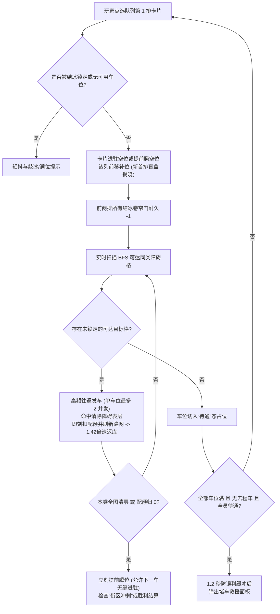

# 《城市清扫队》核心玩法策划案

| 文档属性 | 内容 |
| :--- | :--- |
| **项目名称** | 《城市清扫队》 |
| **文档编号** | 01 |
| **当前版本** | `v0.1.0` |
| **项目阶段** | 立项策划期（开发前定稿） |
| **更新日期** | 2026-11-27 |
| **遵循规范** | 参见 `00_《城市清扫队》项目文档版本号管理规范` |

---

## 1. 核心体验定位与设计支柱

### 1.1 核心玩法概述
《城市清扫队》是一款面向微信与小红书轻量小游戏平台的**竖屏单手策略清扫解压游戏**。玩家在被暴雪与杂物覆盖的城市长街中，通过点选底部纵深车队队列、调度中栏 5+1 车库高频往返出车，沿路网层层清扫积雪与街道垃圾、逐栋点亮城市暖灯与烟火，并巧用**提前腾位机制、暖气总阀连锁与四枚策略道具**运筹破局；随着一关关推进，整条城市沿横向无缝延展为一幅可自由左右滑动观赏的绵延暖灯长卷。

### 1.2 三大体验支柱
1. **高频往返清扫解压**：工程车进库即化作繁忙的市政分遣车位，按明快节拍派出小车沿青石板路冲锋清障、爆开粒子并高速驶回车库接力，呈现车水马龙唤醒城市的鲜活解压感；尾声触发**街区冲刺**收尾，杜绝清理垃圾时间。
2. **无缝城市长卷的暖灯唤醒反馈**：开局街区笼罩在冷靛暗夜之中；随着雪冰与杂物逐格退去，复古路灯亮起暖琥珀光晕、商铺逐栋亮灯飘出炊烟、居民走上石板路漫步；通关后镜头无缝向右平移衔接下一段街区，让玩家逐步点亮一整条生机勃勃的城市长街。
3. **无倒计时的纯净空间博弈**：不设时间倒计时与总步数上限，单局保持一屏看尽的清爽视野，策略张力聚焦于**「4 列纵深牌序 × 5+1 车库周转 × BFS 路网连通 × 双层叠障与机关破局」**，单手易上手、中后期兼具深度规划与逆转爽感。

---

## 2. 竖屏五区界面架构与无缝城市长卷空间设计

整局界面严格适配 **9:16 竖屏单手拇指操作**，自上而下划分为五大功能区：

### 2.1 五区布局规范

| 界面分区 | 屏高占比 | 核心元素 | 交互与布局规则 |
| :--- | :---: | :--- | :--- |
| **1. 顶栏状态与胶囊区** | **7%～8%** | 木纹招牌胶囊、关卡序号、暖灯进度（如 `5/12`）、设置/音效/重开 | 左上角聚焦关卡与暖灯进度；右上角动态避让平台原生胶囊安全净空区。 |
| **2. 天际线与箱庭战场** | **51%～54%** | 顶部无缝城市长卷天际线（暗/暖双态逐栋亮灯）+ 下方奇数中轴正交街区网格 + 四类余量微指示器 | 单局内固定一屏视野不滑屏，确保单手快速预判；仅在使用**火焰融雪弹**进入瞄准态时接受战场点选。 |
| **3. 中栏 5+1 调度车库** | **10.5%～11%** | 5 个固定车位 + 最右侧 1 个虚线临时扩容位（`P+1`） | 展示驻泊车队、剩余配额、作业/待通标识；配额归零仅剩返航动画的车位呈半透可提前进驻态；点击虚线位可直接激活 `P+1`。 |
| **4. 下中栏 4 列出库队列** | **19.5%～21%** | 4 列纵深滑道、前 3 排卡片、列底 `余 N` 角标 | 单手操作主热区。每列仅第 1 排可点，第 2–3 排逐级压暗提供预判；每张非盲盒卡均带清晰目标色块印章与配额数字。 |
| **5. 底栏纯图标道具区** | **8.5%～9%** | 4 枚金边圆润纯图标按钮 | 自左至右依次为：**万能车、车位扩容（P+1）、热风洗牌、火焰融雪弹**；右上角附数量角标，无冗余底字。 |

### 2.2 无缝横向城市长卷与街区接力架构
为兼顾**“后期关卡无限横向拓展”**与**“单局一屏看尽的流畅单手手感”**，游戏空间采用**「整城无缝横向长卷 + 单局一屏精控」**架构：

* **长卷衔接与滑屏体验**：
  * 整座城市被规划为一条**可无限向右延展的横向全景长卷**（如老街拉面巷 → 钟楼中心广场 → 温泉汤屋街 → 节日集市步行街 → 山顶缆车站……）。
  * **单局内**：每 1 关精准聚焦长卷中的 **1 屏标准街区**（不开启局内拖屏，零手势冲突、零屏外盲区）；当前屏幕最左缘隐约露出上一关刚点亮暖灯的老街街角，营造“紧挨着暖街继续向前开道”的连贯代入感。
  * **过关与局外漫游**：通关后镜头平滑向右平移衔接至下一段待清扫街区；在**主界面 / 城市漫游态**下，玩家可单指自由**左右滑动整条城市长卷**，随时回看自己一路点亮的绵延夜景、万家暖窗、袅袅炊烟与穿行其间的居民和清扫车，并支持点击任意已解锁街区重玩或截屏分享。
* **无限扩关与移动端性能保障约束**：
  * **横向分片拼接（Chunked Strips）**：长卷并非单张超宽巨图，而是按每屏（单关或双关）拆分为左右边缘无缝衔接的独立画幅切片，彻底规避移动设备 GPU 单张纹理尺寸上限（`4096px`）与显存飙升风险。
  * **视口裁切与按需加载**：滑动浏览或对局期间，内存与渲染管线仅常驻**当前视口切片 + 左右各 1 屏缓冲切片**（最多同时渲染 2～3 片），离开视口的远端街区自动跳过绘制与动画模拟；后续新增街区主题随平台分包按需拉取，既保证后期加到百关以上不受地图尺寸与首包限制，又确保中低端手机全程稳定 60 FPS。

### 2.3 单局奇数中轴箱庭街区设计
* **标准网格尺度**：单局网格常规为 **11 列 × 11 行**，进阶扩展至 **13 列 × 12 行**，最大不超过 **15 列 × 13 行**，确保每个格子在手机竖屏上拥有充裕的视觉清晰度与点击容错面积。
* **奇数中轴构型**：奇数宽度天然形成对称的**中央主干道**与**街心十字路口（暖气总阀位）**，通过少量不可通行的街景障碍格（木栏、雪松、花坛）与冰封侧巷门围合出真实街巷。
* **南侧通车大道（0 格连通边界）**：网格最底行紧贴已除净的青石板主大道，工程车由所属车库位经此大道驶入街区并原路驶回。
* **天际线逐栋联动与跨格溢出渲染**：
  * 所有寻路、碰撞与清障判定严格以 **1×1 逻辑方格** 为准；
  * 天际线建筑与门前地标门阶格绑定，清通门阶即平滑点亮对应建筑暖窗与炊烟；
  * 街灯、漫步居民与行驶工程车在前景视觉层按 **1.4～1.7 格高度溢出绘制**，强化鲜活绘本箱庭质感。

---

## 3. 核心玩法循环与精确规则

### 3.1 基础四色雪冰、专职工程车与双层障碍格

#### （一）基础四色雪冰与专职工程车

| 障碍类型 | 视觉色号 | 对应工程车 | 质感特征与布放定位 |
| :--- | :---: | :--- | :--- |
| **白松雪** | `#f4f7fb` | **橘红铲雪车** | 蓬松软雪，轮廓圆润；常覆于主干道南段与外沿，作为开局破口主力。 |
| **蓝冻冰** | `#67ccf7` | **冰蓝破冰车** | 半透明棱角冰砖，带晶莹斜光；常封锁中段十字路口与暖气总阀位。 |
| **银白寒霜** | `#84a7cc` | **钢蓝除霜车** | 冷冽钢蓝结霜底覆满银白雾凇羽状霜针与六角冰窗花；常紧密包裹北排深巷房屋与冰门后，作为核心压牌类。 |
| **棕雪泥** | `#9e6230` | **黄铜抓斗车** | 无缝连片湿润泥水洼，掺杂鹅卵碎石与外沿半融残雪；常蜿蜒围合两侧支路商铺，制造多类穿插。 |

#### （二）双层障碍格规则
同一格可叠放“表层 + 里层”两层障碍，在不增加颜色数量的前提下强化策略层次，分为两类：
1. **同色双层厚障（`×2` 压实格）**：
   * **视觉辨识**：格体高出普通格约 25%，侧边带分层棱线，角落附微型 `×2` 标记。
   * **清扫规则**：对应品类工程车需分 **2 趟**（每趟耗 1 点配额）逐层剥离清除；使用**火焰融雪弹**轰炸时可直接双层一次性清净。
2. **异色双层叠障（表层 A 盖里层 B）**：
   * **视觉辨识**：表层底部边缘明确露出约 20% 高度的里层颜色底座与微型角标，信息完全透明。
   * **清扫规则**：先由 A 类车清走表层（耗 1 配额），瞬间露出里层 B 并刷新可达性，再由 B 类车进场清净（耗 1 配额）。
3. **守恒计账原则**：双层格的表层与里层分别计入对应品类的全图待清总层数，确保车辆配额总和严格守恒。

### 3.2 BFS 路网可达性判定规则
* **连通起点**：南侧紧贴“已通车大道”的最底行所有非墙体格均视为天然连通边界。
* **四邻域可达（路口可清）**：位于最底行，或与任意**已清净青石板格**在**上、下、左、右**四正交方向直接相邻的障碍格处于“路口可清”态（亮色外沿描边）；斜角不连通。
* **动态即时刷新**：每清掉 1 层障碍（无论是清出青石板还是剥出双层里层），路网零延迟重算，车库中对应的“待通”车队立即自动唤醒出击。

### 3.3 车库分遣、往返动线与「配额归零提前腾位」规则

1. **驻泊车队与并发节拍**：
   * 每个在岗车位同时最多保持 **2 辆**小车在外执行往返清扫任务，发车间隔约 `0.24 秒`，形成明快连贯的市政作业车流。
2. **完整往返出车动线**：
   * 小车从所属车库位正下方的南侧大道驶出，独占锁定 1 个可达同类目标格，沿最短路高速冲抵并撞碎障碍（爆粒子、配额即刻 `-1`、刷新 BFS 与机关）。
   * 命中后小车做 `0.06 秒` 轻巧弹跳掉头，以 **1.42 倍高速**沿已通青石板路原路驶回所属车库位，入库时触发车位微弹与柔和收车音效。
3. **「配额归零提前腾位」不卡手铁律**：
   * 当某车位的**未分配配额 + 去程小车数归 `0`**，仅剩 1～2 辆小车处于返航动画途中时：
     * 该车位立即进入半透明“返航收队中”态，并**即刻计入可用空车位**（不再计入堵车占满）；
     * 玩家可直接点击下一张队列卡片**无缝进驻**该车位，老车队返航小车自动提速至 **1.65 倍**顺滑驶回底部大道消失，新车零延迟接管发车。
4. **智能选格优先级**：
   1. **BFS 步数最短优先**（由南向北整齐推进）；
   2. **高价值功能格优先**（暖气总阀、路灯、地标门阶优先）；
   3. **同列连贯优先**（形成整排横扫的解压视觉流）。

### 3.4 配额守恒铁律与「全场清类即收队」防死锁机制
1. **静态 1:1 守恒**：标准对局中，每类所有队列车辆的配额总和与地图上需由车队清扫的该类障碍总层数（含双层格每一层）保持 1:1 严格守恒。
2. **动态兜底——「全场清类即收队」**：
   * 只要因万能车、火焰融雪弹或地形机关导致**整张地图上某一类障碍的剩余层数归 `0`**（含深巷、冰门后与双层格里层）：
     * **车库侧**：该类所有车队无论剩余多少配额，立即提前腾位并欢呼离场；
     * **队列侧**：底部 4 列中所有该类未出卡片（含被结冰锁或盲盒盖住的该类卡）自动碎散退场，后排卡片顺滑前推补位。

### 3.5 尾声「街区冲刺」收尾机制
* **触发条件（同时满足）**：
  1. 全图剩余待清障碍层数 `≤ 15%`（且不超过 14 层）；
  2. 底部队列已无任何结冰卷帘门或未揭晓盲盒；
  3. 队列与车库剩余的所有车队类型在当前战场均已可达（彻底解除路径封锁与死锁风险）。
* **触发效果**：
  * 屏幕边缘泛起暖金柔光，弹出提示**「✨ 街区冲刺！」**，背景音效轻快提速；
  * 全车队往返速度自动提升 **×1.6**、发车间隔缩短 **35%**；
  * 车库右侧浮现可选金钮**「⚡ 一键加速收尾」**，点击后系统自动按最优顺序高速派发剩余卡片，群车齐发将尾声余障瞬间清扫殆尽。

---

## 4. 地形机关、队列障碍与多品类街道垃圾清运体系

### 4.1 核心标准机关与障碍

#### （一）暖气总阀与冰封侧巷门
* **构型与触发**：街心十字路口或关键要道埋设红金配色**暖气总阀**（被障碍格覆盖），以地底暖色铜管暗纹连接左右 1～2 扇**冰封侧巷门**。清净总阀格（或被火焰弹直接命中）瞬间，高压白汽沿管道冲开所有绑定的冰封门，将单面推进变为三面/四面包抄。
* **边界**：关闭中的冰封门不可被普通车与万能车铲除，仅可通过对应暖气总阀开启或由火焰融雪弹直接炸毁。

#### （二）结冰卷帘门（`❄×N`）
* **规则**：卡片裹有半透明冰霜锁壳，锁定期间不可点击（误点微抖并响清脆敲冰声）。
* **解冻机制**：其他任意列每成功点出 1 辆车进库，**当前位于第 1～2 排的所有结冰卷帘门耐久 `-1`**，耐久归 `0` 立即碎冰解锁可点。
* **底线**：第 3 排及更深排暂不扣耐久；任何时刻（含洗牌后）均禁止出现“4 列首排全被冰锁”的僵局。

#### （三）暴雪盲盒车（`? 盲车`）
* **规则**：位于第 2 排及以后时隐藏车型与品类，仅露 `?` 与真实配额数字；滑入**第 1 排**瞬间雾散揭晓真身，保持首排 100% 信息透明。

#### （四）双层障碍格
* 包含同色双层压实格与异色双层叠障格，详见第 3.1 节。

### 4.2 后期多品类街道垃圾与专职垃圾车体系

随城市长卷沿横向不断延伸至新街区，在暴雪除雪基础上自然引入**多品类街道垃圾障碍与专职市政清运车**，完全复用 BFS 路网、5+1 车库往返分遣、双层叠障与 1:1 守恒框架。

> [!IMPORTANT]
> **单局同屏 4 类上限铁律**：为保证手机端极速辨识与清爽认知负荷，任何单局地图同时出现的清扫品类**严格上限为 4 类**。中后期关卡按街区主题进行**「2 雪冰 + 2 街道垃圾」**或**「3 雪冰 + 1 特色垃圾」**混编，绝不堆叠过多杂色。

#### （一）四类街道垃圾与专职垃圾车规格表

| 垃圾品类 | 视觉色系与街景特征 | 专职清运车 | 适用街区与差异化特点 |
| :--- | :--- | :--- | :--- |
| **1. 断枝落叶堆** | 森林松绿/枯木褐（`#4d7c0f`），夹杂积雪松枝与落叶 | **旋风碎枝清扫车**（绿白涂装 + 前置旋转滚刷） | 公园街、林荫大道；常沿行道树与花坛成带分布。 |
| **2. 节日礼盒/废纸箱** | 暖绯红/牛皮纸（`#e11d48`），散落彩带与折角纸箱 | **可回收压缩垃圾车**（暖红涂装 + 后置压缩厢） | 集市、商业步行街；常簇拥商铺门阶阻塞亮灯。 |
| **3. 冻凝厨余/摊位油冰** | 青柠黄/浅琥珀（`#84cc16`），泛着冻凝油霜与餐盒 | **高压蒸汽洗扫车**（亮黄白涂装 + 蒸汽喷嘴） | 夜市拉面巷、美食街；清净后石板路泛洁净水光并唤醒店铺烟火。 |
| **4. 积雪废木箱/大件路障** | 深铁灰/旧木色（`#475569`），厚重捆绑木箱 | **重型吊臂清运车**（明黄黑条纹 + 机械吊爪） | 工坊区、车站广场；天然自带**双层厚重耐久（`×2`）**，需重型吊臂车往返 2 趟清运，或使用**火焰融雪弹**一击清净。 |

#### （二）跨品类复合结构：「雪下藏垃圾」
* 复用异色双层格规则：表层覆盖白松雪（底角带清晰纸箱/松枝角标提示），铲雪车扫去表层雪后立刻露出底层街道垃圾，需紧接调度对应垃圾车进场清运，强化“先除雪、再清运、后亮灯”的街区故事感与解谜纵深。

### 4.3 进阶地形与队列模块库（按关卡节奏插拔）
1. **温泉地热泉眼（地形模块）**：清开后自动沿横向融化左右各 2 格蓝冻冰；溢出配额由「全场清类即收队」自动兜底。
2. **双联拖挂车（队列模块）**：单车位按严格顺序携带 `前段 A 类 → 后段 B 类` 两段配额（支持雪车与垃圾车混搭）；前段 A 类配额清零（或全场清类触发收队）后自动卸挂，原地切换为纯 B 类单车继续清扫，考验单槽位先后手衔接规划。
3. **山坡滑落补位区（地形模块）**：坡底格清净后，正上方斜坡障碍按重力下移 1 格补位并即时刷新 BFS（地面青石板与路灯坐标固定）。

---

## 5. 四枚局内道具详细设计

底栏 4 枚道具功能完全正交，全面兼容雪冰、双层格与各类街道垃圾：

| 道具名称 | 图标视觉 | 解决的核心痛点 | 触发条件与生效规则 |
| :--- | :---: | :--- | :--- |
| **1. 万能车** （彩虹蒸汽全能车） | 彩虹蒸汽铲雪车 | 车库被外围杂色堵死，尤其 **5 车位全满** 急需开道 | **不占 5+1 车库位**（5 位全满可直接发动）。从南侧大道专属位以 **4 并发、1.5 倍速**往返清扫 **8 层**任意可达障碍（雪冰与各类垃圾通吃；对双层格每次剥 1 层）。 **智能选格**：优先打通挡住车库待通类的外围障碍 > 压着暖气总阀的格 > 最近格。 |
| **2. 车位扩容** （P+1） | 蓝底金边 `P+` | 车位周转不足、急需暂存深巷车或 5 位堵车救急 | 永久解锁本局第 6 个临时虚线车位（每局限激活 1 次，激活后置灰打勾）。 |
| **3. 热风洗牌** （Shuffle） | 暖橙双龙卷 | 首排被深巷色或冰锁压死，急需翻出救命车 | 将底部所有未出卡片重新洗牌并**尽量均匀重分回 4 列**；智能优先把匹配当前可达类的救命卡片调至前两排，并确保第 1 排至少 2 张非冰锁可点。 |
| **4. 火焰融雪弹** （Flame） | 爆裂火球 | 暖气总阀深埋或关键双层卡口隔墙够不着 | **无视 BFS 路网封锁，手动点选战场定点爆破**（附 3×3 预览光圈，点空地不消耗道具）。火球坠落彻底清除落点周围 **3×3 区域（最多 9 格）**内全部雪冰与街道垃圾（**双层格直接表里双层同清**），命中被埋**暖气总阀**或**冰封侧巷门**直接引爆开启。 |

---

## 6. 视听氛围反馈、首关微引导与手感节奏

### 6.1 无焦虑强引导视觉体系
1. **四类余量微指示器**：于战场底框角隅或顶栏下方陈列本局 4 类障碍的**实时剩余层数**（如 `白 12 · 冰 8 · 霜 3 · 泥 0✓`）。某类余量 `≤ 3` 层时微光轻闪，辅助精准决策是否用道具触发「全场清类即收队」；清零打上暖金/翠绿 `✓`。
2. **战场可达对比**：BFS 可达格带亮白呼吸外沿；未打通深巷覆冷靛阴影；双层格带厚实棱边与里层角标。
3. **首排智能呼吸光**：首排卡片匹配当前 BFS 可达障碍品类时亮起柔和暖金呼吸外框，帮助玩家在半秒内锁定有效出车项。
4. **队列深度透明 & 堵车预警**：每列显示前 3 排 + 列底 `余 N` 牌；仅剩最后 1 个可用车位时闪烁琥珀呼吸警光与双音节提示（A2–Eb3）。

### 6.2 首关前 5 步剧本式微引导（FTUE）

全程不弹长段文字教程框，仅用柔和发光手指光圈与不超过 10 字的俏皮气泡，在 **40 秒内**引导玩家亲手体验全部核心机制：

| 步骤 | 教学目标 | 玩家操作与视觉反馈 | 极简气泡文案 |
| :---: | :--- | :--- | :--- |
| **第 1 步** | 学会点牌、识别可达亮边与往返清扫 | 高亮首排橘红铲雪车；点入后 2 辆小车往返推开入口白雪，点亮第 1 盏路灯。 | `点选亮光车，清扫发亮积雪！` |
| **第 2 步** | 学会开启暖气总阀融化冰封门 | 入口白雪退去露出中央蓝冰总阀，高亮冰蓝破冰车；铲开总阀喷汽冲碎左右冰封门。 | `铲开暖气总阀，冲开冰封侧巷！` |
| **第 3 步** | 学会暂存待通车与震碎结冰卷帘门 | 引导点选首排卡片进库，直观展示“待通”车占位等待通路，同时震裂并解锁邻列 `❄` 结冰卡。 | `点牌震裂冰锁，解锁邻列车辆！` |
| **第 4 步** | 熟悉双层叠障剥离与「提前腾位」接力 | 铲除双层叠障表层露出里层并立刻刷新 BFS，车位配额归 0 呈半透可提前进驻，引导无缝派出下一辆车。 | `剥开表层积雪，空位即刻接力！` |
| **第 5 步** | 自由接管 + 体验商铺亮灯与长卷延展 | 解除强引导，自由清通拉面馆门前 2 格点亮首栋暖灯建筑并刷出散步居民，尾声触发街区冲刺通关并右滑解锁下一段长卷街区。 | `点亮暖灯，唤醒整条城市老街！` |

### 6.3 视听正反馈规范

| 触发节点 | 视觉演出反馈 | 程序化音效反馈 |
| :--- | :--- | :--- |
| **清雪 / 碎冰 / 清垃圾** | 雪雾/冰晶/松叶/纸屑对应色粒子爆散，青石板微弹显现。 | 白雪带通沙沙声、蓝冰高通脆响、纸箱轻脆折声、蒸汽洗扫嘶嘶声。 |
| **双层剥离** | 剥层瞬间震落表层障碍，干脆露出里层材质与底座。 | 清脆两段剥离声，尾音衔接里层对应材质质感。 |
| **结冰卷帘门解冻** | 冰锁耐久扣减时泛裂纹火花，归 0 瞬间冰壳飞溅解锁卡片。 | 清脆敲冰裂纹声，解锁伴随明亮冰晶风铃。 |
| **路灯与商铺逐栋唤醒** | 路灯亮暖琥珀光晕；天际线对应商铺平滑亮窗飘烟，刷出漫步居民。 | 路灯按五声音阶（C6–C7）逐盏递增风铃音；商铺为温暖木琴短琶音。 |
| **返库入位** | 小车高速折返进 bay，车位微弹闪光；提前腾位则老车顺滑驶入大道。 | 轻柔短促的入位提示音。 |
| **街区冲刺与长卷推镜** | 暖金柔边、群车 1.6 倍速欢快清盘、暴雪渐转柔光飘雪；切关时镜头丝滑右滑衔接下一街区。 | 轻快八音盒加速变奏，清盘切入治愈主题胜利乐段。 |

### 6.4 核心手感与节奏基准参数

| 参数项 | 基准参数值 | 体验校准目标 |
| :--- | :---: | :--- |
| **单卡常见配额档位** | `4 / 6 / 8 / 10 / 12` 层 | 小额牌灵活腾位，大额牌制造深巷压牌与长线车库周转博弈。 |
| **车队发车间隔 / 并发上限** | `0.24 秒` / 单车位最多 `2 辆` | 明快连贯的往返清扫节拍，画面鲜活不拥堵。 |
| **去程清扫速度** | `8.8 格/秒` | 单趟穿越街区约 0.8～1.3 秒，打击反馈干脆利落。 |
| **返航返库速度倍率** | 常规 `1.42×` / 末班收队 `1.65×` | 完整呈现返库动线，同时保持极快周转效率。 |
| **街区冲刺加速倍率** | 移速 `1.6×` / 间隔 `0.65×` | 尾声 10 秒内爽快清盘，消灭收尾拖沓感。 |
| **万能车配额 / 火焰弹范围** | `8 层`（4 并发） / `3×3`（双层同清） | 精准破局解围，不破坏核心空间规划乐趣。 |
| **单局目标游玩时长** | 入门 `1.5 分钟` / 进阶 `2.5～3.5 分钟` | 契合微信/小红书小游戏黄金碎片化心流时长。 |

---

## 7. 胜负判定、堵车救援与局外长线闭环

### 7.1 胜利判定
当战场内**全部可清扫雪冰与街道垃圾层数归 `0`**，且最后一辆去程小车完成落格清扫演出后，立即触发本屏街区暖灯齐明与居民欢呼，弹出手绘通关明信片，并支持点击下一关平滑右滑镜头进入长卷下一街区。

### 7.2 堵车死锁判定与 1.2 秒缓冲
仅当**同时满足以下全部 3 项**时进入堵车预警与救援流程：
1. 全部已开启车位（5 格或扩容后 6 格）均被**仍有剩余配额的车队**占满（已配额归 `0` 处于提前腾空态的车位不计入占满）；
2. 战场内无任何去程小车、火球或万能车正在执行清扫，且无待结算机关动画；
3. 车库内所有驻泊车队对应的障碍类型，在当前战场上的 BFS 可达层数均为 `0`。

* **1.2 秒呼吸缓冲**：满足后车库全体待通车辆红光轻抖警示 `1.2 秒`，确认无连锁变化后弹出半透明**「街道堵车啦！」底部救援浮层**（上半屏街区清晰可见），推荐 `P+1 扩容` / `召唤万能车` / `火焰融雪弹` / `热风洗牌` 或 `重新挑战本关`。

### 7.3 局外长线留存与道具产出闭环
1. **单局产出**：通关按完成度与暖灯数发放**暖冬金币**与**暖灯星章**（不设体力限制，随时可重玩）。
2. **无缝城市暖灯长卷漫游**：主界面直接呈现整条可左右自由滑动的城市长卷，所有已通关街区永久保留暖灯、炊烟与散步居民，支持一键导出任意街段的手绘明信片分享。
3. **市政车库涂装屋**：累计暖灯星章解锁纯外观车队皮肤（蒸汽铜车、祭典花车、雪橇涂装等），零数值加成。
4. **道具补给与克制变现**：金币可购置 4 枚局内道具；堵车救援与道具耗尽时支持自愿激励视频或好友助力获取单次救场道具，坚持无强制插屏。

---

## 8. 核心边界场景防错清单（验收标准）

| 编号 | 典型边界场景 | 明确规则判定 |
| :---: | :--- | :--- |
| **E01** | 车库某车位配额已归 `0` 但末班小车仍在返航途中，其余 4 车位均满 | **触发「提前腾位」**；该归零车位半透显示“收队中”并**立刻允许下一张卡无缝入驻**，不卡手、不误判 5/5 堵车。 |
| **E02** | 车库 5/5 满位且全部处于「待通」态，此时战场仍有万能车或火焰弹正在结算 | **暂不触发堵车**；需等所有在途清扫与机关结算完毕，并再连续保持 `1.2 秒` 仍无可达目标格后，才弹出救援面板。 |
| **E03** | 工程车剩余配额仅 `1`，但命中同色双层厚障格（`×2`） | 仅剥离表层 1 层并耗尽配额进入「提前腾位」，里层保留为单层障碍并刷新 BFS，严格维持 1:1 配额守恒。 |
| **E04** | 其他列成功点出 1 辆车进库时，队列第 1～2 排与第 3 排均存在 `❄×N` 结冰卷帘门 | 仅当前处于第 1～2 排的结冰门耐久 `-1`（归 `0` 即碎冰解锁）；第 3 排及更深排暂不扣减耐久。 |
| **E05** | 道具或机关清光全图某类最后几层障碍（含双层里层），车库与队列仍有该类余车 | 立即触发**「全场清类即收队」**：车库该类车欢呼离场，队列深处（含冰锁/盲盒内）该类卡同步退场，余量微指示器打上 `0✓`。 |
| **E06** | 火焰融雪弹砸中异色双层格（如雪下藏垃圾）或冰封侧巷门 | 3×3 范围内无论单层、双层还是冰封门均**一次性彻底清净为青石板**；命中暖气总阀同步引爆开启侧巷门。 |
| **E07** | 万能车清扫途中清掉了挡住车库某“待通”车的障碍 | 每清 1 层实时刷新 BFS，该“待通”车无需等万能车清完 8 层，即刻苏醒出击。 |
| **E08** | 某列队列出空后触发热风洗牌 | 剩余所有卡片尽量**均匀重分回全部 4 列**，最大化恢复前排可选广度，且硬性保证第 1 排至少 2 张非冰锁可点。 |
| **E09** | 临近尾声但场上仍有异色双层格未剥开表层 | 「街区冲刺」判定以**全图所有剩余层（含里层类型）均已可达**为准；若仍有里层异色被封锁，暂不触发一键冲刺。 |

---

## 9. 版本修订记录

| 版本号 | 日期 | 修订摘要 |
| :---: | :---: | :--- |
| `v0.1.0` | 2026-11-26 | 《城市清扫队》核心玩法策划案立项初版定稿。 |
