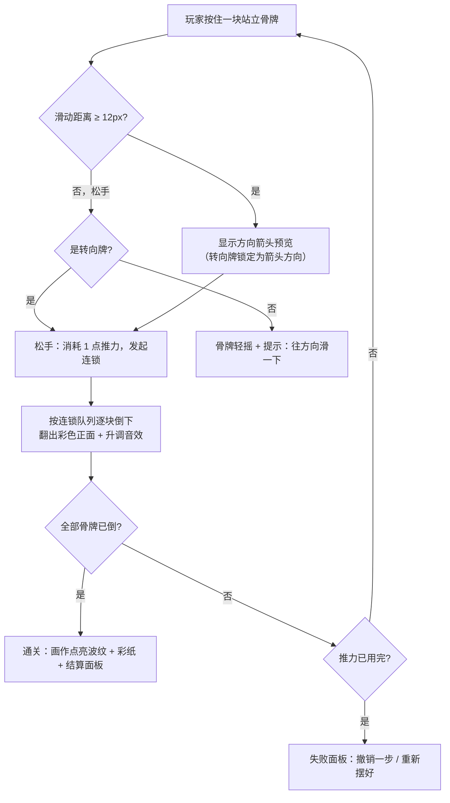
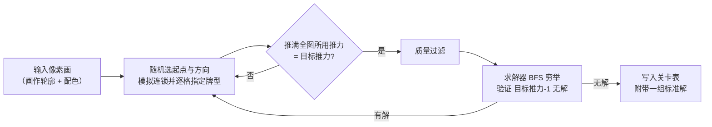

# 《推倒一幅画》核心玩法策划案

| 文档属性 | 内容 |
| :--- | :--- |
| **项目名称** | 《推倒一幅画》 |
| **文档编号** | 01 |
| **当前版本** | `v0.1.0` |
| **项目阶段** | 立项策划期（开发前定稿） |
| **更新日期** | 2026-11-28 |
| **遵循规范** | 参见 `00_项目文档版本号管理规范` |

---

## 1. 核心体验定位与设计支柱

### 1.1 核心玩法概述
《推倒一幅画》是一款面向微信与小红书轻量小游戏平台的**竖屏单指连锁解谜解压游戏**。每一关是一张由多米诺骨牌立成的像素画：玩家按住一块骨牌朝某个方向轻滑，骨牌倒下并撞倒相邻骨牌，连锁一路蔓延；每块骨牌倒下即翻出彩色正面，全部推倒后拼成一幅完整的像素画。玩家需要借助**转向牌**与**分岔牌**规划连锁路线，并利用「已倒骨牌会挡住连锁」这一规则安排推倒顺序，在**有限推力**内推倒整幅画。

### 1.2 三大体验支柱
1. **一推长连锁的解压释放**：玩家每次只做一个滑动动作，随后获得持续数秒、逐块加速的自动连锁演出——骨牌依次倒下、五声音阶逐块升调、连击数字实时跳动，单推可连倒数十块骨牌。操作成本极低、反馈时长极长，是本作解压感的核心来源。
2. **像素画逐块显现的收集满足**：骨牌背面统一为米白底与圆点，彩色正面只在倒下时翻出，关卡名在通关前以 `??` 隐藏。画面从「一片白牌」到「一幅彩画」的转变，形成明确的完成感与收集动机。
3. **轻规划、零压力的逻辑思考**：不设倒计时、不设失败惩罚，撤销与重摆随时可用。策略深度聚焦于**「推哪一块 × 往哪推 × 先推谁」**三个决策，关卡推力上限均经求解器验证为**最少所需推力**，确保每关都有一个需要想清楚的「关键一推」。

---

## 2. 竖屏界面架构与棋盘空间设计

整局界面严格适配 **9:16 竖屏单手拇指操作**，自上而下划分为五个功能区：

### 2.1 五区布局规范

| 界面分区 | 屏高占比 | 核心元素 | 交互与布局规则 |
| :--- | :---: | :--- | :--- |
| **1. 顶栏状态区** | **7%～8%** | 游戏标识、声音开关、设置 | 右上角动态避让平台原生胶囊按钮安全区。 |
| **2. 关卡条与信息行** | **8%～9%** | 横向可滑关卡芯片（已通关显示画作 emoji，未通关显示序号与尺寸）、关卡序号与隐藏画名、**推力槽** | 推力槽以骨牌形小方块表示，已用推力置灰；未通关时画名显示为 `??`。 |
| **3. 牌桌棋盘区** | **55%～60%** | 木框绿呢牌桌、骨牌网格、连击计数浮字、Toast 提示 | 单指操作主热区，单局固定一屏不滑动、不缩放。 |
| **4. 底部工具栏** | **8%～9%** | `撤销` / `提示 N` / `重摆` 三枚大按钮 | 连锁演出期间工具栏锁定。 |
| **5. 规则说明 / 结算面板区** | 余量 | 首关默认展开的折叠规则说明；通关或失败时替换为结算面板 | 结算面板出现在棋盘下方，**不遮挡已拼成的画面**。 |

### 2.2 棋盘尺度规范
* **网格尺寸**：入门关 **5×6～7×7**，标准关 **8×8～10×10**，进阶关最大 **12×12**。
* **格子尺寸**：单格边长按牌桌可用宽度自适应，范围 **24px～58px**，格间距 `3px`；10×10 在 360px 宽屏幕上单格不低于 30px，保证拇指点按容错。
* **异形画布**：像素画外轮廓之外的格子为空位（不放骨牌、不可交互），连锁传到空位即中断，画作轮廓天然构成关卡边界。

---

## 3. 核心玩法循环与精确规则

### 3.1 骨牌类型与倒向规则

| 骨牌类型 | 视觉标识 | 被撞（或被推）后的倒向 | 向外传递 |
| :--- | :--- | :--- | :--- |
| **普通牌** | 米白牌面 + 竖排双圆点 | 沿来向继续倒 | 撞向**正前方** 1 格 |
| **转向牌** | 浅蓝牌面 + 蓝色箭头 | 无论从哪个方向被撞，均朝**箭头方向**倒 | 撞向**箭头方向** 1 格 |
| **分岔牌** | 浅橙牌面 + 橙色 `✢` | 沿来向倒 | 同时撞向**前、左、右** 3 格（相对来向） |

> [!NOTE]
> 「来向」指撞击传入的方向：被玩家直接推倒时为玩家滑动方向；被相邻骨牌撞倒时为撞击传播方向。分岔牌的左、右以来向为基准旋转 90°。

### 3.2 推牌操作规则
1. **按住 + 滑动**：按住任意站立骨牌，滑动超过 `12px` 后按主方向（水平/垂直取位移较大者）判定上、下、左、右四向之一，并在骨牌上方显示方向箭头预览；松手即推出。
2. **转向牌直推**：转向牌无论滑向哪里，方向都锁定为其箭头方向；**轻点转向牌即可直接推倒**。
3. **普通牌 / 分岔牌轻点**：不推倒，骨牌轻摇并 Toast 提示「按住骨牌，往要推倒的方向滑一下」，防止误触浪费推力。
4. **不可推对象**：已倒骨牌、空位不响应；连锁演出进行中禁止发起新推。
5. **推力消耗**：每次成功推出消耗 **1 点推力**，与本次连锁倒下多少块无关。

### 3.3 连锁传播与「已倒即挡」规则
1. **逐层传播**：连锁按广度优先队列推进，每一层（距起点的撞击步数）同时结算；同层多块骨牌在同一时刻倒下。
2. **中断条件**：撞击传到以下位置即中断该支路——棋盘边界外、空位、**已倒下的骨牌**。
3. **「已倒即挡」**：已倒骨牌平躺在原格，不会被再次撞倒，也不会把撞击传过去。因此先推倒的区域会成为后续连锁的「墙」，**推倒顺序直接决定能否在推力内完成**，这是本作逻辑思考的核心来源。
4. **同刻多源撞击**：同一块骨牌在同一层被多个方向同时撞到时，按队列先到先得的确定性顺序取第一个来向。运行时与关卡生成器、求解器使用**同一套连锁模拟代码**，保证线上表现与验证结果完全一致。

### 3.4 推力上限与胜负规则
* **推力上限**：每关显示固定推力（入门 1、标准 2～3、进阶 3～5）。该值由求解器验证为**本关最少所需推力**——用更少的推力不可能推倒全部骨牌。
* **胜利**：全部骨牌倒下即通关（无论剩余推力多少）。
* **失败**：推力用尽且仍有骨牌站立时，弹出失败面板（提示剩余站立块数），提供 `撤销一步` 与 `重新摆好`，无任何惩罚或消耗。

---

## 4. 关卡机关体系与章节节奏

### 4.1 基础骨牌（第 1 章起）
普通牌、转向牌、分岔牌，规则详见第 3.1 节。每关特殊牌（转向 + 分岔）数量占骨牌总数的 **8%～30%**。

### 4.2 进阶机关模块库（按章节插拔）

| 机关 | 视觉标识 | 规则 | 设计意图 |
| :--- | :--- | :--- | :--- |
| **重骨牌（`×2`）** | 加厚牌身 + 角标 `×2` | 需被撞击 **2 次**才倒下；第 1 次撞击只晃动并吞掉该支路撞击。 | 制造「两路连锁汇合」的路线规划需求。 |
| **弹簧牌** | 牌面弹簧图标 | 被撞后朝**来向反方向**倒，把连锁弹回。 | 让连锁在窄长区域往返扫荡，延长单推连击。 |
| **彩色闸门** | 半透明色块栅栏，占 1 格 | 同色骨牌倒下前闸门关闭（视为空位）；场上该色骨牌全部倒下后闸门打开，变为可撞普通牌。 | 引入跨区域先后依赖。 |
| **桥牌** | 牌面双横线 | 被撞后不倒，把撞击**越过自身**传到再前一格；可被多次穿越。 | 打破「已倒即挡」，提供跨越倒牌区的通道。 |
| **定时牌** | 牌面数字 `N` | 被撞后延迟 `N` 层再倒下与传递。 | 控制两路连锁的到达先后，进阶关卡专用。 |

> [!IMPORTANT]
> **单关机关上限铁律**：除基础三类骨牌外，任意单关同屏进阶机关种类**不超过 2 种**；新机关首次登场关卡只出现该机关 + 基础牌，并以 1 推演示其规则。

### 4.3 章节规划（每章 20 关）

| 章节 | 主题 | 新增机关 | 推力区间 | 棋盘尺寸 |
| :---: | :--- | :--- | :---: | :---: |
| 1 | 小花园 | 普通 / 转向 / 分岔 | 1～3 | 5×6～10×10 |
| 2 | 甜品店 | 重骨牌 | 2～3 | 8×8～10×10 |
| 3 | 海边 | 弹簧牌 | 2～4 | 8×8～11×11 |
| 4 | 游乐园 | 彩色闸门 | 3～4 | 9×9～12×12 |
| 5 | 夜市 | 桥牌 | 3～5 | 10×10～12×12 |
| 6 | 节日 | 定时牌 | 3～5 | 10×10～12×12 |

* **章内难度曲线**：波浪式推进，每 5 关为一组「易 → 易 → 中 → 难 → 爽」，第 5 关为**大连锁奖励关**（推力 1～2，单推连倒 ≥ 60% 骨牌），在难关后集中释放解压感。

### 4.4 程序化关卡生成与验证流程

1. **生成**：在画作轮廓上随机选取起点与方向模拟连锁；连锁遇到尚未指定牌型的骨牌时，按前方/左右是否仍有可撞骨牌，按权重指定为普通、转向或分岔牌，直至全图被覆盖。生成过程天然保证存在一组标准解。
2. **质量过滤**：
   * 特殊牌占比在 **8%～30%** 之间；推力 ≥ 2 的关卡至少包含 1 块分岔牌；
   * **每一推的最小覆盖量 ≥ 骨牌总数的 15%**（且不少于 3 块），杜绝「一推倒 70 块、后两推各倒 1 块」的无聊收尾。
3. **最少推力验证**：求解器以「已倒集合」为状态做广度优先穷举，确认用 `目标推力 - 1` 推无法推倒全部骨牌。
4. **产出**：关卡表包含画作、牌型矩阵、推力上限与一组标准解（供提示功能使用）。

---

## 5. 局内辅助功能设计

| 功能 | 图标 | 解决的痛点 | 规则 |
| :--- | :---: | :--- | :--- |
| **撤销** | `↶` | 推错一步不想从头来 | 恢复到上一推之前的棋盘与推力，可连续撤销至开局；**免费、无限次**。被恢复的骨牌带「弹起立回」动画。 |
| **提示** | `💡` | 想不出关键一推 | 每关 **3 次**。若玩家当前棋盘与标准解前 N 推完全一致，则以手指动画演示第 N+1 推（位置 + 方向）并让目标骨牌闪光；若已偏离标准解，提示「这条路走不通了，先撤销试试」，**不扣次数**。 |
| **重摆** | `↺` | 想换思路从头推 | 全部骨牌立回、推力回满、提示次数保留。 |
| **额外推力** | `+1` | 卡关时想直接看完画 | 仅在失败面板出现，观看激励视频后本关推力 `+1`；使用后该关不计入「完美通关」。 |

---

## 6. 视听反馈、首关引导与手感节奏

### 6.1 连锁演出规范
1. **倒牌动画**：骨牌牌身朝倒向压扁滑出并淡出（`150ms`），同时彩色正面从倒向一侧拉伸弹入（`230ms`，带 `1.08` 过冲回弹），倒向一侧扬起 3 粒米白尘点。
2. **加速节奏**：第 `t` 层的间隔为 `max(42ms, 130ms × 0.9^t)`，连锁越往后越快，形成「哒…哒..哒.哒哒哒哒」的加速听感。
3. **连击计数**：棋盘上方实时显示 `×N`，每次更新带 `1.35 → 1` 缩放脉冲；连锁结束后保留 `0.5s` 淡出。
4. **大连锁庆祝**：单推连倒 `≥ 12` 显示「漂亮！」，`≥ 25` 显示「太爽了！」，`≥ 40` 显示「超级连锁！」，并触发牌桌 `220ms` 轻震。

### 6.2 首关引导（FTUE）
全程不弹文字教程框，仅用手指动画与规则折叠栏：

| 关卡 | 教学目标 | 引导方式 |
| :---: | :--- | :--- |
| **第 1 关** | 学会按住滑动推牌、认识转向牌与分岔牌 | 进入 `0.5s` 后在标准解起点骨牌上循环播放「按住 → 滑动」手指动画；规则说明默认展开。推力 1，一推清屏。 |
| **第 2 关** | 理解「已倒即挡」与先后顺序 | 推力 2，首推若选错区域会把关键通道堵死，引导玩家使用撤销。 |
| **第 3 关起** | 自由游玩 | 规则说明默认收起，提示按钮可随时调出手指演示。 |

### 6.3 视听正反馈规范

| 触发节点 | 视觉演出反馈 | 程序化音效反馈 |
| :--- | :--- | :--- |
| **骨牌倒下** | 牌身压扁滑出、彩色正面弹入、尘点扬起 | 短促高通「哒」声 + 五声音阶音符（G4 起，G 调五声音阶逐层升调，第 12 层后在高音区循环）；同层超过 2 块时只发 2 声防爆音。 |
| **连锁进行中** | 连击数字跳动 | 手机短震 `8ms`，节流间隔 ≥ `45ms`。 |
| **推力用尽未完成** | 失败面板上滑 | 低沉三角波「咚」+ 双段震动。 |
| **撤销** | 骨牌弹起立回 | 轻柔短提示音。 |
| **通关** | 画作按对角线波纹逐块放大提亮、底部喷出彩纸、画名揭晓 | 上行六音琶音（C5–G6）+ 节奏震动。 |

### 6.4 核心手感与节奏基准参数

| 参数项 | 基准参数值 | 体验校准目标 |
| :--- | :---: | :--- |
| **滑动判定阈值** | `12px` | 轻滑即可，避免与点按混淆。 |
| **连锁层间隔** | `max(42ms, 130ms × 0.9^t)` | 开头清晰可辨，后段快速倾泻。 |
| **单推演出时长** | `0.6s～3.5s` | 足够享受连锁又不拖沓。 |
| **每推最小覆盖** | `≥ 15%` 骨牌总数 | 每一推都有可观的连锁回报。 |
| **特殊牌占比** | `8%～30%` | 有路线可规划，但画面仍以普通牌为主。 |
| **单局目标游玩时长** | 入门 `30 秒` / 标准 `1～2 分钟` / 进阶 `2～4 分钟` | 契合小游戏碎片化心流时长。 |

---

## 7. 胜负判定与局外长线闭环

### 7.1 胜利判定
最后一块骨牌倒下且连锁演出结束（末层后 `380ms`）时判定通关：揭晓画名、画作波纹点亮、彩纸喷发，`1.1s` 后在棋盘下方弹出结算面板，显示「`N` 推推倒 `M` 块 · 最长连锁 `×K`」，提供 `再推一次` 与 `下一关`。

### 7.2 失败判定
推力归 `0`、连锁演出结束且仍有站立骨牌时判定失败，弹出失败面板。失败不消耗任何资源，不设体力。

### 7.3 局外长线留存闭环
1. **画廊图鉴**：每通关一关即收录该像素画，按章节陈列；集齐一章解锁该章「全家福」大画（由本章 20 幅小画拼成）。
2. **完美通关标记**：不使用提示与额外推力通关的关卡标记金框，作为高玩收集目标。
3. **连锁纪录**：记录单推最长连锁，生成可分享的连锁回放短视频卡片（`3～5s`），用于群聊与朋友圈传播。
4. **骨牌皮肤**：通过金框数量解锁骨牌背面纹样与音色包（木琴、八音盒、竹筒等），零数值加成。
5. **克制变现**：仅在失败面板（额外推力）与提示次数耗尽时提供自愿激励视频，坚持无强制插屏。

---

## 8. 核心边界场景防错清单（验收标准）

| 编号 | 典型边界场景 | 明确规则判定 |
| :---: | :--- | :--- |
| **E01** | 普通牌被轻点但没有滑动 | 不推倒、不消耗推力；骨牌轻摇并 Toast 提示滑动操作。 |
| **E02** | 玩家按住转向牌向非箭头方向滑动 | 预览箭头与实际倒向均锁定为转向牌箭头方向，正常消耗 1 推。 |
| **E03** | 连锁演出过程中玩家再次按住骨牌或点击撤销/提示/重摆 | 全部忽略，直至本次连锁结算完毕。 |
| **E04** | 分岔牌左右两侧为空位或已倒骨牌 | 对应支路直接中断，仅剩余有效方向继续传播，不报错。 |
| **E05** | 两路连锁在同一层同时撞到同一块骨牌 | 按队列先到先得取第一个来向倒下，另一路撞击作废；表现与求解器结果完全一致。 |
| **E06** | 最后一推后全部骨牌倒下，此时推力恰好为 `0` | 判定**通关**，不弹失败面板（胜利判定优先于失败判定）。 |
| **E07** | 玩家已偏离标准解后点击提示 | 不扣提示次数，Toast 提示先撤销；撤销回到标准解路径上后提示恢复可用。 |
| **E08** | 失败面板弹出后点击「撤销一步」 | 恢复上一推前的状态并收起失败面板，推力返还 1 点，可继续游玩。 |
| **E09** | 首关手指引导播放中玩家已自行推牌 | 立即移除引导手指，不再重复播放。 |
| **E10** | 小屏设备（宽 ≤ 360px）打开 12×12 关卡 | 单格不低于 24px，棋盘不出现横向滚动；若低于下限，该关卡不得投放到 12×12 以上尺寸。 |

---

## 9. 版本修订记录

| 版本号 | 日期 | 修订摘要 |
| :---: | :---: | :--- |
| `v0.1.0` | 2026-11-28 | 《推倒一幅画》核心玩法策划案立项初版定稿：确立多米诺连锁推倒像素画玩法、三类基础骨牌与「已倒即挡」规则、最少推力验证的程序化关卡流程、辅助功能与视听手感基准。 |
