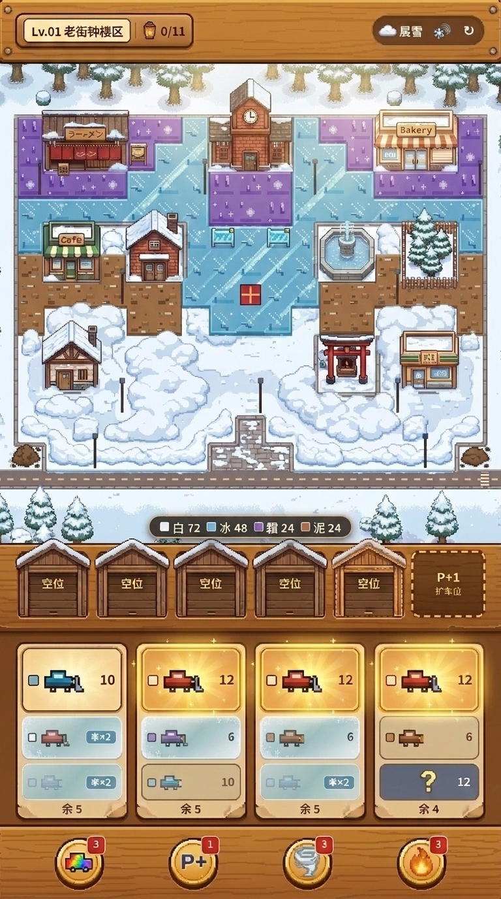
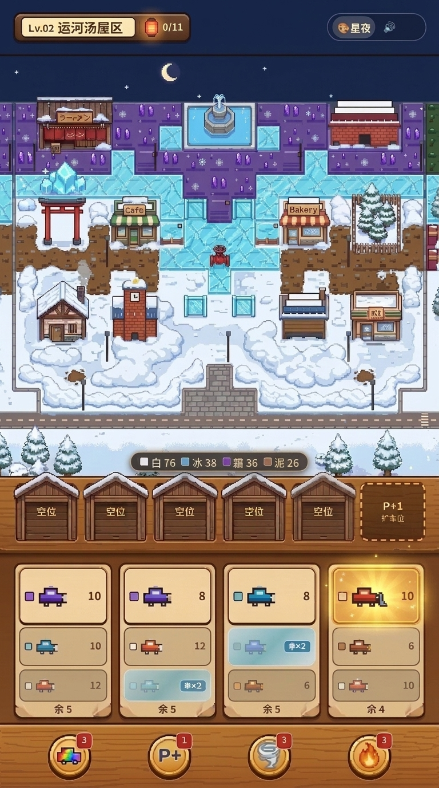
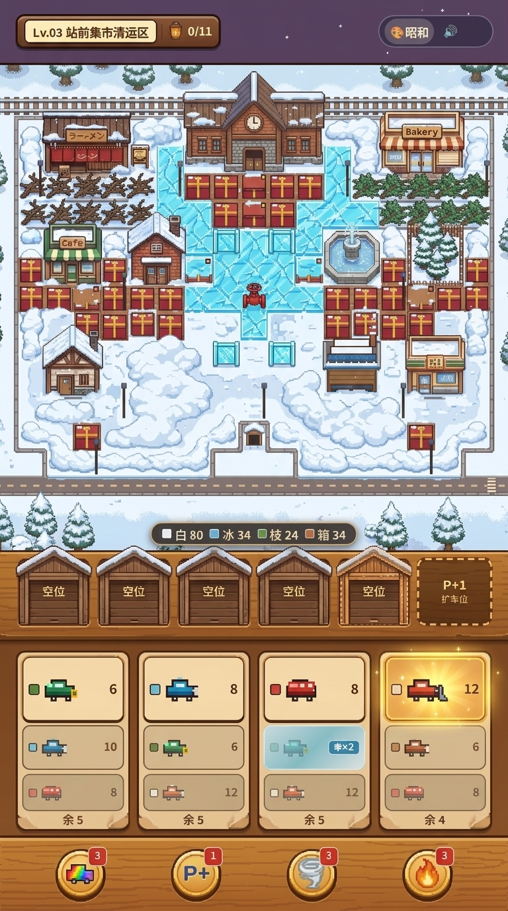

# 《城市清扫队》局内设计图集

| 文档属性 | 内容 |
| :--- | :--- |
| **项目名称** | 《城市清扫队》 |
| **文档编号** | 03 |
| **当前版本** | `v0.1.0` |
| **关联文档** | [01_核心玩法策划案](01_《城市清扫队》核心玩法策划案_v0.1.0.md) · [04_技术架构与开发手册](04_《城市清扫队》技术架构与开发手册_v0.1.0.md) · [06_像素素材制作与瓦片渲染实现方案](06_《城市清扫队》像素素材制作与瓦片渲染实现方案_v0.1.0.md) |
| **更新日期** | 2026-11-26 |

---

## 1. 局内视觉基调与布局约束

本图集确立 **《城市清扫队》** 9:16 竖屏局内基准视觉：采用 **16-bit 暖调田园像素风（对标《星露谷物语》冬季鹈鹕镇手绘像素质感）**、严格 **90° 正交顶俯视角**（零斜视变形、零抗锯齿模糊），并 100% 遵循核心玩法硬性规则：

- **开局零车辆**：玩家点击下方出车队列前，街区路面与 5+1 车库不出现任何车辆。
- **75% 堆雪路网 + 10 座不重复建筑**：每区采用 `17×13` 正交微像素网格，约 74%～76% 为宽阔可清扫街面与广场，约 21%～23% 穿插不重复主题微缩建筑与雪松边景。
- **局内锁定镜头 + 零缝隙跨区过渡**：关卡进行中隐藏切关与漫游按钮并禁止拖拽画布；通关后镜头自动向右平滑推进，相邻街区 0 缝隙边缘直连、以石板大道与人行横道斑马线自然衔接。
- **星露谷雕花木框 UI**：顶部纯净木牌 + 5 座雪顶橡木车库（+ 第 6 虚线 `P+1` 扩容位）+ 4 列×3 行暖羊皮纸出车队列 + 4 枚金边纯图标道具徽章。

---

## 2. 四大核心场景与氛围局内设计图

### 2.1 标准开局静态态（晨雪 · `Lv.01 老街钟楼区` · 开局零车）
- 街区完整覆盖 **白松雪（72）/ 蓝冻冰（48）/ 紫深霜（24）/ 棕雪泥（24）** 四类有机像素材质与中央暖气总阀、双蓝冰门。
- 路上 0 车辆，5 座雪顶木屋车库全为 `空位`；队列首排 3 张红车卡触发三合预兆金色光环，2/3 排展示 `❄×2` 冰封与 `?` 未知盲盒。

### 2.2 点卡作业与三合巨兽实战态（晨雪 · `Lv.01` 作业中）
- 1 号车位合体为金框 **「🔥巨兽」烈焰铲雪车（余 24）**，2 号车位为 **雪泥车（余 5）**，3～5 号位空置。
- 已清通碎石板路面亮起暖金路灯与商铺暖窗，黄金烈焰铲雪车与棕泥车沿严格 90° 四方向出车作业。

### 2.3 深靛星夜氛围态（星夜 · `Lv.02 运河汤屋区` · 开局零车）
- 弯月繁星冬夜、紫晶雪花霜簇、裂纹冰原与复古暖气红阀、月光雪坡与雪顶空车库，精准对应 `白 76 · 冰 38 · 霜 36 · 泥 26`。

### 2.4 中后期除雪 + 垃圾混编态（昭和黄昏 · `Lv.03 站前集市清运区` · 开局零车）
- 顶部贯穿木枕铁轨与雪国木石车站，街区混编 **白松雪（80）+ 蓝冻冰（34）+ 雪松断枝（24）+ 红丝带集市纸箱（34）**。
- 队列同步引入绿色滚刷扫路车与红色压缩垃圾车，保持开局零车与 5 空车库布局。

---

## 3. 五区竖屏占比与界面落地规范

| 分区 | 竖屏高度占比 | 界面结构与交互约束 |
| :--- | :---: | :--- |
| **① 顶部 HUD** | `7.5%` | 左侧雕花木牌（关卡名 + `🏮` 暖灯进度），右侧色调/音效/重开胶囊；**隐藏切关与漫游按钮** |
| **② 城市主战场** | `53.0%` | `17×13` 正交微像素网格；底部悬浮 4 类剩余层数暗木微条；局内锁定镜头，通关自动右滑 0 缝隙切换 |
| **③ 5+1 调度车库** | `10.5%` | 5 座雪顶橡木常驻车库 + 第 6 虚线 `P+1` 扩容位；支持三合一烈焰巨兽金卡与返程「收队早释」 |
| **④ 4×3 出车队列** | `20.0%` | 首排纯白放大卡（唯一可点击，三合预兆亮金光）；2/3 排渐隐缩窄；支持 `❄×N` 冰封与 `?` 未知盲盒；列底标注余量 |
| **⑤ 4 枚道具栏** | `9.0%` | 万能车 / `P+1` 扩位 / 热风洗牌 / 手动 3×3 火焰融雪弹，纯像素图标金边徽章 + 红点数字 |

> [!TIP]
> 障碍物自动拼接切片（Autotile）、双层叠层贴图、建筑墙根堆雪贴花与动态铲雪渲染的完整落地方法，详见 [06_《城市清扫队》像素素材制作与瓦片渲染实现方案_v0.1.0.md](06_《城市清扫队》像素素材制作与瓦片渲染实现方案_v0.1.0.md)。

---

## 4. 版本修订记录

| 版本号 | 日期 | 修订摘要 |
| :---: | :---: | :--- |
| `v0.1.0` | 2026-11-26 | 正式发布《城市清扫队》星露谷风 16-bit 局内设计图集（晨雪开局态、三合巨兽实战态、深靛星夜态、昭和黄昏除雪+垃圾混编态及五区竖屏规范）。 |
