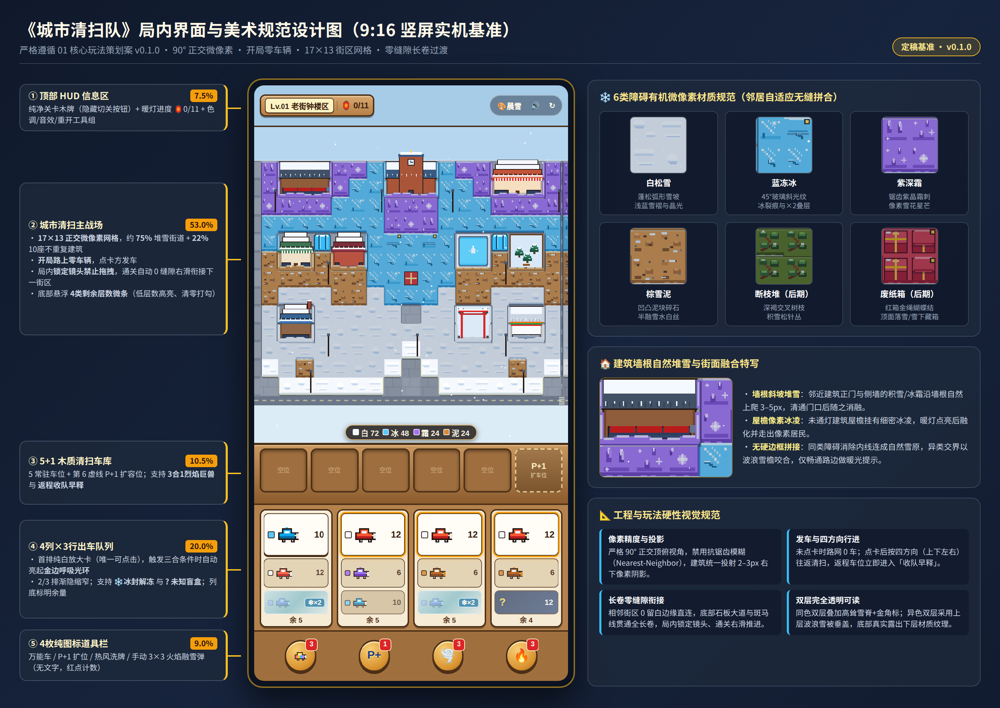
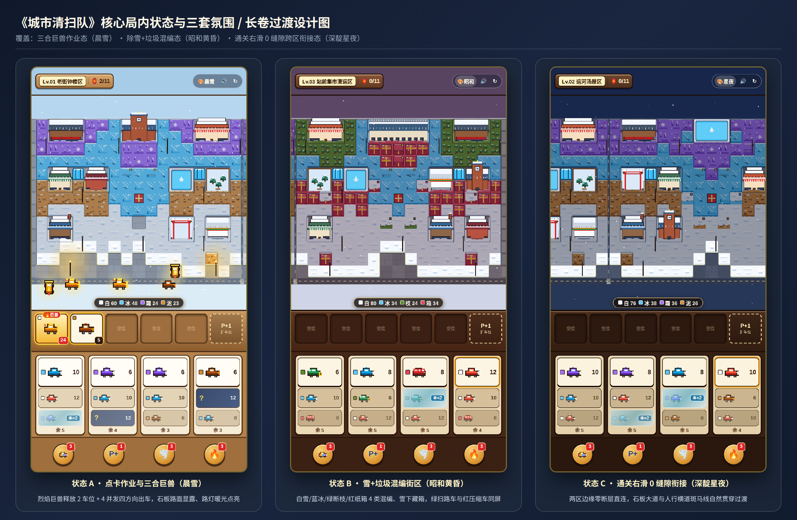
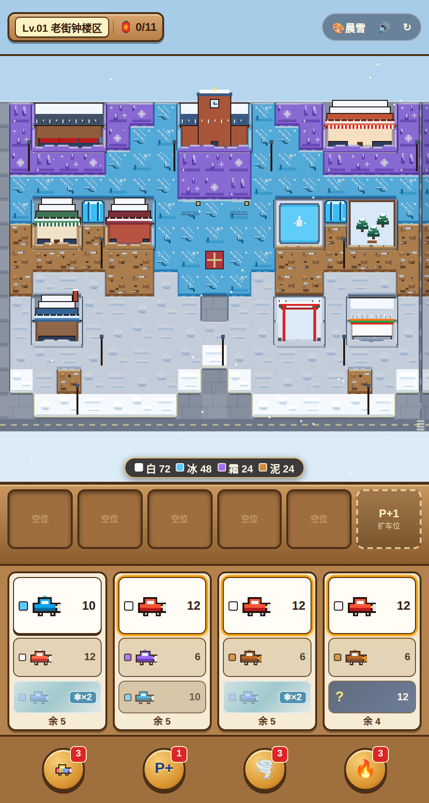
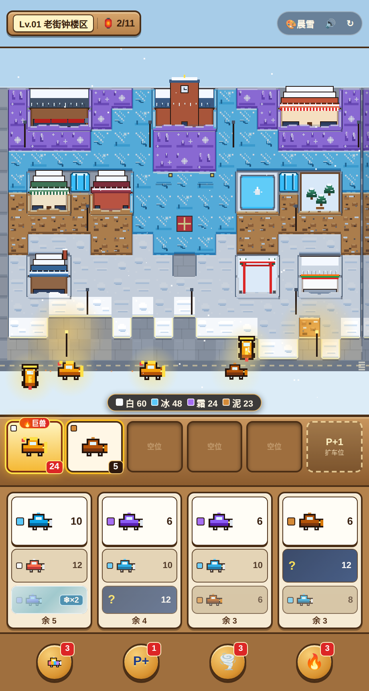
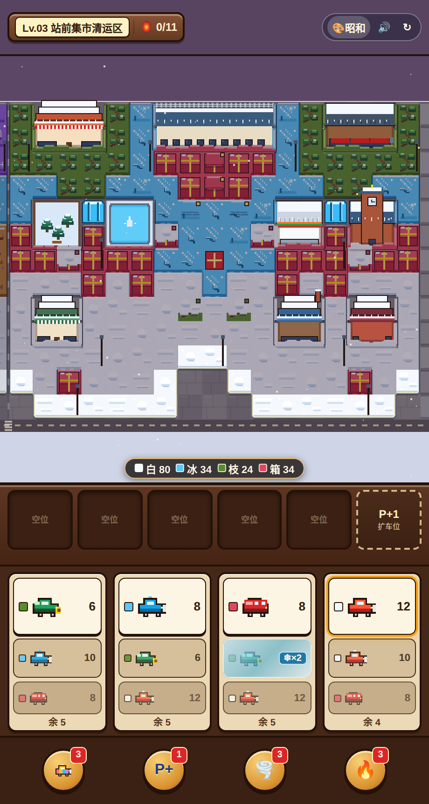

# 《城市清扫队》局内设计图集

| 文档属性 | 内容 |
| :--- | :--- |
| **项目名称** | 《城市清扫队》 |
| **文档编号** | 03 |
| **当前版本** | `v0.1.0` |
| **关联文档** | [01_《城市清扫队》核心玩法策划案_v0.1.0.md](01_《城市清扫队》核心玩法策划案_v0.1.0.md) |
| **更新日期** | 2026-11-26 |

---

## 1. 局内主界面与美术规范总览图（9:16 竖屏基准）

---

## 2. 核心局内状态与三套氛围 / 长卷过渡设计图

覆盖三种关键局内状态与三套像素氛围色调：**点卡清扫 + 三合巨兽作业态（晨雪）**、**雪+垃圾混编街区（昭和黄昏）**、**通关自动右滑 0 缝隙斑马线自然衔接态（深靛星夜）**。

---

## 3. 9:16 实机 1:1 局内基准单页稿

### 3.1 标准开局静态局内图（晨雪 · 第 1 街区 · 开局零车）

### 3.2 点卡作业与三合巨兽实战图（晨雪 · 4 方向行进 + 暖灯点亮）

### 3.3 中后期除雪 + 垃圾混编图（昭和黄昏 · 第 3 街区 · 雪下藏箱/断枝）

---

## 4. 关键美术与 UI 落地参数速查

| 模块 | 竖屏占比 / 规格 | 核心视觉与交互约束 |
| :--- | :--- | :--- |
| **① 顶部 HUD** | `7.5%` | 纯净关卡木牌（如 `Lv.01 老街钟楼区`）+ 暖灯进度 `🏮0/11` + 右上工具组；**隐藏切关与漫游按钮** |
| **② 城市主战场** | `53.0%`（`17×13` 网格） | 严格 90° 正交微像素（Nearest-Neighbor 零模糊）；**~75% 堆雪街区 + ~22% 10 座不重复微缩建筑**；开局路上 **0 车辆**；局内禁止拖拽卷轴，通关自动 **0 缝隙右滑** 衔接下一区；底部悬浮 4 类剩余层数微条 |
| **③ 5+1 车库** | `10.5%` | 5 常驻木框车位 + 第 6 虚线 `P+1` 扩容位；支持三合一烈焰巨兽金卡与返程「收队早释」 |
| **④ 4×3 出车队列** | `20.0%` | 首排纯白放大卡（唯一可点击，三合预兆亮金边呼吸光环）；2/3 排渐隐缩窄；支持 `❄️×N` 冰封与 `?` 未知盲盒；列底标注余量 |
| **⑤ 4 枚道具栏** | `9.0%` | 万能车 / `P+1` 扩位 / 热风洗牌 / 手动 3×3 火焰融雪弹，纯图形徽章 + 红点数字 |
| **有机材质规范** | 邻居自适应无缝拼合 | 白松雪（弧形雪坡）、蓝冻冰（45° 玻璃斜光+裂痕）、紫深霜（锯齿紫晶+像素雪花）、棕雪泥（凹凸泥块+碎石+雪水白丝）、断枝堆（交错枝干+积雪松针）、废纸箱（红箱金绳+落雪）；邻接建筑墙根自然上爬堆雪 3–5px，未通灯屋檐挂冰凌 |
