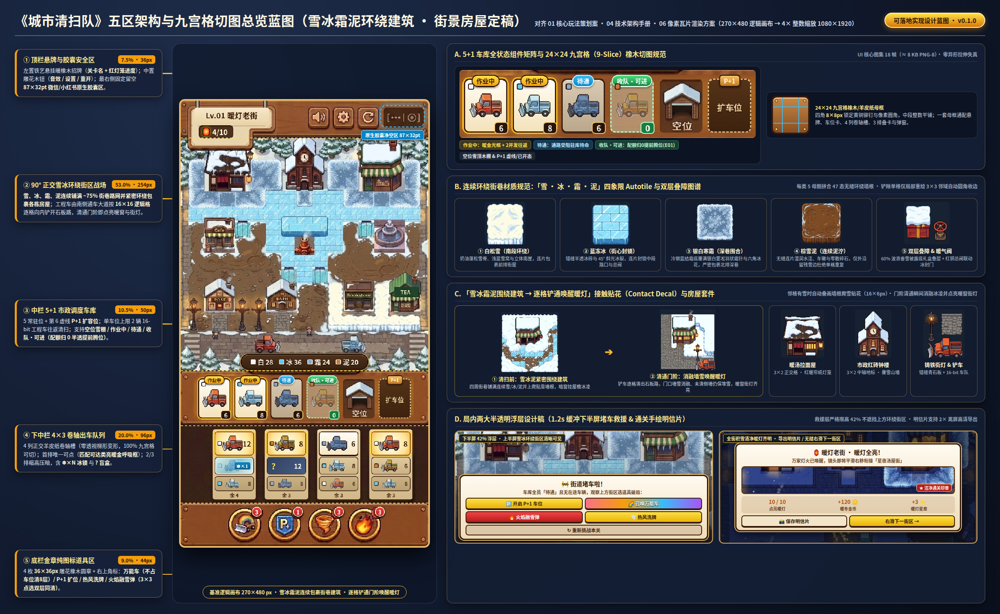
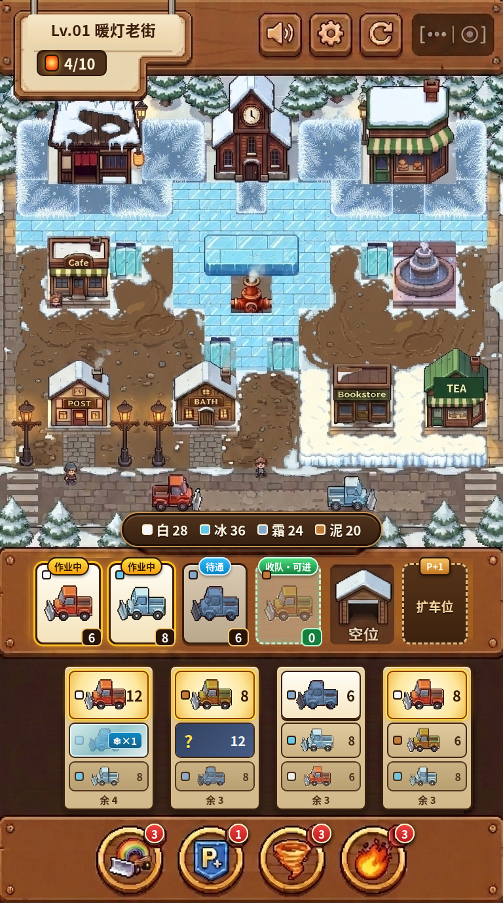

# 《城市清扫队》局内设计图集

| 文档属性 | 内容 |
| :--- | :--- |
| **项目名称** | 《城市清扫队》 |
| **文档编号** | 03 |
| **当前版本** | `v0.1.0` |
| **关联文档** | [01_核心玩法策划案](01_《城市清扫队》核心玩法策划案_v0.1.0.md) · [04_技术架构与开发手册](04_《城市清扫队》技术架构与开发手册_v0.1.0.md) · [06_像素素材制作与瓦片渲染实现方案](06_《城市清扫队》像素素材制作与瓦片渲染实现方案_v0.1.0.md) |
| **更新日期** | 2026-11-27 |

---

## 1. 局内视觉基调与真实落地规范

本图集确立 **《城市清扫队》** 9:16 竖屏局内基准视觉：采用 **16-bit 暖调冬日箱庭像素风**、严格 **90° 正交顶俯视角**（`270×480` 逻辑像素基准，`16×16` 逻辑像素/格，全程 `imageSmoothingEnabled = false` 零模糊整数缩放），确保精致视觉表现与微信 / 小红书小游戏原生 Canvas 2D 工程 1:1 可实现性：

- **雪 · 冰 · 霜 · 泥连续环绕包裹建筑（四象限 Autotile 47 态圆角拼合 + 接触堆雪贴花）**：
  - 全区约 `75%` 街巷路网由四类连续材质严密铺满并紧紧围绕各栋微缩建筑墙根与门阶，工程车从最底部南侧通车大道逐格向内铲开石板通道：
  - **白松雪（南段环绕）**：奶油白蓬松雪脊、浅蓝雪窝褶皱与 `3px` 立体垂雪南崖；
  - **蓝冻冰（街心封锁）**：错缝半透明亮青冰砖、45° 玻璃高光斜纹、细碎冰裂痕与同色双层隆起冰冠；
  - **银白寒霜（深巷围合）**：冷冽钢蓝结霜底覆满银白雾凇羽状霜针与微缩六角冰窗花（还原真实严寒凝霜质感）；
  - **棕雪泥（连续泥泞）**：无缝连片的湿润泥泞水洼、车辙肌理与零散鹅卵碎石，仅在与雪/冰/石板交界的外沿保留半融残雪边，杜绝单格重复切缝。
- **冬日微缩商铺与街景套件（`2×2` / `3×2` 正交占地、真透明独立贴图）**：
  - 含暖汤拉面屋、市政红砖钟楼、条纹雨棚烘焙坊、街角咖啡馆、石砌喷泉、老街邮局、木造温泉汤屋、暖灯书屋、绿顶茶铺及木造车站；未通暖灯时挂屋檐冰凌且墙根叠画接触堆雪贴花，清通门阶瞬间消融门口墙雪并点亮暖琥珀窗光、炊烟与复古铸铁暖光街灯。
- **九宫格木框与平台胶囊避让**：顶栏左置铁艺悬挂橡木招牌，中置雕花木钮（音效/设置/重开），最右侧固定留空 `87×32pt` 平台原生胶囊净空区（`[••• | ⊙]`）；车库、卷轴槽、叠卡与弹窗统一复用 `24×24`（四角 `8×8px` 黄铜铆钉圆角锁死）九宫格母框。

---

## 2. 五区架构与九宫格切图总览蓝图

总览蓝图完整标注竖屏五区像素标尺、右上角原生胶囊净空区、5+1 车库全状态组件矩阵、`24×24` 九宫格切线、连续环绕材质四象限 Autotile 图谱、「雪冰泥围绕建筑 ➔ 逐格铲通唤醒暖灯」接触贴花对比特写，以及下半屏堵车救援与通关手绘明信片浮层：

---

## 3. 四大核心状态与主题氛围 9:16 实机设计图

### 3.1 标准开局零车态（晨雪 · `Lv.01 暖灯老街`）
- **开局零车**：路面与 5 座雪顶橡木车库均为无车初始态（`空位`），第 6 位为虚线 `P+1 扩车位`；全街商铺与铸铁街灯处于未点亮冷冬态并垂挂屋檐冰凌。
- **连续环绕封锁**：北排拉面屋、钟楼、烘焙坊被银白寒霜严密包裹，中央暖气总阀与冰封门被蓝冻冰连片封锁，中段咖啡馆与喷泉被连续湿润棕雪泥围合，南排四栋街屋被蓬松白松雪完整包裹；队列首排匹配可达白雪的 2 张铲雪车卡亮起暖金呼吸框，2～3 排含 `❄×2` 冰晶锁与 `?` 盲盒卡。

### 3.2 高频往返清扫与车库全状态实战态（晨雪 · `Lv.01 暖灯老街` 作业中）
- **逐格开道唤醒暖灯**：铲雪车从南侧通车大道向上逐格铲开左下青石板通道，邮局与汤屋门口积雪消融、暖琥珀窗光与铸铁街灯同步点亮并走出散步像素居民；其余未清区域依然保持连续包裹房屋状态。
- **5+1 车库全运行态同屏示范**：1～2 号位为暖金光框 `作业中`（余 `6` / `8`），3 号位为蓝签 `待通`（银霜钢蓝除霜车余 `6`），4 号位为配额归零半透虚线绿签 `收队·可进`（提前腾位零延迟接力），5 号位为 `空位` 雪顶木棚，6 号位为虚线 `P+1 扩车位`。

### 3.3 深靛星夜氛围与尾声「街区冲刺」态（星夜 · `Lv.02 星夜汤屋街`）
- **万家暖灯与街区冲刺**：全街绝大部分石板路已清通，所有商铺暖窗、红灯笼与铸铁街灯齐亮，仅右上烘焙坊与喷泉边角残留少量银白寒霜与雪泥（剩余层数 `≤15%`）；战场泛起雕花暖金庆典边框，弹出顶部 `✨ 街区冲刺！车队往返速度 ×1.6` 横幅与右下 `⚡ 一键加速收尾` 按钮，已派空的第 2～4 列呈现干净的卷轴羊皮纸空槽（`✓ 本列已清`）。

### 3.4 除雪+街道垃圾混编与「火焰融雪弹 3×3 瞄准态」（昭和黄昏 · `Lv.03 站前集市巷`）
- **单局 4 类连续环绕混编与雪下藏箱**：木枕铁轨与木造车站周围混编白松雪、蓝冻冰、积雪松枝堆与红金丝带礼盒木箱（紧密围绕各栋街屋），清晰呈现上半 `60%` 波浪垂雪被、下半露底红金礼盒的「雪下藏物」异色双层格。
- **3×3 定点瞄准与 `P+1` 已扩容态**：顶部悬浮 `🔥 点选街区投放 3×3 融雪弹 [取消]`，街心总阀与双层区呈现正交 `3×3` 烈焰瞄准框；车库第 6 位展示激活后的 `P+1已开` 可用态，底栏 `P+` 盾章圆形置灰打 `✓`。

---

## 4. 五区竖屏像素布局与 UI 切图实现规范表

| 分区 | 屏高占比 / 逻辑高度 | 核心 UI 组件与真实落地实现约束 |
| :--- | :---: | :--- |
| **① 顶栏悬牌与胶囊区** | `7.5%`（`36 px`） | 左置铁艺悬挂橡木招牌（关卡名 + 红灯笼进度）；中置 `3` 枚雕花木质方钮（音效/设置/重开）；最右侧固定预留 `87×32pt` 平台原生胶囊安全净空区。 |
| **② 正交城市主战场** | `53.0%`（`254 px`） | `16×16 px` 逻辑瓦片网格；连续白松雪、蓝冻冰、银白寒霜、棕雪泥采用 5 母图四象限 Autotile 环绕房屋；双层采用隆起雪冠/冰脊与 `60%` 波浪垂雪被实时叠绘；底部居中悬浮四类余量胶囊。 |
| **③ 5+1 市政调度车库** | `10.5%`（`50 px`） | 6 等宽槽位居中排布；覆盖 `空位`（雪顶木棚）、`作业中`（暖金光框 + 16-bit 专职车 + 配额）、`待通`（灰米底 + 蓝签）、`收队·可进`（半透虚线框 + 绿签 `0`）、`P+1`（虚线待开 / 实线已开）。 |
| **④ 4×3 卷轴出车队列** | `20.0%`（`96 px`） | 4 列正交羊皮纸卷轴槽；首排唯一可点（匹配可达类亮暖金呼吸框），2～3 排缩高压暗；特殊态叠加半透明冰晶遮罩 `❄×N` 或深靛盲盒层 `?`；列底绘 `余 N` / `已清空`。 |
| **⑤ 底栏金章道具区** | `9.0%`（`44 px`） | 4 枚 `36×36 px` 雕花橡木圆章纯图标（万能车 / `P+` / 热风洗牌 / 火焰融雪弹）+ 右上角标；无底部冗余文字，激活态叠加外发光环，单局限次用尽态圆形置灰打 `✓`。 |

---

## 5. 版本修订记录

| 版本号 | 日期 | 修订摘要 |
| :---: | :---: | :--- |
| `v0.1.0` | 2026-11-27 | 正式定稿《城市清扫队》16-bit 局内 UI 设计图集（含五区架构与九宫格切图总览蓝图、雪冰霜泥连续环绕建筑规范、银白雾凇寒霜与无缝连片泥泞材质、冬日微缩商铺街景及四大核心实机状态稿）。 |
