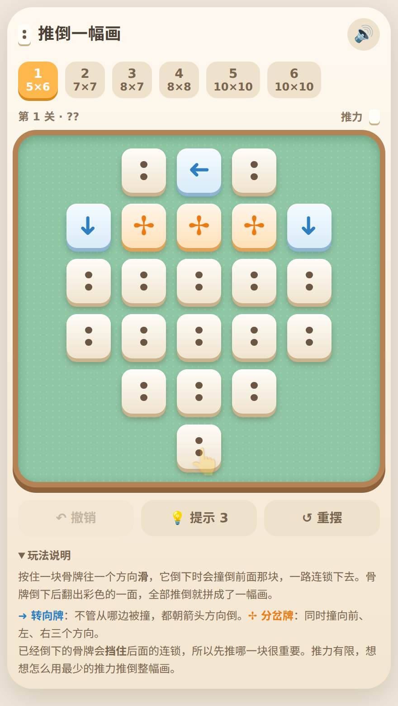
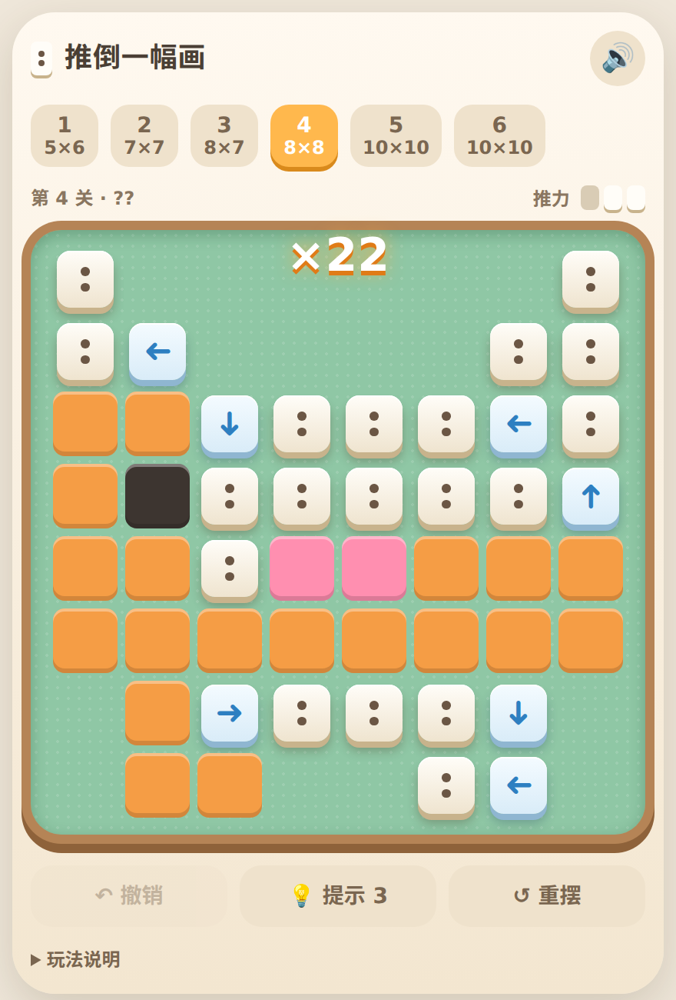
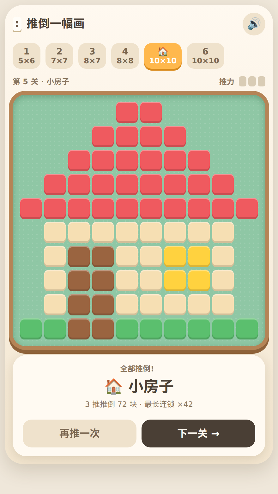
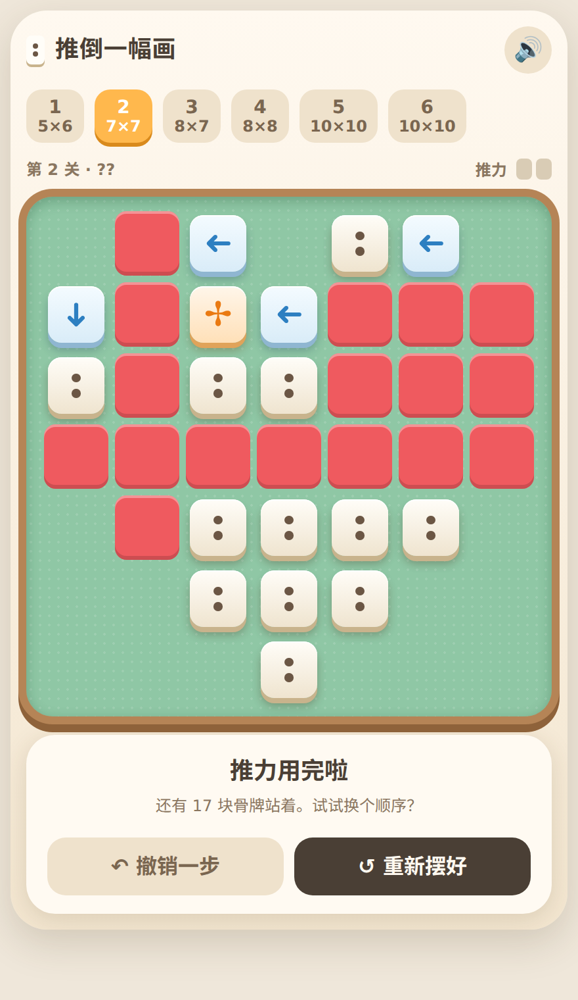

# 《推倒一幅画》局内设计图集

| 文档属性 | 内容 |
| :--- | :--- |
| **项目名称** | 《推倒一幅画》 |
| **文档编号** | 03 |
| **当前版本** | `v0.1.0` |
| **关联文档** | [01_核心玩法策划案](01_《推倒一幅画》核心玩法策划案_v0.1.0.md) · [04_技术架构与开发手册](04_《推倒一幅画》技术架构与开发手册_v0.1.0.md) · [06_像素画与骨牌渲染实现方案](06_《推倒一幅画》像素画与骨牌渲染实现方案_v0.1.0.md) |
| **更新日期** | 2026-11-28 |

---

## 1. 局内视觉基调与落地规范

本图集确立 **《推倒一幅画》** 9:16 竖屏局内基准视觉：采用**暖调桌面手工质感 + 明快像素画色块**的轻治愈风格，全屏严格 **90° 正交顶俯视角**，确保在微信 / 小红书小游戏原生 Canvas 2D 工程中 1:1 高帧率落地：

- **木框绿呢桌面容器**：外层卡片为暖奶油米白渐变（`#fff9f0 → #f3e6d0`）；棋盘区为暖橡木边框（`#b58456` / 阴影 `#8e623a`）配薄荷绿呢绒底面（`#8fc7a5` + 微弱细点纹理），对米白骨牌与高饱和像素画正面均提供稳定对比度。
- **三类基础骨牌的秒级辨识**：
  - **普通牌**：米白牌身（`#fffdf8 → #efe4cf`）配深棕底边厚度与竖排双圆点；
  - **转向牌**：冰蓝牌身（`#f4fbff → #d9ecf8`）配饱和蓝实心箭头（`#2d7fc1`），无论滑向何方均锁定箭头方向；
  - **分岔牌**：暖杏牌身（`#fff6ea → #ffe0b8`）配亮橙四向十字花符号（`#ea7a12`），提示前/左/右三路分流。
- **异形画布与倒牌显画对比**：像素画轮廓外直接露出绿呢桌面；骨牌站立时带厚实立面投影，倒下后平铺为圆角微立体彩色瓷砖块，站立区与已显画区域一眼可分。
- **不遮挡画面的底部内联结算**：通关与失败面板均在棋盘下方展开（替代底部工具栏与规则栏），确保玩家完整欣赏刚拼出的像素画，方便直接截屏分享。

---

## 2. 四大核心状态 9:16 实机设计图

### 2.1 首关开局与手指引导态（第 1 关 · `5×6`）
- **首关即玩**：顶部关卡条高亮当前第 1 关，信息行隐藏画名为 `第 1 关 · ??`，右侧推力槽显示 `1` 块立起的小骨牌。
- **零文字弹窗引导**：进关 `0.5s` 后在标准解起点骨牌上循环播放向上滑动的手指动画；底部规则说明仅在首关默认展开，清晰展示普通牌、蓝色转向牌与橙色分岔牌。

### 2.2 单推连锁进行态（第 4 关 · `8×8`）
- **一推显画与实时连击**：消耗第 1 点推力（推力槽首格置灰）后，连锁沿转向牌与分岔牌持续推进，牌桌顶部居中跳出醒目暖橙描边连击数字 `×22`。
- **站立与平铺的层次对比**：已倒骨牌翻出橙、黑、粉等彩色方块拼出小猫轮廓；尚未被波及的骨牌仍保持立起投影态，工具栏在连锁期间自动锁定防误触。

### 2.3 全部推倒通关态（第 5 关 · `10×10 小房子`）
- **完整显画不遮挡**：72 块骨牌全部倒下拼出红顶黄窗绿草地的小房子像素画，信息行揭晓真实画名 `第 5 关 · 小房子`，关卡条芯片切换为房子图标。
- **底部结算卡**：结算面板在棋盘下方顺滑弹出，展示画名、`3 推推倒 72 块 · 最长连锁 ×42` 战绩，以及 `再推一次` 与 `下一关 →` 双按钮。

### 2.4 推力用尽失败与撤销态（第 2 关 · `7×7`）
- **「已倒即挡」逻辑反馈**：2 点推力全部用完（推力槽两格均置灰），左侧与右侧已倒红色方块阻断了通向中下部的通道，棋盘仍留有 `17` 块站立骨牌。
- **零压力救援**：底部弹出失败面板，提示剩余站立块数，提供免费无限次的 `↶ 撤销一步` 与 `↺ 重新摆好`（正式版同步预留激励视频 `+1 额外推力` 入口）。

---

## 3. 五区竖屏布局与 UI 组件实现规范表

| 分区 | 屏高占比 | 核心 UI 组件与落地实现约束 |
| :--- | :---: | :--- |
| **① 顶栏状态区** | `7%～8%` | 左置双点小骨牌图标 + 游戏名；中右置圆形声音开关（微信小游戏版右上角固定避让 `87×32pt` 原生胶囊净空区）。 |
| **② 关卡条与信息行** | `8%～9%` | 顶部连续编号横向滑动芯片（当前关暖橙高亮、已通关显示像素画图标、未通关显示序号与尺寸）；下方左侧为关卡号与画名（通关前 `??`），右侧为骨牌形推力槽。 |
| **③ 绿呢木框牌桌区** | `55%～60%` | 暖橡木外框 + 绿呢点纹底板；按 `min(58px, floor((可用宽 - (W-1)×3) / W))` 自适应单格尺寸（下限 `24px`）；顶部居中叠放连击数字，底部叠放 Toast 提示。 |
| **④ 底部工具栏** | `8%～9%` | 三等宽圆角按钮：`↶ 撤销`（无历史步时置灰）、`💡 提示 N`（次数归 0 置灰）、`↺ 重摆`；连锁演出期间全部禁用。 |
| **⑤ 规则栏 / 结算面板区** | 余量 | 对局中为可折叠规则说明（首关展开、第 2 关起收起）；通关或失败时隐藏工具栏与规则栏，原地切换为内联结算卡，绝不遮挡牌桌画面。 |

---

## 4. 版本修订记录

| 版本号 | 日期 | 修订摘要 |
| :---: | :---: | :--- |
| `v0.1.0` | 2026-11-28 | 正式定稿《推倒一幅画》9:16 竖屏局内设计图集，确立木框绿呢牌桌与三类骨牌视觉基调、四大实机状态图（首关引导、单推连锁、通关显画、失败撤销）及五区布局实现规范。 |
