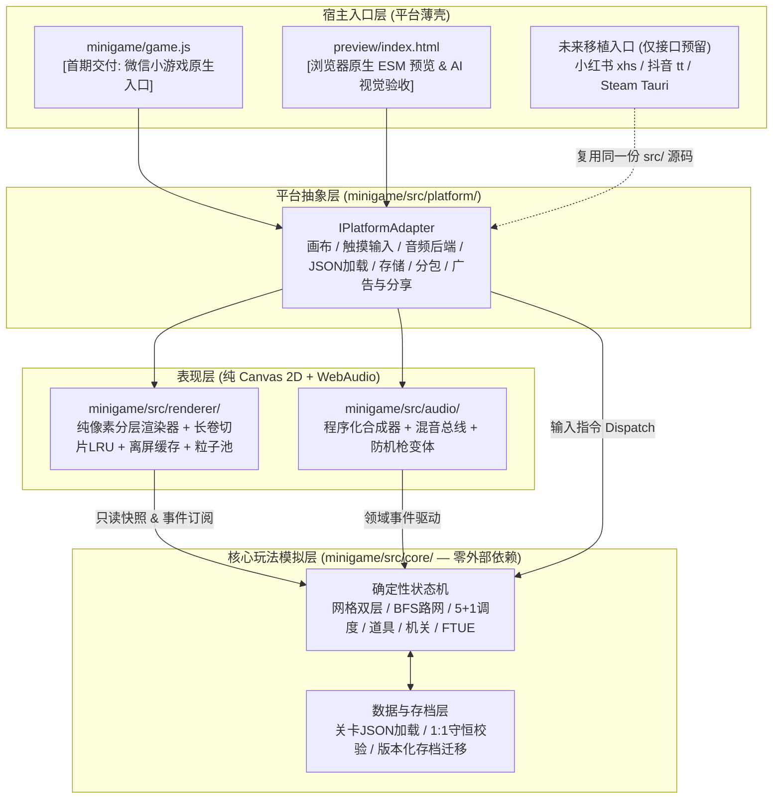

# 《城市清扫队》技术架构与开发手册

| 文档属性 | 内容 |
| :--- | :--- |
| **项目名称** | 《城市清扫队》 |
| **文档编号** | 04 |
| **当前版本** | `v0.1.0` |
| **项目阶段** | 立项策划期（开发前技术定稿） |
| **更新日期** | 2026-11-27 |
| **遵循规范** | 参见 `00_《城市清扫队》项目文档版本号管理规范`、`01_《城市清扫队》核心玩法策划案` |

---

## 1. 技术定位与核心架构原则

### 1.1 研发模式与目标平台边界
本项目采用 **AI 全程端到端编码、全文本原生工程** 模式，面向**纯像素美术风格**的轻量化竖屏策略小游戏构建自研轻量 2D 引擎：

* **首期唯一研发与发布端**：**微信小游戏原生工程**（`minigame/` 目录即为标准 `project.config.json` + `game.json` + `game.js` 工程，微信开发者工具直接打开即运行、预览与上传），单机本地存档，零服务端运维成本。
* **架构级无痛移植预留（首期仅做抽象隔离，不实现具体壳工程）**：
  * **小红书小游戏**（`xhs.*` Canvas 2D 运行时）
  * **抖音小游戏**（`tt.*` Canvas 2D 运行时）
  * **Steam 桌面端**（Windows / macOS / Steam Deck，基于 Tauri v2 或 Electron 容器 + Steamworks SDK 桥接）
* **本地预览与自动验收端**：`preview/` 静态入口页（通过浏览器原生 `<script type="module">` 直接加载 `minigame/src/` 同一份源码，供 AI 无头回归测试与人工即时试玩验收）。

### 1.2 五大架构红线
1. **标准原生 ES Module 直跑**：小游戏核心源码统一采用标准 JavaScript ES Module（显式 `.js` 相对路径），由微信开发者工具、浏览器预览与 Node.js 22 直接加载运行。
2. **静态类型契约检查**：全源码启用 `// @ts-check` 与 JSDoc 类型标注，配合仓库外置的 `types/*.d.ts` 类型声明与 `jsconfig.json`，在本地执行 `tsc -p jsconfig.json --noEmit` 完成全仓静态类型校验，防范跨轮次迭代中的字段误写与状态机分支遗漏。
3. **逻辑与表现绝对解耦**：`minigame/src/core/` 为 100% 纯逻辑确定性模拟层，零 Canvas / DOM / `wx` 依赖，可直接在 Node.js 22 内置测试运行器（`node --test`）下高速无头验证。
4. **纯像素统一像素密度（Zero Mixels）**：全局强制 `imageSmoothingEnabled = false` 与统一虚拟像素坐标系，所有地砖、载具、建筑长卷与 UI 严格对齐像素网格，彻底杜绝抗锯齿模糊、亚像素闪烁与跨尺度混合像素。
5. **玩法规则单一事实来源**：数值常量、配额守恒、BFS 连通、提前腾位、道具规则与 E01～E09 边界验收标准均以 `01_《城市清扫队》核心玩法策划案` 为准，代码通过统一配置表驱动并由自动化测试锁死回归。

---

## 2. 总体分层架构与原生工程目录规范

### 2.1 四层解耦架构图



### 2.2 仓库目录规范

核心隔离原则：**`minigame/` 内仅存放真机运行所需的纯净文件**，微信开发者工具直接导入 `minigame/` 即可运行与发布；所有开发辅助脚本、静态类型声明、自动化测试与源美术处理资产统一置于 `minigame/` 之外。

```text
cheng-shi-qing-sao-dui/
├── docs/                                # 00~06 规范与策划/技术文档（遵循 00 版本号规范）
├── minigame/                            # 【微信开发者工具直接打开的原生小游戏工程目录】
│   ├── project.config.json              # 微信小游戏项目配置（启用原生 ES6/SWC 支持）
│   ├── game.json                        # 竖屏锁定 + 分包清单（subpackages）
│   ├── game.js                          # 极简入口（< 40 行：创建 WxAdapter 并调用 bootstrap）
│   ├── src/
│   │   ├── main.js                      # 宿主无关的引擎装配入口 bootstrap(adapter)
│   │   ├── core/                        # 纯 JS 确定性玩法核心（零平台/画布依赖）
│   │   │   ├── constants.js             # 基准手感与节奏参数（参见 01 策划案 §6.4）
│   │   │   ├── grid/                    # 网格模型、双层障碍栈、零延迟 BFS 连通与最短路径
│   │   │   ├── fleet/                   # 5+1 车库、发车节拍、提前腾位、往返动线
│   │   │   ├── queue/                   # 4 列纵深队列、结冰卷帘门、暴雪盲盒、热风洗牌
│   │   │   ├── mechanisms/              # 暖气总阀与冰封门；预留温泉泉眼、双联拖挂、山坡滑落
│   │   │   ├── props/                   # 万能车、P+1 扩容、热风洗牌、火焰融雪弹
│   │   │   ├── rules/                   # 1:1 守恒、全场清类即收队、街区冲刺、1.2s 堵车判定
│   │   │   ├── ftue/                    # 首关 5 步剧本式微引导状态机
│   │   │   ├── save/                    # 版本化存档模型、双备份容错、迁移链
│   │   │   └── engine.js                # GameEngine 主循环（固定 1/60s 步长 + 命令/事件循环）
│   │   ├── renderer/                    # 纯像素 Canvas 2D 六层渲染器、长卷切片 LRU、粒子池、UI、明信片
│   │   ├── audio/                       # 程序化像素音效合成器（WebAudio）+ 混音总线
│   │   └── platform/                    # 平台适配目录（wx-adapter.js 等）
│   ├── assets/                          # 主包精简像素资产（atlas_core.png + JSON、12px 像素字体、第 1 章切片）
│   ├── levels/                          # 第 1 章节声明式关卡 JSON（1~15 关）
│   └── subpackages/                     # 按章节拆分的后续街区分包（ch02/、ch03/...）
├── preview/                             # 【本地 Web 预览与 AI 视觉测试入口】
│   ├── index.html                       # 原生 <script type="module"> 直连 ../minigame/src/main.js
│   ├── web-adapter.js                   # 浏览器 / 未来 Steam 桌面端平台适配器
│   └── serve.mjs                        # 约 30 行 Node 内置静态文件服务
├── types/                               # 外置静态类型契约（供本地 tsc 校验，不进入小游戏包）
│   ├── domain.d.ts                      # 领域数据结构、指令、事件、存档类型定义
│   ├── platform.d.ts                    # IPlatformAdapter 跨端平台接口契约
│   └── wx-minigame.d.ts                 # 微信小游戏 wx.* 精简类型声明
├── assets-raw/                          # 源美术资产与合规台账（不进入小游戏包）
│   ├── asset-manifest.json              # 资产清册：尺寸、锚点、来源、许可证、QA 状态
│   ├── palette/master-palette.json      # 统一主调色板（对齐 01 策划案色号与暖夜光效）
│   ├── pixel-src/                       # 代码像素点阵脚本（用于离线烘焙核心小元件图集）
│   └── raw/                             # 外部 AI 生图 / 像素工具导出的原始长卷与皮肤图
├── tests/                               # Node 内置测试（node --test）：核心逻辑 + E01~E09 + 视觉回归
├── tools/                               # 开发期离线工具（不进入小游戏包）
│   ├── pixel-baker.mjs                  # 代码像素点阵离线烘焙 → minigame/assets/atlas_core.png + JSON
│   ├── asset-pipeline.py                # 外部贴图归一化（真透明、最近邻、限色量化、1px 外扩、合图、QA）
│   ├── verify-levels.mjs                # 关卡 1:1 守恒、4 类上限、可达性与无道具求解器校验
│   └── verify-minigame.mjs              # 微信包体红线（主包 ≤4MB / 整包 ≤30MB）与非法全局扫描
├── jsconfig.json                        # 开启 checkJs + strict，供本地全仓静态类型校验
└── package.json                         # "type": "module" 与统一测试/校验脚本
```

### 2.3 技术栈选型基线

| 技术维度 | 选型方案 | 工程职责 |
| :--- | :--- | :--- |
| **源码语言与模块** | 原生 JavaScript（ES Module，显式 `.js` 后缀） | 微信小游戏、浏览器预览、Node.js 与后续多端直接原生运行同一份源码 |
| **静态类型校验** | `// @ts-check` + JSDoc + 外置 `types/*.d.ts` + `tsc --noEmit` | 开发期全仓静态类型校验，保障核心状态机与跨模块接口一致性 |
| **渲染方案** | 原生 Canvas 2D + 离屏画布缓存 | 全平台原生支持，冷启动迅速，天然契合纯像素最近邻缩放 |
| **音频方案** | WebAudio API（`wx.createWebAudioContext`）+ 音频池降级 | 支持 01 策划案要求的程序化合成音效、五声音阶与低延迟高并发混音 |
| **测试与 QA 工具链** | Node.js 22 内置 `node --test` + `Playwright` + Python `Pillow` | 负责无头逻辑单测、自动点玩截屏验收与像素贴图质量门禁 |

---

## 3. 纯像素视觉架构与双阶段贴图资产管线

### 3.1 虚拟像素坐标系与屏幕适配规范

为兼顾 `01_《城市清扫队》核心玩法策划案` 中 **9:16 竖屏五区布局**、**最大 `15×13` 奇数中轴网格** 以及 **纯像素零混合像素（Zero Mixels）** 要求，全局锁定以下像素空间基准：

* **逻辑画布基准分辨率**：**`270 × 480` 逻辑像素**（标准 `9:16`，在 `1080×1920` 主流手机屏上呈精确 **`4×` 整数倍放大**）。
* **全面屏纵向弹性扩展**：锁定逻辑宽度恒为 **`270px`**，按设备真实宽高比计算逻辑高度 `logicalH = Math.round(270 * (screenH / screenW))`（通常为 `480 ~ 600px`）。多出的纵向像素平滑分配给顶栏胶囊安全净空区与战场/天际线留白，五区核心交互热区严格按策划案比例锚定。
* **全局统一砖块尺度**：**`16 × 16` 逻辑像素 = 1 逻辑格**（全关卡恒定，杜绝不同关卡缩放导致像素颗粒不一）：
  * `15 × 13` 最大网格：`240 × 208 px`，左右保留 `15 px` 街角留白。
  * `11 × 11` 标准网格：`176 × 176 px`，左缘留白自然承接上一关已点亮暖灯的老街街角（对应 01 策划案 §2.2）。
  * **前景跨格溢出基准**（对应 01 策划案 §2.3）：工程车 `24 × 24 px`（`1.5` 格高）、复古路灯 `12 × 26 px`（`1.625` 格高）、漫步像素居民 `12 × 20 px`（`1.25` 格高）。
  * **双层障碍格视觉基准**（对应 01 策划案 §3.1）：普通格 `16 × 16 px`；双层格在顶部向上隆起 `+4 px`（共 `20 px` 高，占 `25%` 增量），异色双层格底部显式露出 `3~4 px` 里层底座色与 `5×5 px` 像素角标。
* **像素清晰度铁律**：
  * 主画布物理像素按 `Math.floor(screenWidth * dpr)` 初始化，绘制缩放前强制锁定 `ctx.imageSmoothingEnabled = false`。
  * 所有精灵、摄像机偏移与粒子绘制坐标统一 `Math.round()` 像素吸附，杜绝亚像素抖动与撕裂。
  * 图集内所有平铺地砖与精灵四周强制施加 **`1px` 边缘像素外扩（Extrusion）**，彻底消除缩放接缝渗色。

### 3.2 五区像素布局与微信胶囊安全区适配

```text
+--------------------------------------------------+  y = 0
| [Safe Top Inset: 动态读取微信胶囊 Rect 避让]      |  7%~8%  (区1: 顶栏状态与胶囊区)
|  木纹招牌胶囊  关数  暖灯 5/12   [音][设][重]     |
+--------------------------------------------------+
|  无缝城市长卷天际线切片 (270 × 68~76px)           |
|  暗夜基底 + 暖窗/炊烟叠加层 + 逐栋绑定亮灯        |  51%~54%(区2: 天际线与箱庭战场)
|  +--------------------------------------------+  |
|  |  11×11 ~ 15×13 奇数中轴箱庭网格 (16px/格)   |  |
|  |  (左缘隐现上一关暖灯街角)                   |  |
|  +--------------------------------------------+  |
|  ========= 南侧已通车青石板大道 (16px) =========  |
|  [四类余量微指示器: 白12 · 冰8 · 霜3 · 泥0✓]      |
+--------------------------------------------------+
| [Bay1] [Bay2] [Bay3] [Bay4] [Bay5] [P+1虚线位]    |  10.5%~11% (区3: 5+1 调度车库)
| (6 × 40px + 5 × 4px 间距 = 260px，居中对齐)      |
+--------------------------------------------------+
| [Col1]   [Col2]   [Col3]   [Col4]    (前3排可视)  |  19.5%~21% (区4: 4 列出库队列)
| (4 × 60px + 3 × 6px 间距 = 258px，列底「余N」)   |
+--------------------------------------------------+
|    [万能车]   [P+1]   [热风洗牌]   [火焰融雪弹]   |  8.5%~9%   (区5: 底栏道具区)
|    (4 枚 36×36px 金边像素纯图标 + 数量角标)       |
+--------------------------------------------------+  y = logicalH (含底部安全区留白)
```

### 3.3 纯像素贴图资产管线：代码像素烘焙 + 外部生成贴图双轨制

运行时渲染器**只消费标准化产物：`PNG 雪碧图集 / 长卷切片 + JSON 元数据`**，与素材产出方式彻底解耦。针对不同粒度的纯像素资产采用**双轨并行管线**，兼顾 AI 快速闭环与大画幅绘本像素表现力：

| 资产类别 | 典型代表 | 生产方式 | 尺寸与输出规范 |
| :--- | :--- | :--- | :--- |
| **规则高频元件**（MVP 即刻产出，后期可无痛替换精修图） | 青石板、四色雪冰、四类垃圾、双层底座、暖气总阀、冰封门、工程车/垃圾车 4 向帧、万能车、街灯、像素行人、UI 框与道具图标 | **轨道 A：离线代码像素烘焙**（`tools/pixel-baker.mjs` 将受限调色板点阵脚本烘焙为真像素 PNG 图集） | 单帧 `16×16` / `24×24` / `36×36`；打包至 `atlas_core.png`（`≤ 512×512`，约 `30~80 KB`） |
| **大画幅叙事美术**（生成贴图素材并过自动化量化管线） | 无缝城市长卷天际线切片（拉面巷、钟楼广场、温泉汤屋街等）、每栋商铺暗夜/暖灯双态贴图、手绘像素风通关明信片底图、特色车队皮肤 | **轨道 B：AI 生图 / 像素工具绘制 → 自动化像素归一化管线**（`tools/asset-pipeline.py`） | 每屏天际线切片 `270×80 px` 基准；索引色 PNG 压缩后单片仅 `4~12 KB` |
| **像素字体** | 关卡标题、气泡短文案（≤10 字）、数字配额 | 开源 12px 像素中文字体（`Fusion Pixel 12px` / `Zpix`，SIL OFL 协议）按游戏词表离线裁剪子集 + `5×7`/`7×9` 位图数字图集 | 子集字体或位图页（`≤ 60 KB`） |

#### 自动化像素素材归一化与 QA 门禁（`tools/asset-pipeline.py`）
任何外部生成或手绘导入 `assets-raw/raw/` 的素材，入库 `minigame/assets/` 或 `minigame/subpackages/` 前**必须**经过脚本流水线，严禁把未经处理的 AI 原图直接放进游戏包：
1. **真透明与伪棋盘格检测**：强制校验 Alpha 通道，自动拦截“伪透明灰白格子”或半透明脏边光晕（Halos），并在透明像素外扩边缘主色。
2. **最近邻网格对齐与限色调色板量化**：按目标像素尺寸执行 Nearest-Neighbor 降采样，并映射到 `assets-raw/palette/master-palette.json`（冷靛暗夜 + 暖琥珀灯火 + 四色高辨识度障碍色系），严格控制单图颜色上限，消除伪像素糊边。
3. **长卷无缝衔接校验**：对相邻街区切片的左右 `1px` 边界执行高度与基线色差检查，保证长卷横向拼接无缝。
4. **资产清册与合规留档**：在 `assets-raw/asset-manifest.json` 中记录每份资产的 `size`、`anchor`、`source.kind`（`procedural_baked` / `ai_generated_processed` / `hand_drawn`）、`license` 与 `technical_checks_passed` 字段（既作构建门禁，也为未来 Steam 提审 AI 内容披露留存完整台账）。

---

## 4. 核心玩法模块与确定性状态机设计（`minigame/src/core/`）

### 4.1 固定时间步长与命令-事件循环

为保证逻辑 100% 可复现、不依赖设备刷新率（在 60Hz / 120Hz 手机与 Node 无头单测中结果完全一致），核心层采用 **固定步长模拟（`FIXED_DT = 1 / 60` 秒）+ 显式命令输入 + 领域事件输出**。以下类型契约声明于 `types/domain.d.ts`（供 `tsc --noEmit` 对纯 JS 代码实施静态校验）：

```typescript
// types/domain.d.ts — 外置静态类型契约（不打入小游戏包）
export type GameCommand =
  | { type: 'TAP_QUEUE_COLUMN'; col: 0 | 1 | 2 | 3 }
  | { type: 'ACTIVATE_BAY_EXPAND' }                   // 点击虚线位或 P+1 道具
  | { type: 'USE_PROP_RAINBOW' }                      // 发动万能车
  | { type: 'USE_PROP_SHUFFLE' }                      // 发动热风洗牌
  | { type: 'USE_PROP_FLAME'; gx: number; gy: number } // 火焰弹落点爆破
  | { type: 'TRIGGER_SPRINT_AUTO' }                   // 点击「一键加速收尾」
  | { type: 'RESTART_LEVEL' };

export type GameDomainEvent =
  | { type: 'CARD_DISPATCHED'; col: number; bayIndex: number; kind: ObstacleKind }
  | { type: 'CARD_LOCKED_SHAKE'; col: number; reason: 'FROZEN' | 'GARAGE_FULL' }
  | { type: 'SHUTTER_DECAYED'; col: number; row: number; remain: number }
  | { type: 'MYSTERY_REVEALED'; col: number; kind: ObstacleKind }
  | { type: 'VEHICLE_LAUNCHED'; vehicleId: number; bayIndex: number; path: GridPos[] }
  | { type: 'CELL_LAYER_CLEARED'; gx: number; gy: number; clearedKind: ObstacleKind; clearedCount: number; remainingLayers: number }
  | { type: 'VALVE_TRIGGERED'; valveId: string; openedGates: GridPos[] }
  | { type: 'LAMP_LIT'; lampIndex: number; gx: number; gy: number }
  | { type: 'BUILDING_LIT'; buildingId: string }
  | { type: 'TYPE_ALL_CLEARED'; kind: ObstacleKind; retreatedBays: number[]; removedCards: number }
  | { type: 'BAY_EARLY_RELEASED'; bayIndex: number }
  | { type: 'SPRINT_ACTIVATED' }
  | { type: 'DEADLOCK_WARNING_STARTED' }
  | { type: 'DEADLOCK_CONFIRMED' }
  | { type: 'LEVEL_WON'; stars: number; coins: number };
```

### 4.2 网格、双层障碍与可扩展障碍品类模型

所有雪冰与街道垃圾统一抽象为同一套品类体系（`ObstacleKind`），并在关卡加载与静态校验时硬性约束**单局 `activeKinds.length <= 4`**（参见 01 策划案 §4.2）：

```typescript
// types/domain.d.ts
export type SnowKind = 'SNOW_WHITE' | 'ICE_BLUE' | 'FROST_SILVER' | 'SLUSH_BROWN';
export type GarbageKind = 'LEAF_GREEN' | 'BOX_RED' | 'GREASE_LIME' | 'CRATE_GRAY';
export type ObstacleKind = SnowKind | GarbageKind;

export type CellBaseType = 'ROAD' | 'WALL' | 'ICE_GATE' | 'SLOPE_TILE';

export interface CellState {
  gx: number;
  gy: number;
  base: CellBaseType;
  /** 障碍层栈：索引 0 为里层，末尾为当前表层；长度 0=已清净，1=单层，2=双层（含同色压实与异色/雪下藏垃圾） */
  layers: ObstacleKind[];
  /** 绑定机关或地标标记 */
  valveId?: string;            // 暖气总阀 ID（全清本格层后自动引爆）
  gateId?: string;             // 冰封侧巷门 ID（开启后 base 由 ICE_GATE 转为 ROAD）
  lampId?: string;             // 路灯格（清净时点亮并触发五声音阶）
  doorstepBuildingId?: string; // 绑定天际线建筑 ID（全部门阶清净时点亮对应商铺）
  springId?: string;           // 进阶预留：温泉地热泉眼（清开后横向融化左右各 2 格蓝冰）
  /** 实时运行态（由 BFS 重算与调度锁维护） */
  reachable: boolean;          // 当前是否处于“路口可清”四邻域可达态
  bfsDist: number;             // 距南侧通车大道的最短步数（不可达为 Infinity）
  reservedByVehicleId: number | null; // 独占锁定防多车撞同一格
}
```

### 4.3 零延迟 BFS 路网引擎与智能选格算法

* **触发时机**：初始化、任意障碍格清去 1 层、冰封门开启、火焰弹爆破、山坡重力滑落补位后**同帧同步重算**。网格规模最大仅 `15 × 13 = 195` 格，使用预分配 `Int16Array` 环形队列执行 BFS，单次全图重算耗时 **`< 0.04 ms`**，零 GC 压力。
* **连通与最短路规则**（参见 01 策划案 §3.2）：
  1. 起点集合：最底行（`gy === height - 1`）所有非 `WALL`、非关闭态 `ICE_GATE` 的格，初始距离 `bfsDist = 1`。
  2. 扩散规则：仅从**已清净可通行格**（`base === 'ROAD' && layers.length === 0`）向正交四邻域（上、下、左、右）扩散；遇到含障碍格标记 `reachable = true` 并记录 `bfsDist` 及前驱节点 `parent[]`，但不再穿透其后方。
  3. 路径回溯：通过 `parent[]` 数组在 `O(L)` 内直接提取从南侧大道入场到目标格的最短折线路径；小车命中后沿同一路径逆序以 `1.42×`（末班收队 `1.65×`）高速返航。
* **智能选格排序权重**（参见 01 策划案 §3.3）：对所有 `reachable && topLayer === bay.kind && reservedByVehicleId === null` 的候选格按元组升序挑选：
  1. `bfsDist` 升序（由南向北整齐推进）；
  2. 高价值权重（`valveId` / `lampId` / `doorstepBuildingId` 优先）；
  3. 同列连贯性（`|gx - bay.lastTargetGx|` 升序，形成整排横扫手感）。

### 4.4 5+1 调度车库、提前腾位与清类收队状态机

为精准满足 `01_《城市清扫队》核心玩法策划案` 第 3.3～3.4 节与边界清单 **E01～E05**，车库槽位严格区分**“逻辑配额占用”**与**“视觉返航动画”**：

```typescript
// types/domain.d.ts
export type BayStatus =
  | 'LOCKED'        // 仅第 6 位（索引 5）未激活 P+1 时所处状态
  | 'EMPTY'         // 空闲可入驻
  | 'ACTIVE'        // 有可达目标，按节拍派车中
  | 'WAITING'       // 有剩余配额但当前 BFS 无可达同类目标（待通占位）
  | 'RETREATING';   // 【提前腾位态】剩余未发配额=0 且在途去程车=0，仅剩返航动画；逻辑上等价于可入驻空位

export interface BaySlotState {
  index: number;              // 0..5
  status: BayStatus;
  kind: ObstacleKind | null;
  remainingQuota: number;     // 尚未派发的配额
  outboundCount: number;      // 当前在途去程小车数
  returningCount: number;     // 当前在途返航小车数（仅视觉表现，不阻塞新卡进驻）
  dispatchCooldown: number;   // 发车冷却（基准 0.24s，冲刺期 ×0.65）
  /** 进阶模块预留：双联拖挂车第二段品类（第一段清零卸挂后转为主车，详见 01 §4.3） */
  trailerNext?: { kind: ObstacleKind; quota: number } | null;
}
```

* **提前腾位铁律（覆盖 E01）**：每当某辆去程车抵达目标并完成清扫扣减后，若该槽位满足 `remainingQuota === 0 && outboundCount === 0`，立即切换为 `RETREATING` 并计入「可用空位」；一旦新卡入驻该槽位，原槽位尚未归位的返航小车移交至 `detachedReturningVehicles` 视觉队列并自动提速至 `1.65×` 顺滑驶入大道消失。
* **双层剥离守恒与结冰解冻（覆盖 E03 / E04）**：点选队列首排卡片进驻车位后，对当前位于队列第 1～2 排的所有结冰卷帘门执行耐久 `-1`（第 3 排及更深排不扣减）；工程车命中同色或异色双层格时严格仅剥离表层 1 层并扣除 1 点配额，随后刷新 BFS 路网。
* **全场清类即收队（覆盖 E05）**：每次清扫后更新各品类全图剩余总层数表 `remainingByKind[kind]`（包含表层、里层、冰门后与深巷）。一旦某品类归 `0`，同帧清空车库内所有该品类车位（提前腾位欢呼离场），并遍历 4 列队列所有深度（含结冰锁与未揭晓盲盒）移除该品类卡片且顺滑前推补位。

### 4.5 尾声「街区冲刺」、1.2 秒堵车防误判与道具不变量

* **街区冲刺判定（覆盖 E09）**：需同时满足 ① 全图剩余总层数 `≤ 15%` 且 `≤ 14`；② 队列内无任何 `frozenCount > 0` 或 `isMystery === true` 的卡片；③ **当前地图上所有剩余层（含双层格里层）对应的障碍品类在 BFS 视野中均已被打通且无冰门封锁**。激活后全局倍率乘以 `speedScale = 1.6`、`intervalScale = 0.65`，并开放 `TRIGGER_SPRINT_AUTO` 自动贪心派发剩余队列。
* **1.2 秒堵车防误判（覆盖 E02，参见 01 §7.2）**：仅当全部已开启槽位均处于 `WAITING`（排除 `EMPTY`/`RETREATING`/`ACTIVE`）且战场无在途去程车/万能车/火焰弹/机关结算动画时启动 `deadlockTimer`；任意上述条件打破即清零计时器；连续保持满 `1.2s` 后广播 `DEADLOCK_CONFIRMED` 弹出半透明底部救援浮层。
* **队列防僵局不变量（覆盖 E08）**：队列初始化、洗牌（热风洗牌）与结冰生成均通过 `ensureQueuePlayable()` 校验，硬性保证非空队列第 1 排绝不出现 4 列全被结冰锁死的死局；热风洗牌时按 `totalCards / 4` 均匀重分回全部 4 列，并优先把可立即匹配 BFS 可达类的卡片前置到前两排，且确保第 1 排至少 2 张非冰锁可点。

### 4.6 进阶机关插件化扩展口

为支持中后期新街区模块按关卡插拔（参见 01 §4.3）而不污染主状态机，`minigame/src/core/mechanisms/` 采用**事件钩子注册表（`IMechanismModule`）**：
* 首期实装：`heating-valve.js`（暖气总阀 + 冰封侧巷门）。
* 接口预留：`geothermal-spring.js`（清开后横向融化左右 2 格蓝冰并触发清类收队检查）、`dual-trailer.js`（车位卸挂变身）、`slope-gravity.js`（清格后垂直列重力下移并触发 BFS 重算）。

---

## 5. 纯像素高性能渲染管线与长卷内存管理（`minigame/src/renderer/`）

### 5.1 六层渲染流水线与离屏脏矩缓存

为确保中低端手机在微信小游戏中全程稳定 **60 FPS** 且单帧耗时 `< 6 ms`，渲染器采用**“静态离屏缓存 + 动态对象池”**策略：

| 渲染层级 | 绘制内容 | 刷新策略与性能优化 |
| :---: | :--- | :--- |
| **Layer 0** | 深靛夜空基底、远景星雪氛围、无缝城市长卷天际线切片（暗态基底 + 暖窗叠加态 + 烟囱炊烟帧） | **横向分片拼接（Chunked Strips）**：每关 1 片（`270×80px`），仅绘制当前视口及左右缓冲片（最多 2～3 片），离屏自动剔除 |
| **Layer 1** | 街区静态地表（青石板路、木栏、雪松、花坛、地下暖气铜管暗纹、南侧通车大道） | **离屏画布缓存（`OffscreenCanvas`）**：开局绘制 1 次，仅当冰封门开启或机关变动时重绘，每帧 1 次 `drawImage` 完成 |
| **Layer 2** | 障碍格层（四色雪冰/垃圾、双层 `+4px` 隆起与里层露底角标、BFS 可达呼吸亮边、冷靛未达阴影） | 仅在格子被清扫/刷新可达性时标记脏块更新离屏障碍层；呼吸亮边采用轻量全局 Alpha 脉冲叠加 |
| **Layer 3** | Y 轴排序前景溢出层（`1.4~1.7×` 格高：路灯杆与暖琥珀光晕、漫步像素居民、往返工程车与万能车） | 按 `footY` 升序排列后直接从单一主图集 `drawImage` 批绘，无状态频繁切换 |
| **Layer 4** | 粒子与高光特效层（雪雾、冰晶、松叶、纸屑、蒸汽喷流、碎冰火花、火焰弹 3×3 瞄准光圈） | **固定容量对象池**（预分配 `256` 粒子槽位，`swap-remove` 回收，运行时 0 对象分配 / 0 GC 抖动） |
| **Layer 5** | 五区像素 UI 与浮层（顶栏状态、四类余量微指示器、5+1 车库、4×3 队列、底栏 4 道具、FTUE 引导气泡、通关明信片与堵车救援层） | 纯 Canvas 2D 像素自绘组件树 + 统一命中盒（HitBox）表；响应 `tap` 与长卷漫游态水平拖拽惯性滑动 |

### 5.2 无缝城市长卷分片加载与 LRU 显存控制

针对 `01_《城市清扫队》核心玩法策划案` §2.2 的**百关级无限横向扩关**约束：
* **坐标体系**：第 `k` 关（`k >= 1`）在长卷世界中的起始像素坐标为 `worldX = (k - 1) * 270`。
  * **对局态**：摄像机平滑锁定于 `cameraX = (k - 1) * 270 - 16`（左侧精确露出 `16px` 上一关暖灯街角），关闭水平拖屏手势避免误触。
  * **通关推镜**：触发带缓动的 `cameraX` 右移补间（`0.85s`，`easeInOutCubic`），无缝衔接到下一段街区。
  * **主界面/长卷漫游态**：开放单指水平拖拽 + 惯性滑动 + 边缘阻尼回弹，并支持点击任意已解锁街区重玩或截取明信片。
* **窗口式切片管理（Windowed Chunk Loader）**：
  * 任何时刻显存仅常驻 `[activeChunk - 1, activeChunk, activeChunk + 1]` 共 **3 个切片纹理**（总显存 `< 1.5 MB`）。
  * 摄像机越界进入新区间时，异步预加载前方切片并即时释放超出窗口的旧切片图片引用，响应平台 `onMemoryWarning` 时立即清理非活跃缓存。
* **手绘像素明信片导出**：复用长卷当前视口切片 + 已点亮暖窗状态 + 通关印章，在独立 `540×960`（`2×` 整数放大）离屏画布合成为高清无模糊像素明信片，调用平台 `canvas.toTempFilePath` 直接用于保存或微信转发。

---

## 6. 程序化像素音效与混音引擎（`minigame/src/audio/`）

完全对齐 `01_《城市清扫队》核心玩法策划案` §6.3 的程序化音效要求，首期采用 **WebAudio 实时合成 + 轻量节拍循环**，整套音效与背景氛围乐体积接近 `0 KB`（零大体积 MP3 占用主包），且支持后续无痛混入外部短音效采样：

### 6.1 混音总线拓扑与响度规范
```text
[程序化合成器 / 音频节点]
   ├── Music (八音盒/复古芯片暖冬旋律，街区冲刺动态提速) ──▶ MusicDuck ──┐
   ├── SFX   (清雪/碎冰/纸箱/蒸汽/冰锁碎裂/火焰弹/路灯风铃) ───────────┼──▶ Master Limiter (-1 dBTP) ──▶ Destination
   └── UI    (选卡轻击/敲冰/堵车双音节 A2-Eb3/入位提示)   ─────────────┘
```

* **分贝音量映射**：设置面板 `0..1` 滑条经平方曲线映射增益（`gain = v * v`，`v === 0` 彻底静音），移动端目标综合响度 **`-18 LUFS ± 2`**，主总线挂载软限幅器防止多车并发与火焰弹同帧清障削波爆音。
* **防机枪效应与并发上限（Polyphony Cap）**：同类高频清障音效（如扫雪、碎冰）限制同时发声数 `≤ 4`、最小触发间隔 `35ms`，每次触发施加 `±1` 半音随机微调与 `±1.5 dB` 响度抖动；路灯点亮严格按五声音阶 `C6–D6–E6–G6–A6–C7` 顺序递增，商铺亮灯触发温暖木琴大三和弦短琶音。
* **平台生命周期安全**：微信小游戏在切后台（`onHide`）、来电中断（`onAudioInterruptionBegin`）时自动暂停 `AudioContext`，回到前台（`onShow`）与首次触摸后自动 `resume()`，并遵循 iOS 静音键兼容策略。

---

## 7. 关卡数据格式、存档体系与静态守恒校验

### 7.1 关卡 JSON Schema 规范（`minigame/levels/` 与 `subpackages/*/levels/`）

关卡采用纯声明式 JSON，运行时统一通过 `platform.loadJson(relPath)` 跨端加载（微信走 `wx.getFileSystemManager()`，浏览器/Steam 走 `fetch`，Node 单测走 `fs.readFileSync`）：

```json
{
  "schemaVersion": 1,
  "levelId": 1,
  "chapterId": "ch01_ramen_alley",
  "title": "老街拉面巷",
  "skylineChunk": "assets/chunks/ch01_strip_01.png",
  "grid": { "width": 11, "height": 11 },
  "activeKinds": ["SNOW_WHITE", "ICE_BLUE", "FROST_SILVER", "SLUSH_BROWN"],
  "cells": [
    { "gx": 5, "gy": 10, "base": "ROAD", "layers": ["SNOW_WHITE"], "lampId": "lamp_1" },
    { "gx": 5, "gy": 6,  "base": "ROAD", "layers": ["ICE_BLUE"],   "valveId": "valve_center" },
    { "gx": 2, "gy": 6,  "base": "ICE_GATE", "gateId": "gate_left", "layers": [] },
    { "gx": 8, "gy": 3,  "base": "ROAD", "layers": ["FROST_SILVER", "SNOW_WHITE"], "doorstepBuildingId": "bldg_ramen" }
  ],
  "valves": [
    { "id": "valve_center", "opensGateIds": ["gate_left", "gate_right"] }
  ],
  "buildings": [
    { "id": "bldg_ramen", "stripX": 148, "doorsteps": [[8, 3], [9, 3]] }
  ],
  "queueColumns": [
    [{ "kind": "SNOW_WHITE", "quota": 6, "frozen": 0, "mystery": false }],
    [{ "kind": "ICE_BLUE", "quota": 6, "frozen": 0, "mystery": false }],
    [{ "kind": "FROST_SILVER", "quota": 8, "frozen": 0, "mystery": false }],
    [{ "kind": "SLUSH_BROWN", "quota": 4, "frozen": 2, "mystery": false }]
  ],
  "ftueScriptId": "ftue_level_1"
}
```

### 7.2 关卡自动校验器（`tools/verify-levels.mjs`）
每新增或修改任意关卡 JSON，本地自动执行以下 6 项硬核校验，任意一项不通过即阻断交付：
1. **品类上限检查**：`activeKinds.length <= 4`，且所有格子与卡片品类均属于 `activeKinds`。
2. **1:1 配额守恒检查**：对每个 `kind`，校验 `sum(queueCards[kind].quota) === countAllLayersOnGrid(kind)`。
3. **几何与中轴合法性**：网格宽度为奇数且处于 `[11..15]`，高度 `[11..13]`，所有坐标与引用 ID（`valveId`、`gateId`、`doorstepBuildingId`）无悬空。
4. **队列开局防死锁**：4 列首排至少存在 1 张非冰锁且对应品类开局 BFS 可达的卡片；禁止 4 列首排全被冰锁。
5. **全图连通闭包检查**：模拟引爆全部可达暖气总阀后，校验全图所有含障碍格均可从南侧大道连通到达（零孤岛格）。
6. **无道具自动求解器验证**：运行内置启发式无头求解 Bot（模拟不使用任何道具），验证关卡存在合法通关路径并输出步数、峰值车库占用与估算游玩时长。

### 7.3 版本化本地存档与容错迁移（单机首期 + 云端预留）

```typescript
// types/domain.d.ts
export interface PlayerSaveV1 {
  version: 1;
  updatedAt: number;
  highestUnlockedLevel: number;
  clearedLevels: Record<number, { stars: number; bestMoves: number; lampsLit: number }>;
  currency: { warmCoins: number; lampStars: number };
  props: { rainbow: number; expand: number; shuffle: number; flame: number };
  unlockedSkins: string[];
  equippedSkinId: string;
  settings: { musicVol: number; sfxVol: number; haptics: boolean };
  ftueCompleted: boolean;
}
```

* **防损坏双备份写入机制**：严格仅持久化纯 JSON 数据（禁止序列化运行时对象），每次在**安全边界**（通关、购置道具、切换皮肤、修改设置）触发写入；按「先备份当前有效主档至 `save_v1_bak` → 再覆盖写入 `save_v1_main` + CRC32 校验摘要」流程执行。启动读取若主档 JSON 截断或校验失败，自动无缝回退至 `.bak` 备份档并提示用户。
* **版本演进链**：启动加载时校验 `data.version`；若 `version > CURRENT_SAVE_VERSION` 拒绝降级覆盖并安全提示；若 `version < CURRENT_SAVE_VERSION`，按不可删除的纯函数迁移链 `MIGRATIONS[v -> v+1]` 逐级升级。
* **云端同步扩展点**：`SaveManager` 依赖抽象的 `ICloudSyncAdapter`（首期注入 `NoopCloudSyncAdapter`）；后期接入**微信云开发（CloudBase）**或 **Steam Cloud** 时，只需实现冲突合并策略（取 `highestUnlockedLevel` 与单调递增成就并集），业务代码零侵入。

---

## 8. 平台抽象层与多端无痛移植方案（`minigame/src/platform/`）

### 8.1 统一平台契约（`IPlatformAdapter`）

业务层（`core` / `renderer` / `audio`）严禁直接调用 `wx.*`、`tt.*`、`xhs.*` 或浏览器 `window.*`，全部通过 `types/platform.d.ts` 定义的统一契约访问宿主能力：

| 能力域 | 抽象接口方法 | 微信小游戏（首期实装） | 小红书小游戏（预留） | 抖音小游戏（预留） | Steam 桌面端（预留） |
| :--- | :--- | :--- | :--- | :--- | :--- |
| **主画布与离屏** | `createMainCanvas()` / `createOffscreenCanvas(w, h)` | `wx.createCanvas()` | `xhs.createCanvas()` | `tt.createCanvas()` | `<canvas>` / `OffscreenCanvas` |
| **视口与胶囊避让** | `getViewportMetrics()` | `wx.getWindowInfo()` + `wx.getMenuButtonBoundingClientRect()` | `xhs.getSystemInfoSync()` + 胶囊接口 | `tt.getSystemInfoSync()` + 胶囊接口 | 窗口宽高 + 16:9 横屏长卷延展视口 |
| **帧循环** | `requestAnimationFrame(cb)` | 全局 `requestAnimationFrame` | 全局 `requestAnimationFrame` | 全局 `requestAnimationFrame` | `window.requestAnimationFrame` |
| **图片与 JSON 加载** | `loadImage(path)` / `loadJson(path)` | `wx.createImage()` / `wx.getFileSystemManager()` | `xhs.createImage()` / `xhs` FS | `tt.createImage()` / `tt` FS | `new Image()` / `fetch()` |
| **触摸 / 键鼠输入** | `onPointerDown/Move/Up(cb)` | `wx.onTouchStart/Move/End` | `xhs.onTouchStart/Move/End` | `tt.onTouchStart/Move/End` | Pointer Events + 滚轮/方向键长卷漫游 |
| **音频与震动** | `createWebAudioContext()` / `vibrateShort()` | `wx.createWebAudioContext()` / `wx.vibrateShort` | `xhs` Audio API / 震动降级 | `tt.createWebAudioContext()` / `tt.vibrateShort` | 标准 `AudioContext` / 手柄震动可选 |
| **本地存档** | `readStorage(k)` / `writeStorage(k, v)` | `wx.getStorageSync` / `wx.setStorageSync` | `xhs.getStorageSync` | `tt.getStorageSync` | 本地 AppData 原子文件 + Steam Cloud |
| **分包加载** | `loadSubpackage(name)` | `wx.loadSubpackage` | 平台分包或按需资源拉取 | `tt.loadSubpackage` | 全量本地随包，即时同步返回 |
| **激励广告与分享** | `showRewardedAd(slot)` / `sharePostcard(file)` | `wx.createRewardedVideoAd` / `wx.shareAppMessage` | 小红书流量主与笔记/好友分享 | `tt.createRewardedVideoAd` / 录屏分享 | 买断制自动屏蔽广告入口；接入 Steam 截图与成就 |

### 8.2 首期微信小游戏原生配置规范（`minigame/`）

* **入口与原生配置**：
  * `project.config.json`：启用微信开发者工具原生 ES6/SWC 转换与代码压缩；打开 `minigame/` 即可直接预览、真机调试与上传。
  * `game.json`：锁定 `"deviceOrientation": "portrait"`，显式声明 `subpackages` 列表。
  * `game.js`：极简启动入口（`< 40` 行），初始化 `WxMiniGameAdapter` 并调用 `bootstrap(adapter)`，直接对接 Canvas 2D 与小游戏原生接口。
* **包体预算与百关分包策略**：严格遵循微信小游戏 **主包 ≤ 4 MB、整包 ≤ 30 MB** 平台上限：
  * **主包（红线 `≤ 2.5 MB`，硬上限 `4 MB`）**：全量原生 JS 源码（预计 `120~240 KB`）、`atlas_core.png`（核心雪冰/垃圾/车辆/UI 像素图集）、子集化像素字体、第 1 章节（1～15 关）天际线切片与关卡 JSON。
  * **按章节拆分的常规分包（`minigame/subpackages/ch02/`、`ch03/`…）**：每 15～20 关为一个主题街区分包（含该主题专属长卷切片、新增垃圾/皮肤贴图与关卡 JSON，单包约 `150~400 KB`）。按此密度，30 MB 整包内即可离线容纳 **数百关纯像素街区长卷**；若未来超规模扩张，资源加载器已预留 `CDN + wx.env.USER_DATA_PATH` 本地文件缓存兜底路径。
* **审核与合规工程准备**：
  * 广告与社交模块通过特性开关（`FeatureFlags`）控制，未开通流量主或提审阶段可一键无缝隐藏广告按钮或降级为免费/好友助力。
  * 确保 `minigame/` 内代码零 `eval`、零 `new Function`、零未备案外部域名请求。

### 8.3 后期多端移植说明（小红书 / 抖音 / Steam）
* **小红书小游戏 & 抖音小游戏**：均直接沿用 `minigame/src/` 全部原生 JS 源码与像素资产，仅新增约 `150~200` 行的平台适配文件（`xhs-adapter.js` / `tt-adapter.js`）与目标平台配置文件即可上线。
* **Steam 桌面端（未来可选）**：以 **Tauri v2**（轻量安全、产物体积约 `10~15 MB`）或 **Electron** 直接封装 `preview/index.html` + `minigame/src/` + `assets/`，并通过 Rust/Node 桥接 Steamworks SDK（成就、云存档、好友状态）。在桌面 `16:9` 宽屏下，渲染器视口逻辑自动解锁横向视野，让**无缝城市长卷自然铺满左右两侧宽屏背景**，核心操作区居中呈现，同时通过 `FeatureFlags.isPremiumDesktop = true` 自动关闭激励视频广告入口，改为游戏内纯金币/暖灯星章产出。

---

## 9. AI 全程自主开发与四级自动化验收体系

由于本项目全程由 AI 编写、测试与维护代码，用户不参与手工编码，工程体系内置**“AI 自验闭环 + 用户极简试玩验收”**机制：

### 9.1 四级自动化门禁（AI 每次交付前必须全部通过）

| 门禁级别 | 执行命令 | 校验内容与通过标准 |
| :---: | :--- | :--- |
| **L1 静态类型校验** | `npm run check:types` | 执行 `tsc -p jsconfig.json --noEmit`：全量校验 `minigame/src/**/*.js` 与 `types/*.d.ts` 契约，断言 **0 类型错误、0 未处理枚举分支**。 |
| **L2 核心逻辑与边界单测** | `npm run test:core` | Node 22 原生 `node --test` 跑通：BFS 连通、双层叠障、5+1 提前腾位、结冰解冻、清类收队、街区冲刺、1.2s 堵车缓冲、存档损坏回退、以及 **`01` 策划案 §8 全部 E01～E09 边界用例** 100% 通过。 |
| **L3 关卡守恒与视觉回归** | `npm run verify:levels && npm run test:visual` | 静态扫描全部关卡 JSON（1:1 守恒、4 类上限、无孤岛、无道具求解器通关）；校验像素图集真透明与调色板；启动 `preview/serve.mjs` + 无头 `Playwright` 跑通首关 FTUE 5 步自动点击，在 `9:16` 与全面屏视口下截屏复核，断言 0 控制台报错且帧耗时达标。 |
| **L4 微信原生包门禁** | `npm run verify:wx` | 扫描 `minigame/` 确认**零浏览器非法全局引用**（`document.` / `window.` / `eval(`）、确认全部 ES Module 相对路径带 `.js` 后缀、校验主包 `< 4 MB`、整包 `< 30 MB`。 |

### 9.2 用户极简协作界面
研发全程用户仅需介入以下 3 个非编码节点：
1. **玩法与像素手感验收**：直接用微信开发者工具打开 `minigame/` 目录扫码真机试玩，或打开 AI 提供的本地 Web 预览页体验，用自然语言提出手感、节奏或视觉修改意见。
2. **像素风格定调与贴图确认**：在长卷天际线、核心车型等大画幅美术进入量产时，确认主视觉色板与像素样图方向。
3. **微信开放平台后台操作**：在微信公众平台与开发者工具中完成 AppID 配置、软著/备案提审、流量主广告位 ID 填写及一键上传发布。

---

## 10. 研发里程碑与分阶段交付路线

| 里程碑 | 对应文档基线 | 核心交付物与可验收闭环 |
| :--- | :---: | :--- |
| **M1：原生工程底座与确定性核心** | `v0.5.0` | 初始化 `minigame/` 原生目录、`types/*.d.ts` 与 `jsconfig.json`；完成 `src/core/` 全部规则与 E01～E09 自动化单测；完成 `verify-levels.mjs` 与版本化本地存档系统。 |
| **M2：纯像素 MVP 可玩原型** | `v0.6.0` | 完成 `tools/pixel-baker.mjs` 初始像素图集、`src/renderer/` 纯像素五区画布、`src/audio/` 程序化音效、`preview/` 原生试玩页与首关 5 步 FTUE，实现完整可玩闭环。 |
| **M3：微信小游戏真机接入与长卷漫游** | `v0.7.0` | 完成 `wx-adapter.js` 完整适配（胶囊避让、分包加载、触摸/震动、明信片分享、激励广告位接口）；实现无缝城市长卷主界面漫游、第 1～2 章节多品类垃圾关卡与皮肤系统。 |
| **M4：贴图量产替换与真机性能调优** | `v0.8.0` | 通过 `tools/asset-pipeline.py` 替换精修纯像素长卷天际线与建筑暖灯双态贴图；中低端真机 60 FPS 压测、显存与冷启动优化。 |
| **M5：提审封板与上线** | `v0.9.0` → `v1.0.0` | 微信小游戏合规检查、激励广告联调、软著/备案材料齐备、正式版本发布。 |

---

## 11. 版本修订记录

| 版本号 | 日期 | 修订摘要 |
| :---: | :---: | :--- |
| `v0.1.0` | 2026-11-26 | 《城市清扫队》技术架构与开发手册立项初版定稿，确立微信小游戏原生 ES Module + Canvas 2D 纯像素引擎架构、JSDoc 静态类型校验体系、小红书/抖音/Steam 无痛移植适配层、双轨像素贴图管线及 AI 全程自动化验收体系。 |
