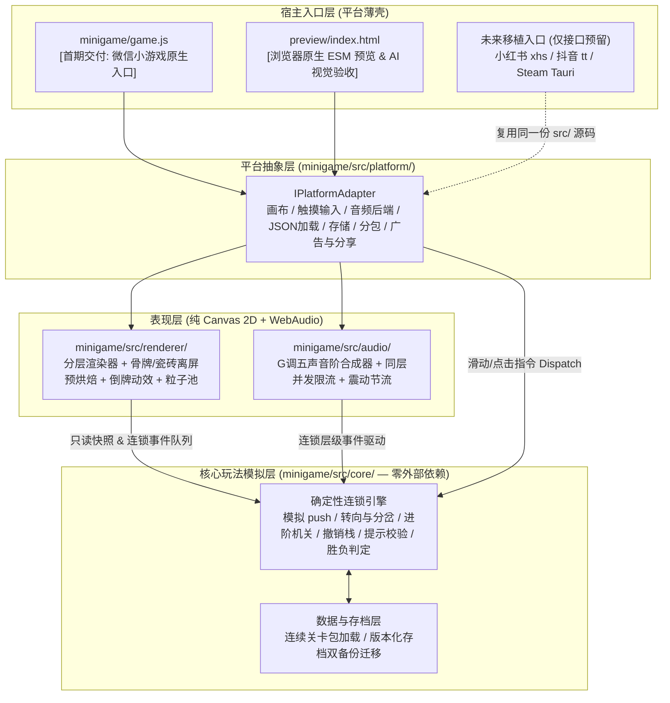

# 《推倒一幅画》技术架构与开发手册

| 文档属性 | 内容 |
| :--- | :--- |
| **项目名称** | 《推倒一幅画》 |
| **文档编号** | 04 |
| **当前版本** | `v0.1.0` |
| **项目阶段** | 立项策划期（开发前技术定稿） |
| **更新日期** | 2026-11-28 |
| **遵循规范** | 参见 `00_《推倒一幅画》项目文档版本号管理规范`、`01_《推倒一幅画》核心玩法策划案` |

---

## 1. 技术定位与核心架构原则

### 1.1 研发模式与目标平台边界
本项目采用 **AI 全程端到端编码、全文本原生工程** 模式，面向**轻量化竖屏多米诺连锁解压小游戏**构建自研轻量 2D 引擎：

* **首期唯一研发与发布端**：**微信小游戏原生工程**（`minigame/` 目录即为标准 `project.config.json` + `game.json` + `game.js` 工程，微信开发者工具直接打开即运行、预览与上传），单机本地存档，零服务端运维成本。
* **架构级无痛移植预留（首期仅做抽象隔离，不实现具体壳工程）**：
  * **小红书小游戏**（`xhs.*` Canvas 2D 运行时）
  * **抖音小游戏**（`tt.*` Canvas 2D 运行时）
  * **Steam 桌面端**（Windows / macOS / Steam Deck，基于 Tauri v2 或 Electron 容器 + Steamworks SDK 桥接）
* **本地预览与自动验收端**：`preview/` 静态入口页（通过浏览器原生 `<script type="module">` 直接加载 `minigame/src/` 同一份源码，供 AI 无头回归测试与人工即时试玩验收）。

### 1.2 五大架构红线
1. **标准原生 ES Module 直跑**：小游戏核心源码统一采用标准 JavaScript ES Module（显式 `.js` 相对路径），由微信开发者工具、浏览器预览与 Node.js 22 直接加载运行。
2. **静态类型契约检查**：全源码启用 `// @ts-check` 与 JSDoc 类型标注，配合仓库外置的 `types/*.d.ts` 类型声明与 `jsconfig.json`，在本地执行 `tsc -p jsconfig.json --noEmit` 完成全仓静态类型校验，防范跨轮次迭代中的字段误写与状态机分支遗漏。
3. **逻辑与表现绝对解耦，且模拟器三端同源**：`minigame/src/core/` 为 100% 纯逻辑确定性模拟层，零 Canvas / DOM / `wx` 依赖；**游戏运行时、离线关卡生成器、最少推力求解器**直接共享同一个 `simulatePush()` 函数，杜绝线上表现与验证结果偏差。
4. **高清矢量与像素瓷砖清晰渲染**：桌面、骨牌与像素画正面均采用离屏缓存与 DPR 精确缩放，圆角、符号与倒牌动效全程 60 FPS 无抖动，杜绝低端机每帧重算阴影导致的掉帧。
5. **玩法规则单一事实来源**：操作阈值、连锁加速公式、五声音阶音高、提示防刷规则与 E01～E10 边界验收标准均以 `01_《推倒一幅画》核心玩法策划案` 为准，代码通过统一配置表驱动并由自动化测试锁死回归。

---

## 2. 总体分层架构与原生工程目录规范

### 2.1 四层解耦架构图



### 2.2 仓库目录规范

核心隔离原则：**`minigame/` 内仅存放真机运行所需的纯净文件**，微信开发者工具直接导入 `minigame/` 即可运行与发布；所有开发辅助脚本、静态类型声明、自动化测试、像素画原稿与离线关卡生成工具统一置于 `minigame/` 之外。

```text
cheng-shi-qing-sao-dui/
├── docs/                                # 00~06 规范与策划/图集/技术/渲染文档
├── demo/                                # 浏览器直接可玩的单文件 HTML5 玩法原型
├── minigame/                            # 【微信开发者工具直接打开的原生小游戏工程目录】
│   ├── project.config.json              # 微信小游戏项目配置（启用原生 ES6/SWC 支持）
│   ├── game.json                        # 竖屏锁定 + 分包清单（subpackages）
│   ├── game.js                          # 极简入口（< 40 行：创建 WxAdapter 并调用 bootstrap）
│   ├── src/
│   │   ├── main.js                      # 宿主无关的引擎装配入口 bootstrap(adapter)
│   │   ├── core/                        # 纯 JS 确定性玩法核心（零平台/画布依赖）
│   │   │   ├── constants.js             # 基准手感与节奏参数（参见 01 策划案 §6.4）
│   │   │   ├── simulator.js             # simulatePush() 纯函数：BFS 逐层连锁与「已倒即挡」
│   │   │   ├── mechanisms/              # 进阶机关插件：重骨牌、弹簧牌、彩色闸门、桥牌、定时牌
│   │   │   ├── hint.js                  # 标准解路径前缀比对与手指演示坐标输出
│   │   │   ├── ftue.js                  # 第 1 关手指引导与第 2 关防卡死提示控制
│   │   │   ├── save.js                  # 版本化存档模型、双备份容错、迁移链
│   │   │   └── engine.js                # GameEngine 状态机（命令分发、撤销栈、演出时序、胜负）
│   │   ├── renderer/                    # Canvas 2D 分层渲染器、骨牌离屏贴图缓存、倒牌动画、粒子池、UI
│   │   ├── audio/                       # 程序化 G 调五声音阶木牌合成器 + 软限幅总线 + 震动节流
│   │   └── platform/                    # 平台适配目录（wx-adapter.js 等）
│   ├── assets/                          # 主包精简资产（核心 UI 图标、皮肤贴图、字库子集）
│   ├── levels/                          # 连续编号主包关卡数据（v1.0.0: levels_001_020.json）
│   └── subpackages/                     # v1.1+ 扩关与扩展皮肤分包预留目录（v1.0.0 无需分包）
├── preview/                             # 【本地 Web 预览与 AI 视觉测试入口】
│   ├── index.html                       # 原生 <script type="module"> 直连 ../minigame/src/main.js
│   ├── web-adapter.js                   # 浏览器 / 未来 Steam 桌面端平台适配器
│   └── serve.mjs                        # 约 30 行 Node 内置静态文件服务
├── types/                               # 外置静态类型契约（供本地 tsc 校验，不进入小游戏包）
│   ├── domain.d.ts                      # 骨牌、连锁事件、关卡 JSON、存档类型定义
│   ├── platform.d.ts                    # IPlatformAdapter 跨端平台接口契约
│   └── wx-minigame.d.ts                 # 微信小游戏 wx.* 精简类型声明
├── arts-src/                            # 像素画原稿与画作调色板清单（不进入小游戏包）
├── tests/                               # Node 内置测试（node --test）：模拟器 + 求解器 + E01~E10
├── tools/                               # 开发期离线工具（不进入小游戏包）
│   ├── generate-levels.mjs              # 像素画 → 连锁模拟生成 + 质量过滤 + BFS 最少推力证明
│   ├── verify-levels.mjs                # 关卡全量回归校验（标准解可达、最少推力紧界、尺寸合规）
│   └── verify-minigame.mjs              # 微信包体红线（主包 ≤4MB / 整包 ≤30MB）与非法全局扫描
├── jsconfig.json                        # 开启 checkJs + strict，供本地全仓静态类型校验
└── package.json                         # "type": "module" 与统一测试/校验脚本
```

### 2.3 技术栈选型基线

| 技术维度 | 选型方案 | 工程职责 |
| :--- | :--- | :--- |
| **源码语言与模块** | 原生 JavaScript（ES Module，显式 `.js` 后缀） | 微信小游戏、浏览器预览、Node.js 与后续多端直接原生运行同一份源码 |
| **静态类型校验** | `// @ts-check` + JSDoc + 外置 `types/*.d.ts` + `tsc --noEmit` | 开发期全仓静态类型校验，保障状态机与工具链契约一致 |
| **渲染方案** | 原生 Canvas 2D + 离屏预烘焙贴图缓存 | 全平台原生支持，冷启动快，骨牌立面与彩色瓷砖离线缓存一次复用 |
| **音频方案** | WebAudio API（`wx.createWebAudioContext`）+ 音频池降级 | 实时合成短促木牌撞击与 G 调五声音阶，体积接近 0 KB |
| **测试与 QA 工具链** | Node.js 22 内置 `node --test` + 无头 Chromium / Playwright | 负责无头逻辑单测、E01～E10 验收、关卡证明与多屏视觉回归 |

---

## 3. 竖屏坐标适配与手势输入体系

### 3.1 逻辑坐标系与自适应棋盘尺度
为兼顾 `01_《推倒一幅画》核心玩法策划案` 第 2 节的 **9:16 竖屏五区布局** 与 **5×6～12×12** 全尺度棋盘：

* **逻辑视口基准**：锁定逻辑宽度 `logicalW = 360px`（`9:16` 对应 `logicalH = 640px`，全面屏按 `Math.round(360 * screenH / screenW)` 弹性延伸至 `640～780px`），渲染画布按物理分辨率 `Math.floor(screenWidth * dpr)` 初始化并施加统一缩放 `ctx.scale(scale, scale)`。
* **微信胶囊避让**：通过 `platform.getViewportMetrics()` 动态读取右上角原生胶囊矩形，顶栏声音开关左移避开 `87×32pt` 净空区。
* **棋盘自适应单格公式**（严格对齐 `01` §2.2 与 `03` §3）：在 `360px` 逻辑宽屏下，左右外留白各 `6px`、木框 `6px`、绿呢内边距 `6px`（单侧共 `18px`，牌桌可用内宽 `tableInnerWidth = 324px`），按以下公式计算单格尺寸：
  ```javascript
  const gap = 3;
  const cellSize = Math.max(24, Math.min(58, Math.floor((tableInnerWidth - (W - 1) * gap) / W)));
  ```
  `12×12` 棋盘在 `360px` 宽屏上为 `floor((324 - 33) / 12) = 24px`，确保无横向滚动（覆盖验收标准 **E10**）。

### 3.2 按住滑动手势状态机
1. `pointerdown` 命中站立骨牌且 `!engine.busy && !engine.ended` 时记录起点 `(x0, y0)` 与 `cellIndex`，进入按压视觉态；若推力已为 0，弹 Toast 提示并返回。
2. `pointermove` 计算位移 `(dx, dy)`：当 `Math.max(|dx|, |dy|) >= 12`（逻辑像素）时判定主方向 `dir`（`'^' | '>' | 'v' | '<'`）；若目标为**转向牌**，强制覆盖为该牌自身箭头方向（覆盖 **E02**），并在牌面上方绘制预览箭头。
3. `pointerup`：
   * 已确定 `dir` → 派发 `PUSH_DOMINO` 命令；
   * 未达阈值但目标是**转向牌** → 直接以转向牌箭头方向派发 `PUSH_DOMINO`；
   * 未达阈值且目标是普通/分岔牌 → 不消耗推力，触发骨牌轻摇与滑动提示 Toast（覆盖 **E01**）。

---

## 4. 核心玩法模块与确定性连锁引擎（`minigame/src/core/`）

### 4.1 领域模型与命令-事件契约

```typescript
// types/domain.d.ts — 外置静态类型契约（不打入小游戏包）
export type Dir = '^' | '>' | 'v' | '<';
export type DominoKind =
  | 'NORMAL'   // '.' 普通牌
  | 'TURN'     // '^'|'>'|'v'|'<' 转向牌
  | 'SPLIT'    // '+' 分岔牌
  | 'HEAVY'    // 进阶：重骨牌 (hp=2)
  | 'SPRING'   // 进阶：弹簧牌 (反向弹回)
  | 'GATE'     // 进阶：彩色闸门 (同色全倒后开启)
  | 'BRIDGE'   // 进阶：桥牌 (不倒，越过传到再前一格)
  | 'TIMER';   // 进阶：定时牌 (延迟 N 层倒下)

export interface CascadeEvent {
  cellIndex: number;
  fallDir: Dir;       // 该骨牌实际倒向
  layer: number;      // 距起点的 BFS 层级 (0, 1, 2...)
  action: 'FALL' | 'CRACK' | 'PASS_BRIDGE' | 'GATE_OPEN';
}

export type GameCommand =
  | { type: 'PUSH_DOMINO'; cellIndex: number; dir: Dir }
  | { type: 'UNDO' }
  | { type: 'REQUEST_HINT' }
  | { type: 'RESET_LEVEL' }
  | { type: 'GRANT_EXTRA_PUSH' }   // 激励视频奖励 +1 推力
  | { type: 'SELECT_LEVEL'; levelId: number };

export type GameDomainEvent =
  | { type: 'CASCADE_STARTED'; pushIndex: number; events: CascadeEvent[]; totalFallen: number }
  | { type: 'CASCADE_STEP'; step: CascadeEvent; comboCount: number; layer: number }
  | { type: 'CASCADE_FINISHED'; chainSize: number; remainingStanding: number }
  | { type: 'UNDO_APPLIED'; restoredCells: number[] }
  | { type: 'HINT_SHOWN'; y: number; x: number; dir: Dir; hintsLeft: number }
  | { type: 'HINT_OFF_PATH' }
  | { type: 'LEVEL_WON'; levelId: number; pushesUsed: number; bestChain: number; isPerfect: boolean }
  | { type: 'LEVEL_FAILED'; remainingStanding: number };
```

### 4.2 确定性连锁模拟算法（`minigame/src/core/simulator.js`）

`simulatePush(level, boardState, y0, x0, d0)` 为纯函数，不修改入参，返回 `{ nextState, events }`。核心规则严格匹配 `01` 策划案 §3.3 与边界清单 **E04 / E05**：

```javascript
// 相对来向左右转 90°
const DIRS = ['^', '>', 'v', '<'];
const DV = { '^': [-1, 0], '>': [0, 1], 'v': [1, 0], '<': [0, -1] };
const turnLeft = d => DIRS[(DIRS.indexOf(d) + 3) % 4];
const turnRight = d => DIRS[(DIRS.indexOf(d) + 1) % 4];

/**
 * 基础三类骨牌 BFS 确定性连锁（进阶机关通过机制钩子在同一队列上扩展）
 */
export function simulatePush(H, W, present, types, fallen, y0, x0, d0) {
  const nextFallen = fallen.slice();
  const events = [];
  const queue = [[y0, x0, d0, 0]]; // [y, x, incomingDir, layer]

  for (let qi = 0; qi < queue.length; qi++) {
    const [y, x, d, layer] = queue[qi];
    if (y < 0 || x < 0 || y >= H || x >= W) continue;
    const i = y * W + x;
    if (!present[i] || nextFallen[i]) continue; // 空位或「已倒即挡」立即中断

    nextFallen[i] = 1;
    const tp = types[i];
    const fallDir = (tp === '.' || tp === '+') ? d : tp;
    events.push({ cellIndex: i, fallDir, layer, action: 'FALL' });

    const emits = tp === '+' ? [d, turnLeft(d), turnRight(d)] : [fallDir];
    for (const e of emits) {
      queue.push([y + DV[e][0], x + DV[e][1], e, layer + 1]);
    }
  }
  return { nextFallen, events };
}
```

* **确定性保证**：队列按固定顺序 `[前进, 左转, 右转]` 入队，同层多源撞击同一块骨牌时严格取先入队者（覆盖 **E05**）；越界、空位与已倒骨牌静默跳过（覆盖 **E04**）。
* **进阶机关扩展钩子**：
  * **重骨牌**：`hp` 数组初始为 `2`，第 1 次被撞仅减至 `1` 并输出 `CRACK` 事件不向外传播，第 2 次被撞才倒下传播；
  * **弹簧牌**：`emits = [opposite(d)]`；
  * **桥牌**：不可直推且不计入通关待倒总数；被撞时不置 `nextFallen[i] = 1`，直接以同向 `d` 推入下一格 `[y + dy, x + dx, d, layer + 1]`（带最大步数防环上限）；
  * **彩色闸门**：关闭期间不可直推且阻断撞击；每次 `FALL` 后检查场上剩余同色计数，归零瞬间激活闸门格转为可推可撞普通牌（计入通关待倒总数）；
  * **定时牌**：推入优先队列或按 `layer + delay` 分桶调度。

### 4.3 连锁时序加速、撤销栈、提示校验与胜负判定
1. **加速时序公式**（参见 `01` §6.1）：第 `t` 层的层间延迟为 `stepDelay(t) = Math.max(42, 130 * Math.pow(0.9, t))`（单位 ms）；演出总时长为末层触发时刻 `+ 380ms`。期间 `engine.busy = true`，屏蔽全部输入与工具按钮（覆盖 **E03**）。
2. **免费无限撤销栈**：每次推牌前将 `{ fallen, hp, gates, used }` 深拷贝压入 `history[]`；`UNDO` 弹出栈顶恢复状态并退出失败面板（覆盖 **E08**）。
3. **提示路径校验（`minigame/src/core/hint.js`）**：从初始状态依次重放关卡标准解 `sol[0 .. used - 1]`，与当前棋盘 `fallen` 比对：
   * 完全一致且 `hintsLeft > 0` → 扣减 1 次提示，返回 `sol[used]` 播放手指演示；
   * 已有偏差 → 触发 `HINT_OFF_PATH` 提示玩家先撤销，**不扣次数**（覆盖 **E07**）；
   * `RESET_LEVEL` 保留当前局剩余提示次数，仅切关或通关重玩时重置为 `3` 次（参见 `01` §5）。
4. **胜负优先级**：连锁结束后先统计站立骨牌数 `remainingStanding`——若为 `0` 立即判胜（覆盖 **E06**，即使此时 `used === limit`）；否则若 `used >= limit` 判负。

---

## 5. 离线关卡生成与最少推力证明工具（`tools/`）

为支撑数百关持续产出且 100% 可解，离线工具链直接导入 `minigame/src/core/simulator.js`：

### 5.1 关卡 JSON Schema（连续编号）

关卡以紧凑数组打包（`v1.0.0` 全 20 关打包为单文件 `minigame/levels/levels_001_020.json`，单关仅约 `300～500 B`，20 关合计仅 `~8 KB`；后续按百关拆包扩展）：

```json
{
  "schemaVersion": 1,
  "levelId": 5,
  "name": "小房子",
  "emoji": "🏠",
  "limit": 3,
  "art": [
    "....RR....",
    "...RRRR...",
    "..RRRRRR..",
    ".RRRRRRRR.",
    "RRRRRRRRRR",
    ".CCCCCCCC.",
    ".CBBCCYYC.",
    ".CBBCCYYC.",
    ".CBBCCCCC.",
    "GGBBGGGGGG"
  ],
  "types": [
    "    .<    ",
    "   v.+v   ",
    "  .+..>.  ",
    " v...^... ",
    ".+........",
    " >......v ",
    " ......<. ",
    " +.....^< ",
    " >......v ",
    "........+."
  ],
  "sol": [[7, 6, "<"], [3, 4, "<"], [3, 8, "<"]]
}
```

### 5.2 生成与验证管线（`tools/generate-levels.mjs` & `tools/verify-levels.mjs`）
1. **正向连锁生成**：读取 `arts-src/` 中的像素画字符矩阵与目标推力 `target`，按种子随机挑起点与方向执行连锁，在连锁经过未定型格子时根据前/左/右邻格空闲度按权重落入 `.`（普通）、`^>v<`（转向）或 `+`（分岔），直到全图推倒。
2. **体验质量门禁**：
   * 特殊牌占比处于 `8%～30%`；`target >= 2` 至少含 1 块分岔牌；
   * 每一推覆盖量常规 `≥ max(3, ceil(totalDominoes × 0.15))`（异形窄轮廓可放宽至 `≥ 10%` 且 `≥ 3` 块），杜绝「首推 70 块、后两推各 1 块」的畸形关卡；
   * 每关进阶机关种数 `≤ 2`。
3. **最少推力紧界证明（BFS 穷举求解器）**：以状态字符串 `fallen.join('')` 去重，在深度 `1 .. target - 1` 枚举所有合法单推，硬性断言 `target - 1` 推**无解**；若发现更短解则丢弃该种子继续搜索。
4. **全量 CI 校验（`verify-levels.mjs`）**：发版前验证全部关卡 `levelId` 连续唯一、宽高 `≤ 12×12`、标准解 `sol` 按顺序重放必推倒 100% 骨牌、`sol.length === limit`、且 `limit - 1` 推无解。

---

## 6. 高性能 Canvas 2D 渲染与程序化音频引擎

### 6.1 五层 Canvas 2D 渲染架构（`minigame/src/renderer/`）
详细像素色板、骨牌预烘焙与倒牌动效规格参见 [06_像素画与骨牌渲染实现方案](06_《推倒一幅画》像素画与骨牌渲染实现方案_v0.1.0.md)，引擎层按 5 层由底到顶合批绘制（单帧耗时 `< 3 ms`）：

| 层级 | 绘制内容 | 刷新策略 |
| :---: | :--- | :--- |
| **Layer 0** | 暖色背景、木框绿呢牌桌、细点纹底面 | 离屏画布静态缓存（仅切关或尺寸变化时重绘 1 次） |
| **Layer 1** | 已倒骨牌翻出的彩色像素画瓷砖 | 离屏脏格缓存（仅某格落定后绘制 1 次该格） |
| **Layer 2** | 站立骨牌（普通/转向/分岔/进阶机关）与按压位移、滑动方向预览箭头 | 仅绘制未倒格，直接从预烘焙单格离屏图集 `drawImage` |
| **Layer 3** | 正在倒下的骨牌动画（牌身压扁滑出 + 瓷砖弹入）、扬尘颗粒、通关波纹与彩纸 | 固定容量对象池（`256` 粒子，`swap-remove` 零 GC） |
| **Layer 4** | 顶栏、连续编号关卡条、推力槽、连击浮字、手指引导、底部工具栏与内联结算面板 | 统一命中盒（HitBox）表与脏标更新 |

### 6.2 程序化 G 调五声音阶音频与震动引擎（`minigame/src/audio/`）
完全对齐 `01` 策划案 §6.3，纯 WebAudio 实时合成，核心音效包体 `0 KB`：

```text
[短促带通噪声 (3200Hz, 30ms)] ──┐
[五声音阶正弦主音 + 4×泛音]     ├──▶ Master Soft Limiter (-1 dBTP) ──▶ Destination
[失败三角波 / 通关六音琶音]     ──┘
```

* **升调算法**：`PENTA = [1, 9/8, 5/4, 3/2, 5/3]`，基频 `392 Hz`（G4）；第 `layer` 层取 `n = layer < 12 ? layer : 10 + ((layer - 10) % 5)`，频率 `392 * PENTA[n % 5] * 2^floor(n / 5)`。
* **防爆音与节流**：同一 BFS 层最多触发 **2 声**骨牌音效（第 1 声增益 `1.0`，第 2 声 `0.6`，其余静音）；短震 `vibrateShort` 严格节流间隔 `≥ 45ms`。
* **微信生命周期安全**：监听 `onHide` / `onAudioInterruptionBegin` 自动挂起音频上下文，`onShow` 与首次触摸后恢复。

---

## 7. 版本化存档与平台抽象层

### 7.1 本地存档模型（`PlayerSaveV1`）

```typescript
// types/domain.d.ts
export interface PlayerSaveV1 {
  version: 1;
  updatedAt: number;
  highestUnlockedLevel: number;
  currentLevelId: number;
  clearedLevels: Record<number, { bestChain: number; perfect: boolean }>;
  globalBestChain: number;
  unlockedSkins: string[];
  equippedSkinId: string;
  equippedSoundPackId: string;
  settings: { muted: boolean; haptics: boolean };
  ftueCompleted: boolean;
}
```

* **双备份容错写入**：在安全边界（通关、切皮肤、改设置）先备份当前有效主档至 `save_v1_bak`，再覆盖写入 `save_v1_main` + CRC32 校验摘要；读取损坏时自动回退至 `.bak` 档。
* **版本迁移链**：启动时按纯函数迁移链 `MIGRATIONS[v -> v+1]` 顺序升级；预留 `ICloudSyncAdapter` 扩展点供后期接入微信云开发或 Steam Cloud。

### 7.2 统一平台契约（`IPlatformAdapter`）

业务层（`core` / `renderer` / `audio`）严禁直接调用 `wx.*`、`tt.*`、`xhs.*` 或浏览器 `window.*`，全部经由 `minigame/src/platform/` 抽象层接入：

| 能力域 | 抽象接口方法 | 微信小游戏（首期实装） | 小红书 / 抖音（预留） | Steam 桌面端（预留） |
| :--- | :--- | :--- | :--- | :--- |
| **主画布与离屏** | `createMainCanvas()` / `createOffscreenCanvas(w, h)` | `wx.createCanvas()` | `xhs` / `tt.createCanvas()` | `<canvas>` / `OffscreenCanvas` |
| **视口与胶囊避让** | `getViewportMetrics()` | `wx.getWindowInfo()` + `wx.getMenuButtonBoundingClientRect()` | 对应平台系统与胶囊 API | 窗口宽高（16:9 居中牌桌） |
| **帧循环与资源** | `requestAnimationFrame` / `loadJson` / `loadImage` | 全局 rAF / `wx.getFileSystemManager()` | 对应平台 FS API | 浏览器 rAF / `fetch()` |
| **输入** | `onPointerDown/Move/Up` | `wx.onTouchStart/Move/End` | `xhs` / `tt.onTouch*` | Pointer Events（鼠标/触控） |
| **音频与震动** | `createWebAudioContext()` / `vibrateShort()` | `wx.createWebAudioContext()` / `wx.vibrateShort` | 对应平台 Audio/Vibrate | 标准 `AudioContext` |
| **本地存档** | `readStorage` / `writeStorage` | `wx.getStorageSync` / `setStorageSync` | 对应平台 Storage | AppData 原子文件 + Steam Cloud |
| **广告与分享** | `showRewardedAd(slot)` / `shareImage(file)` | `wx.createRewardedVideoAd` / `wx.shareAppMessage` | 对应平台流量主与分享 | 买断制关闭广告；接入成就 |

### 7.3 首期微信包体预算（红线远低于平台上限）
* **微信平台上限**：主包 `≤ 4 MB`、整包 `≤ 30 MB`。
* **`v1.0.0`（20 关）实测预算**：原生 JS 源码（`~75 KB`）+ 核心 UI/3 套皮肤资源（`~25 KB`）+ 首发 20 关 JSON（`~8 KB`）+ 系统字体或轻量字库子集（`0～60 KB`）≈ **`110～170 KB`**，零分包秒开；`v1.1+` 扩至百关及新增皮肤包时再按需启用 `subpackages/`。
* **提审合规与降级**：激励广告与分享通过 `FeatureFlags` 开关控制（未开通流量主前零报错平滑降级，详见 `05_《推倒一幅画》提审运营与商业化方案`）；`minigame/` 内零 `eval`、零 `new Function`、零未备案外链请求。

---

## 8. 四级自动化验收门禁与研发里程碑

### 8.1 四级自动化门禁（每次交付前全部通过）

| 门禁级别 | 执行命令 | 校验内容与通过标准 |
| :---: | :--- | :--- |
| **L1 静态类型校验** | `npm run check:types` | `tsc -p jsconfig.json --noEmit` 断言 **0 类型错误、0 未处理枚举分支**。 |
| **L2 核心逻辑与边界单测** | `npm run test:core` | `node --test` 跑通：`simulatePush` 确定性、转向/分岔/进阶机关、撤销栈、提示路径比对、存档损坏回退、以及 **`01` 策划案 §8 全部 E01～E10 边界用例**。 |
| **L3 关卡紧界与视觉回归** | `npm run verify:levels && npm run test:visual` | 全量关卡标准解验证 + `limit - 1` 无解紧界验证 + 最小覆盖率校验；启动 `preview/serve.mjs` 无头跑通首关引导与通关流程并截屏复核，断言 0 控制台报错。 |
| **L4 微信原生包门禁** | `npm run verify:wx` | 扫描 `minigame/` 确认零非法全局引用（`document.` / `window.` / `eval(`）、全部相对路径带 `.js` 后缀、主包 `< 4 MB`。 |

### 8.2 分阶段交付里程碑

| 里程碑 | 文档基线 | 核心交付物与可验收闭环 |
| :--- | :---: | :--- |
| **M1：原生工程底座与确定性核心** | `v0.5.0` | 搭起 `minigame/` 原生工程、`types/*.d.ts`、`src/core/` 与 E01～E10 单测；交付 `generate-levels.mjs` 与 `verify-levels.mjs` 并生成验证通过的 `levels_001_020.json`。 |
| **M2：Canvas 2D 渲染与 20 关完整可玩版** | `v0.6.0` | 完成五层 Canvas 2D 渲染器、骨牌离屏预烘焙、G 调五声音阶合成器、`preview/` 预览页与 `1～20` 关全流程可玩闭环。 |
| **M3：微信真机适配、收集与商业化接入** | `v0.7.0` | 完成 `wx-adapter.js`（胶囊避让、触摸震动、激励广告 A1～A3 及无流量主降级、分享与 20 画拼贴海报、`wx.reportEvent` 埋点）、画廊图鉴、完美金框、3 套首发皮肤与第 20 关毕业承接页。 |
| **M4：合规自检、真机压测与 `v1.0.0` 上线** | `v0.9.0` → `v1.0.0` | 对照 `05` 提审 10 项红线逐条过检、中低端真机 60 FPS 与冷启动压测、提交备案/提审并正式发布 `v1.0.0`。 |
| **M5：`v1.1+` 进阶机关与百关扩关** | `v1.1.0+` | 验证首版留存与广告达标后，按 `02` 排期分批上线重骨牌、弹簧牌、彩色闸门、桥牌、定时牌并扩充至 150+ 关。 |

---

## 9. 版本修订记录

| 版本号 | 日期 | 修订摘要 |
| :---: | :---: | :--- |
| `v0.1.0` | 2026-11-28 | 《推倒一幅画》技术架构与开发手册立项初版定稿：确立微信小游戏原生 ES Module + Canvas 2D 架构、三端同源确定性连锁模拟器、扁平连续编号关卡生成与最少推力证明管线、程序化 G 调五声音阶音频及四级自动化验收门禁。 |
