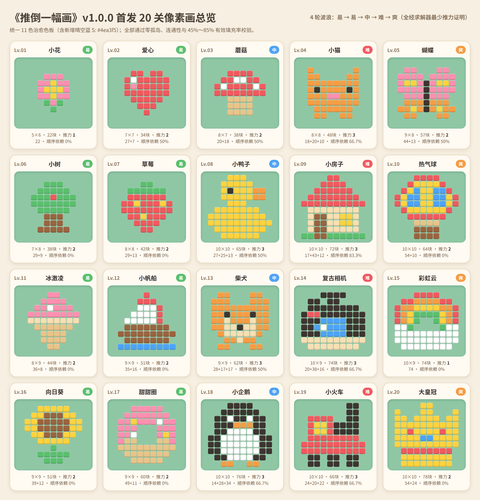

# 《推倒一幅画》首发 20 关关卡设计蓝图

| 文档属性 | 内容 |
| :--- | :--- |
| **项目名称** | 《推倒一幅画》 |
| **文档编号** | 07 |
| **当前版本** | `v0.1.0` |
| **项目阶段** | 立项策划期（开发前定稿） |
| **关联文档** | [00_项目文档版本号管理规范](00_《推倒一幅画》项目文档版本号管理规范_v0.1.0.md) · [01_核心玩法策划案](01_《推倒一幅画》核心玩法策划案_v0.1.0.md) · [02_关卡与数值策划案](02_《推倒一幅画》关卡与数值策划案_v0.1.0.md) · [04_技术架构与开发手册](04_《推倒一幅画》技术架构与开发手册_v0.1.0.md) · [06_像素画与骨牌渲染实现方案](06_《推倒一幅画》像素画与骨牌渲染实现方案_v0.1.0.md) |
| **更新日期** | 2026-11-28 |

---

## 1. 首发 20 关像素画总览与符号图例

本文档为 `v1.0.0` 首发全部 **20 关**的逐关精确设计蓝图（总计 **1116** 块骨牌，最高单推连倒 **×74** 见于 Lv.15 彩虹云）。全部 20 关均已通过 **5 条像素画红线**（零孤岛、连通性、45%～85% 有效填充率、2～5 色原创剪影）以及 **离线 BFS 求解器最少推力紧界证明**（用 `limit - 1` 推绝对无解），进入 M1 研发后可直接导出为 `minigame/levels/levels_001_020.json`。



### 符号与色码速查
* **骨牌牌型（`types`）**：`·` 空位 · `.` 普通牌（竖排双圆点）· `^` `>` `v` `<` 浅蓝转向牌 · `+` 亮橙分岔牌。
* **像素画色码（`art`，共 11 色）**：`R` 珊瑚红 `#ef5a5f` · `O` 暖橘橙 `#f59d45` · `Y` 鹅蛋黄 `#ffd23f` · `G` 嫩草绿 `#5bbf6e` · `P` 樱花粉 `#ff8fb0` · `C` 奶油米 `#f6dfb3` · `T` 浅驼褐 `#e8c48a` · `B` 焦糖棕 `#9a6440` · `K` 炭咖黑 `#3d3530` · `W` 纯净白 `#ffffff` · `S` 晴空蓝 `#4ea3f5`。

---

## 2. 全 20 关求解器实测总表

所有指标均由确定性模拟器与 BFS 求解器实测产出；`O` 为打乱标准解推序的失败比例，`S` 为全部合法首推中能导向 `L` 推通关的起手比例：

| 关号 | 档位 | 画作名 | 题材 | 尺寸 | 骨牌数 (填充率) | 推力 `L` | 特殊牌 (`P_spec`) | 各推覆盖拆解 | 链深 `D` | 顺序依赖 `O` | 首推容错 `S` |
| :---: | :---: | :--- | :---: | :---: | :---: | :---: | :---: | :---: | :---: | :---: | :---: |
| **1** | 易 | 🌸 小花 | 植物 | `5×6` | 22 (73.3%) | **1** | 1转+4岔 (22.7%) | `22` | 6 | 0% | 10.6% |
| **2** | 易 | ❤️ 爱心 | 符号 | `7×7` | 34 (69.4%) | **2** | 4转+5岔 (26.5%) | `27 + 7` | 6 | 50% | 7.3% |
| **3** | 中 | 🍄 蘑菇 | 植物 | `8×7` | 38 (67.9%) | **2** | 4转+7岔 (28.9%) | `20 + 18` | 12 | 50% | 3.6% |
| **4** | 难 | 🐱 小猫 | 动物 | `8×8` | 48 (75%) | **3** | 7转+4岔 (22.9%) | `18 + 20 + 10` | 17 | 66.7% | 1.2% |
| **5** | **爽** | 🦋 蝴蝶 | 动物 | `9×8` | 57 (79.2%) | **2** | 11转+6岔 (29.8%) | `44 + 13` | 19 | 50% | 0.5% |
| **6** | 易 | 🌳 小树 | 植物 | `7×8` | 38 (67.9%) | **2** | 5转+6岔 (28.9%) | `29 + 9` | 12 | 0% | 8.8% |
| **7** | 易 | 🍓 草莓 | 美食 | `8×8` | 42 (65.6%) | **2** | 4转+8岔 (28.6%) | `29 + 13` | 8 | 0% | 1.3% |
| **8** | 中 | 🐥 小鸭子 | 动物 | `10×10` | 65 (65%) | **3** | 6转+8岔 (21.5%) | `27 + 25 + 13` | 16 | 50% | 2.1% |
| **9** | 难 | 🏠 小房子 | 建筑 | `10×10` | 72 (72%) | **3** | 10转+7岔 (23.6%) | `17 + 43 + 12` | 23 | 83.3% | 0.4% |
| **10** | **爽** | 🎈 热气球 | 交通 | `10×10` | 64 (64%) | **2** | 9转+8岔 (26.6%) | `54 + 10` | 24 | 0% | 1.7% |
| **11** | 易 | 🍦 冰激凌 | 美食 | `8×9` | 44 (61.1%) | **2** | 7转+6岔 (29.5%) | `36 + 8` | 11 | 0% | 5.8% |
| **12** | 易 | ⛵ 小帆船 | 交通 | `9×9` | 51 (63%) | **2** | 8转+5岔 (25.5%) | `35 + 16` | 13 | 0% | 1.1% |
| **13** | 中 | 🐶 柴犬 | 动物 | `9×9` | 62 (76.5%) | **3** | 13转+5岔 (29%) | `28 + 17 + 17` | 11 | 50% | 5.3% |
| **14** | 难 | 📷 复古相机 | 日常 | `10×9` | 74 (82.2%) | **3** | 12转+8岔 (27%) | `20 + 38 + 16` | 19 | 66.7% | 0.8% |
| **15** | **爽** | 🌈 彩虹云 | 天象 | `10×9` | 74 (82.2%) | **1** | 10转+10岔 (27%) | `74` | 32 | 0% | 12% |
| **16** | 易 | 🌻 向日葵 | 植物 | `9×9` | 51 (63%) | **2** | 8转+7岔 (29.4%) | `39 + 12` | 11 | 0% | 3.3% |
| **17** | 易 | 🍩 甜甜圈 | 美食 | `9×9` | 60 (74.1%) | **2** | 10转+8岔 (30%) | `49 + 11` | 23 | 0% | 15.2% |
| **18** | 中 | 🐧 小企鹅 | 动物 | `10×10` | 76 (76%) | **3** | 15转+7岔 (28.9%) | `14 + 28 + 34` | 15 | 66.7% | 7.3% |
| **19** | 难 | 🚂 小火车 | 交通 | `10×10` | 66 (66%) | **3** | 10转+6岔 (24.2%) | `24 + 20 + 22` | 18 | 66.7% | 1.7% |
| **20** | **爽** | 👑 大皇冠 | 符号 | `10×10` | 78 (78%) | **2** | 14转+9岔 (29.5%) | `54 + 24` | 25 | 0% | 13.7% |

---

## 3. 逐关详细设计蓝图（Lv.01 ～ Lv.20）

### 3.1 第 1 轮波浪（Lv.01 ～ Lv.05）：新手启蒙与首次爽感释放

#### Lv.01 🌸 小花（易 · 植物）
* **基础规格**：`5×6` 网格 · 有效骨牌 **22** 块（填充率 `73.3%` · 3 色）· 推力上限 **1**（已证明 `0` 推无解）
* **难度实测**：特殊牌 `22.7%`（1 转向 + 4 分岔）· 最大/最小单推 `100% / 100%` · 最长链深 **6** 层 · 顺序依赖 `O = 0%` · 首推容错 `S = 10.6%`
* **设计意图**：FTUE 新手首关：1 推清屏，用手指动画引导玩家 3 秒学会按住滑动，直观认识普通牌、转向牌与分岔牌。
* **常见错路**：本关仅 1 推；若轻点普通牌未滑动则轻摇提示不扣推力。
* **标准解（`sol`）**：
  1. **第 1 推**：从 `(行 3, 列 0)` 向右 → → 连倒 **22** 块（100.0%，链深 6 层）

```text
像素画色码 (art)   │  骨牌牌型 (types)
──────────────────────┼────────────────────────
 0: · P P P ·   │   0: · . . . ·
 1: P P Y P P   │   1: . . . . .
 2: P Y Y Y P   │   2: . . . . .
 3: P P Y P P   │   3: + + + + ^
 4: · G P G ·   │   4: · . . . ·
 5: · · G · ·   │   5: · · . · ·
```

#### Lv.02 ❤️ 爱心（易 · 符号）
* **基础规格**：`7×7` 网格 · 有效骨牌 **34** 块（填充率 `69.4%` · 3 色）· 推力上限 **2**（已证明 `1` 推无解）
* **难度实测**：特殊牌 `26.5%`（4 转向 + 5 分岔）· 最大/最小单推 `79.4% / 20.6%` · 最长链深 **6** 层 · 顺序依赖 `O = 50%` · 首推容错 `S = 7.3%`
* **设计意图**：首次 2 推顺序教学：刻意保留 50% 顺序依赖，让玩家第一次亲身体验「已倒即挡」并自然学会免费撤销。
* **常见错路**：若先推第 2 推起点，会提前推倒交界通道导致第 1 推被挡死；点「撤销」换顺序即可顺畅通关。
* **标准解（`sol`）**：
  1. **第 1 推**：从 `(行 1, 列 4)` 向左 ← → 连倒 **27** 块（79.4%，链深 6 层）
  2. **第 2 推**：从 `(行 4, 列 5)` 向上 ↑ → 连倒 **7** 块（20.6%，链深 4 层）

```text
像素画色码 (art)       │  骨牌牌型 (types)
──────────────────────────┼────────────────────────────
 0: · R R · R R ·   │   0: · . . · > . ·
 1: R W R R R R R   │   1: v + + + + > .
 2: R P R R R R R   │   2: . . . . . + v
 3: R R R R R R R   │   3: . . . . . . .
 4: · R R R R R ·   │   4: · . . . . . ·
 5: · · R R R · ·   │   5: · · . . . · ·
 6: · · · R · · ·   │   6: · · · . · · ·
```

#### Lv.03 🍄 蘑菇（中 · 植物）
* **基础规格**：`8×7` 网格 · 有效骨牌 **38** 块（填充率 `67.9%` · 3 色）· 推力上限 **2**（已证明 `1` 推无解）
* **难度实测**：特殊牌 `28.9%`（4 转向 + 7 分岔）· 最大/最小单推 `52.6% / 47.4%` · 最长链深 **12** 层 · 顺序依赖 `O = 50%` · 首推容错 `S = 3.6%`
* **设计意图**：转向折返训练：通过帽檐与边缘转向牌让连锁拐弯包抄伞盖与菌柄，过渡到中等思考深度。
* **常见错路**：注意先清大块主链再补剩余区，避免把转向入口提前封死。
* **标准解（`sol`）**：
  1. **第 1 推**：从 `(行 2, 列 0)` 向右 → → 连倒 **20** 块（52.6%，链深 12 层）
  2. **第 2 推**：从 `(行 6, 列 4)` 向上 ↑ → 连倒 **18** 块（47.4%，链深 7 层）

```text
像素画色码 (art)         │  骨牌牌型 (types)
────────────────────────────┼──────────────────────────────
 0: · · R R R R · ·   │   0: · · . . + . · ·
 1: · R R W W R R ·   │   1: · . . . + . < ·
 2: R W R R R R W R   │   2: . . . . . . + v
 3: R R R R R R R R   │   3: . . . . + v . .
 4: · · T T T T · ·   │   4: · · . . . . · ·
 5: · · T T T T · ·   │   5: · · + + + v · ·
 6: · · T T T T · ·   │   6: · · . . . . · ·
```

#### Lv.04 🐱 小猫（难 · 动物）
* **基础规格**：`8×8` 网格 · 有效骨牌 **48** 块（填充率 `75%` · 3 色）· 推力上限 **3**（已证明 `2` 推无解）
* **难度实测**：特殊牌 `22.9%`（7 转向 + 4 分岔）· 最大/最小单推 `41.7% / 20.8%` · 最长链深 **17** 层 · 顺序依赖 `O = 66.7%` · 首推容错 `S = 1.2%`
* **设计意图**：首次 3 推挑战：异形猫耳轮廓形成天然孤角，高顺序依赖要求先规划长链路再收尾双耳。
* **常见错路**：猫耳与双脚位置容易被中间先倒的骨牌隔断，推序错误极易剩 3～6 块。
* **标准解（`sol`）**：
  1. **第 1 推**：从 `(行 0, 列 7)` 向下 ↓ → 连倒 **18** 块（37.5%，链深 17 层）
  2. **第 2 推**：从 `(行 1, 列 6)` 向下 ↓ → 连倒 **20** 块（41.7%，链深 9 层）
  3. **第 3 推**：从 `(行 7, 列 2)` 向上 ↑ → 连倒 **10** 块（20.8%，链深 7 层）

```text
像素画色码 (art)         │  骨牌牌型 (types)
────────────────────────────┼──────────────────────────────
 0: O · · · · · · O   │   0: . · · · · · · .
 1: O O · · · · O O   │   1: . . · · · · . .
 2: O O O O O O O O   │   2: . . . . + . . .
 3: O K O O O O K O   │   3: . ^ . . + . < .
 4: O O O P P O O O   │   4: . . . . + . . .
 5: O O O O O O O O   │   5: ^ . . . . . . <
 6: · O O O O O O ·   │   6: · v + . . . v ·
 7: · O O · · O O ·   │   7: · . . · · . < ·
```

#### Lv.05 🦋 蝴蝶（爽 · 动物）
* **基础规格**：`9×8` 网格 · 有效骨牌 **57** 块（填充率 `79.2%` · 4 色）· 推力上限 **2**（已证明 `1` 推无解）
* **难度实测**：特殊牌 `29.8%`（11 转向 + 6 分岔）· 最大/最小单推 `77.2% / 22.8%` · 最长链深 **19** 层 · 顺序依赖 `O = 50%` · 首推容错 `S = 0.5%`
* **设计意图**：第 1 个逢 5 大连锁爽关：双翅分岔爆发，首推倾泻 60%+ 骨牌，集中释放前 4 关积累的解压感。
* **常见错路**：优先寻找连通蝶身与主翅的分岔入口，顺手即得高连击。
* **标准解（`sol`）**：
  1. **第 1 推**：从 `(行 2, 列 2)` 向右 → → 连倒 **44** 块（77.2%，链深 19 层）
  2. **第 2 推**：从 `(行 1, 列 8)` 向下 ↓ → 连倒 **13** 块（22.8%，链深 7 层）

```text
像素画色码 (art)           │  骨牌牌型 (types)
──────────────────────────────┼────────────────────────────────
 0: · P P · · · P P ·   │   0: · v < · · · v < ·
 1: P P P P · P P P P   │   1: . . . . · . < . .
 2: P Y Y P K P Y Y P   │   2: . . ^ ^ . . . + <
 3: P P P P K P P P P   │   3: ^ + . . . . . . .
 4: · P P P K P P P ·   │   4: · + . . . . . . ·
 5: · O O O K O O O ·   │   5: · . . . . . < . ·
 6: O O Y O K O Y O O   │   6: . + . . . . + + .
 7: · O O · · · O O ·   │   7: · > . · · · . . ·
```

---

### 3.2 第 2 轮波浪（Lv.06 ～ Lv.10）：进阶构型与首次超级连锁

#### Lv.06 🌳 小树（易 · 植物）
* **基础规格**：`7×8` 网格 · 有效骨牌 **38** 块（填充率 `67.9%` · 3 色）· 推力上限 **2**（已证明 `1` 推无解）
* **难度实测**：特殊牌 `28.9%`（5 转向 + 6 分岔）· 最大/最小单推 `76.3% / 23.7%` · 最长链深 **12** 层 · 顺序依赖 `O = 0%` · 首推容错 `S = 8.8%`
* **设计意图**：爽关后的轻松过渡：树冠与树干分区清晰，2 推低门槛维持流畅心流。
* **常见错路**：树干入口较窄，留心从树冠顺带穿入或单独 1 推收口。
* **标准解（`sol`）**：
  1. **第 1 推**：从 `(行 2, 列 4)` 向左 ← → 连倒 **29** 块（76.3%，链深 12 层）
  2. **第 2 推**：从 `(行 6, 列 4)` 向上 ↑ → 连倒 **9** 块（23.7%，链深 6 层）

```text
像素画色码 (art)       │  骨牌牌型 (types)
──────────────────────────┼────────────────────────────
 0: · · G G G · ·   │   0: · · > . v · ·
 1: · G G G G G ·   │   1: · . . . + . ·
 2: G G G R G G G   │   2: v + + . . . .
 3: G G G G G G G   │   3: . . . . > + ^
 4: · G G G G G ·   │   4: · . . . . . ·
 5: · · B B B · ·   │   5: · · . . . · ·
 6: · · B B B · ·   │   6: · · . . . · ·
 7: · B B B B B ·   │   7: · . + + . . ·
```

#### Lv.07 🍓 草莓（易 · 美食）
* **基础规格**：`8×8` 网格 · 有效骨牌 **42** 块（填充率 `65.6%` · 3 色）· 推力上限 **2**（已证明 `1` 推无解）
* **难度实测**：特殊牌 `28.6%`（4 转向 + 8 分岔）· 最大/最小单推 `69% / 31%` · 最长链深 **8** 层 · 顺序依赖 `O = 0%` · 首推容错 `S = 1.3%`
* **设计意图**：明快红绿高饱和成画：强化「倒牌显色」的收集愉悦，2 推结构友好。
* **常见错路**：顶部绿叶与果身衔接处有转向引导，沿边缘试推容错较高。
* **标准解（`sol`）**：
  1. **第 1 推**：从 `(行 0, 列 3)` 向右 → → 连倒 **29** 块（69.0%，链深 8 层）
  2. **第 2 推**：从 `(行 3, 列 5)` 向右 → → 连倒 **13** 块（31.0%，链深 3 层）

```text
像素画色码 (art)         │  骨牌牌型 (types)
────────────────────────────┼──────────────────────────────
 0: · · · G G · · ·   │   0: · · · + v · · ·
 1: · G G G G G G ·   │   1: · v + + . . . ·
 2: · R R R R R R ·   │   2: · . . . . . . ·
 3: R R Y R R R Y R   │   3: . < . . . + + v
 4: R R R R R R R R   │   4: . . . + . . . .
 5: · R R Y R R R ·   │   5: · . . + . . . ·
 6: · · R R R R · ·   │   6: · · . + . . · ·
 7: · · · R R · · ·   │   7: · · · . . · · ·
```

#### Lv.08 🐥 小鸭子（中 · 动物）
* **基础规格**：`10×10` 网格 · 有效骨牌 **65** 块（填充率 `65%` · 3 色）· 推力上限 **3**（已证明 `2` 推无解）
* **难度实测**：特殊牌 `21.5%`（6 转向 + 8 分岔）· 最大/最小单推 `41.5% / 20%` · 最长链深 **16** 层 · 顺序依赖 `O = 50%` · 首推容错 `S = 2.1%`
* **设计意图**：首次踏入 10×10 大画幅：引导玩家学会在更多骨牌中先找高分岔长链路。
* **常见错路**：鸭头与鸭身由细颈相连，需按正确顺序贯通颈部通道。
* **标准解（`sol`）**：
  1. **第 1 推**：从 `(行 8, 列 8)` 向上 ↑ → 连倒 **27** 块（41.5%，链深 16 层）
  2. **第 2 推**：从 `(行 4, 列 5)` 向左 ← → 连倒 **25** 块（38.5%，链深 9 层）
  3. **第 3 推**：从 `(行 8, 列 1)` 向右 → → 连倒 **13** 块（20.0%，链深 7 层）

```text
像素画色码 (art)             │  骨牌牌型 (types)
────────────────────────────────┼──────────────────────────────────
 0: · · · Y Y Y · · · ·   │   0: · · · > . . · · · ·
 1: · · Y Y Y Y Y · · ·   │   1: · · . . . + . · · ·
 2: · · Y K Y Y Y O O ·   │   2: · · . . . + . . . ·
 3: · · Y Y Y Y Y O O ·   │   3: · · ^ + . + . . . ·
 4: · · · Y Y Y · · · ·   │   4: · · · ^ . . · · · ·
 5: · Y Y Y Y Y Y Y · ·   │   5: · > . . . . . . · ·
 6: Y Y Y Y Y Y Y Y Y ·   │   6: . + . . . . . . < ·
 7: Y Y Y Y Y Y Y Y Y Y   │   7: . . . . . . . . + .
 8: · Y Y Y Y Y Y Y Y ·   │   8: · . + + . . . . . ·
 9: · · Y Y Y Y Y Y · ·   │   9: · · . > . . . . · ·
```

#### Lv.09 🏠 小房子（难 · 建筑）
* **基础规格**：`10×10` 网格 · 有效骨牌 **72** 块（填充率 `72%` · 5 色）· 推力上限 **3**（已证明 `2` 推无解）
* **难度实测**：特殊牌 `23.6%`（10 转向 + 7 分岔）· 最大/最小单推 `59.7% / 16.7%` · 最长链深 **23** 层 · 顺序依赖 `O = 83.3%` · 首推容错 `S = 0.4%`
* **设计意图**：中段核心思考高潮：屋顶三角区与房身矩形区交错依赖，3 推强顺序博弈。
* **常见错路**：若先截断屋檐衔接层，会导致顶部屋脊被拆成孤立碎块。
* **标准解（`sol`）**：
  1. **第 1 推**：从 `(行 3, 列 1)` 向右 → → 连倒 **17** 块（23.6%，链深 12 层）
  2. **第 2 推**：从 `(行 9, 列 9)` 向左 ← → 连倒 **43** 块（59.7%，链深 23 层）
  3. **第 3 推**：从 `(行 8, 列 5)` 向上 ↑ → 连倒 **12** 块（16.7%，链深 5 层）

```text
像素画色码 (art)             │  骨牌牌型 (types)
────────────────────────────────┼──────────────────────────────────
 0: · · · · R R · · · ·   │   0: · · · · . < · · · ·
 1: · · · R R R R · · ·   │   1: · · · . . + < · · ·
 2: · · R R R R R R · ·   │   2: · · . . . < . . · ·
 3: · R R R R R R R R ·   │   3: · . . . . . ^ . . ·
 4: R R R R R R R R R R   │   4: . . . + . . . + + .
 5: · C C C C C C C C ·   │   5: · > v . . > . . . ·
 6: · C B B C C Y Y C ·   │   6: · . . . + + v . . ·
 7: · C B B C C Y Y C ·   │   7: · . . . . . . . . ·
 8: · C B B C C C C C ·   │   8: · ^ . < . . . . . ·
 9: G G B B G G G G G G   │   9: . . . . . . . . + .
```

#### Lv.10 🎈 热气球（爽 · 交通）
* **基础规格**：`10×10` 网格 · 有效骨牌 **64** 块（填充率 `64%` · 5 色）· 推力上限 **2**（已证明 `1` 推无解）
* **难度实测**：特殊牌 `26.6%`（9 转向 + 8 分岔）· 最大/最小单推 `84.4% / 15.6%` · 最长链深 **24** 层 · 顺序依赖 `O = 0%` · 首推容错 `S = 1.7%`
* **设计意图**：第 2 个逢 5 大连锁爽关：大画幅单推突破 40+ 连击，首次触发「超级连锁！」与牌桌震动。
* **常见错路**：气球主囊分岔密集，一推扫穿主囊后顺手收掉吊篮即可。
* **标准解（`sol`）**：
  1. **第 1 推**：从 `(行 2, 列 7)` 向左 ← → 连倒 **54** 块（84.4%，链深 24 层）
  2. **第 2 推**：从 `(行 0, 列 5)` 向下 ↓ → 连倒 **10** 块（15.6%，链深 4 层）

```text
像素画色码 (art)             │  骨牌牌型 (types)
────────────────────────────────┼──────────────────────────────────
 0: · · · R R R R · · ·   │   0: · · · . . + v · · ·
 1: · · R Y Y Y Y R · ·   │   1: · · . . . < > . · ·
 2: · R Y S Y Y S S R ·   │   2: · v . . . . . . . ·
 3: R Y S S Y Y S S Y R   │   3: . . . . . . . . + <
 4: R Y S S Y Y S S Y R   │   4: ^ + . . . . . . . ^
 5: · R Y Y Y Y Y Y R ·   │   5: · > + . . . . . . ·
 6: · · R R R R R R · ·   │   6: · · > . + . . . · ·
 7: · · · T T T T · · ·   │   7: · · · . + . . · · ·
 8: · · · B B B B · · ·   │   8: · · · . + . . · · ·
 9: · · · B B B B · · ·   │   9: · · · . + . . · · ·
```

---

### 3.3 第 3 轮波浪（Lv.11 ～ Lv.15）：多元轮廓与单推清屏高光

#### Lv.11 🍦 冰激凌（易 · 美食）
* **基础规格**：`8×9` 网格 · 有效骨牌 **44** 块（填充率 `61.1%` · 4 色）· 推力上限 **2**（已证明 `1` 推无解）
* **难度实测**：特殊牌 `29.5%`（7 转向 + 6 分岔）· 最大/最小单推 `81.8% / 18.2%` · 最长链深 **11** 层 · 顺序依赖 `O = 0%` · 首推容错 `S = 5.8%`
* **设计意图**：甜品主题轻松调剂：蛋筒与冰激凌球层次分明，2 推节奏明快。
* **常见错路**：尖锥底端收窄，适合由主链顺推收尾而非从底尖起手。
* **标准解（`sol`）**：
  1. **第 1 推**：从 `(行 3, 列 7)` 向左 ← → 连倒 **36** 块（81.8%，链深 11 层）
  2. **第 2 推**：从 `(行 6, 列 3)` 向左 ← → 连倒 **8** 块（18.2%，链深 3 层）

```text
像素画色码 (art)         │  骨牌牌型 (types)
────────────────────────────┼──────────────────────────────
 0: · · · P P · · ·   │   0: · · · v < · · ·
 1: · · P P P P · ·   │   1: · · . + . . · ·
 2: · P P W P P P ·   │   2: · . . < . . . ·
 3: P P P P P P P P   │   3: v . . . + + + +
 4: C C C C C C C C   │   4: > . . . . . . .
 5: · T T T T T T ·   │   5: · . . < . . . ·
 6: · · T T T T · ·   │   6: · · v + . . · ·
 7: · · T T T T · ·   │   7: · · . . . . · ·
 8: · · · T T · · ·   │   8: · · · . . · · ·
```

#### Lv.12 ⛵ 小帆船（易 · 交通）
* **基础规格**：`9×9` 网格 · 有效骨牌 **51** 块（填充率 `63%` · 4 色）· 推力上限 **2**（已证明 `1` 推无解）
* **难度实测**：特殊牌 `25.5%`（8 转向 + 5 分岔）· 最大/最小单推 `68.6% / 31.4%` · 最长链深 **13** 层 · 顺序依赖 `O = 0%` · 首推容错 `S = 1.1%`
* **设计意图**：帆面、船体与蓝色海浪三段色块分明，2 推畅快显画。
* **常见错路**：留意船帆与船身交界转向牌方向，避免先清海浪阻断下行路。
* **标准解（`sol`）**：
  1. **第 1 推**：从 `(行 4, 列 3)` 向左 ← → 连倒 **35** 块（68.6%，链深 13 层）
  2. **第 2 推**：从 `(行 0, 列 4)` 向下 ↓ → 连倒 **16** 块（31.4%，链深 6 层）

```text
像素画色码 (art)           │  骨牌牌型 (types)
──────────────────────────────┼────────────────────────────────
 0: · · · · R · · · ·   │   0: · · · · . · · · ·
 1: · · · R R R · · ·   │   1: · · · v + v · · ·
 2: · · · W W W R · ·   │   2: · · · . . . . · ·
 3: · · W W W W R · ·   │   3: · · . < . > ^ · ·
 4: · W W W W W R · ·   │   4: · v . . > . . · ·
 5: · B B B B B B B ·   │   5: · + . . . . . . ·
 6: B B B B B B B B B   │   6: . + + . . . . . .
 7: · B B B B B B B ·   │   7: · . > . . . . . ·
 8: S S S S S S S S S   │   8: . + . . . . . . .
```

#### Lv.13 🐶 柴犬（中 · 动物）
* **基础规格**：`9×9` 网格 · 有效骨牌 **62** 块（填充率 `76.5%` · 3 色）· 推力上限 **3**（已证明 `2` 推无解）
* **难度实测**：特殊牌 `29%`（13 转向 + 5 分岔）· 最大/最小单推 `45.2% / 27.4%` · 最长链深 **11** 层 · 顺序依赖 `O = 50%` · 首推容错 `S = 5.3%`
* **设计意图**：中度顺序依赖 3 推关：柴犬双耳与小爪增加局部死角，巩固 3 推规划能力。
* **常见错路**：先保连通耳根的长链路，再处理脸颊与下巴剩余区。
* **标准解（`sol`）**：
  1. **第 1 推**：从 `(行 4, 列 8)` 向上 ↑ → 连倒 **28** 块（45.2%，链深 11 层）
  2. **第 2 推**：从 `(行 6, 列 7)` 向左 ← → 连倒 **17** 块（27.4%，链深 10 层）
  3. **第 3 推**：从 `(行 3, 列 5)` 向上 ↑ → 连倒 **17** 块（27.4%，链深 9 层）

```text
像素画色码 (art)           │  骨牌牌型 (types)
──────────────────────────────┼────────────────────────────────
 0: · O O · · · O O ·   │   0: · . . · · · > . ·
 1: O O O · · · O O O   │   1: . . . · · · ^ . <
 2: O O O O O O O O O   │   2: . . . > . > . . ^
 3: O O K O O O K O O   │   3: . . . ^ . + . . .
 4: O O C O O O C O O   │   4: + + + . . . . . <
 5: O O C C K C C O O   │   5: . . . > . . . . .
 6: · O C C C C C O ·   │   6: · . . + . . . . ·
 7: · · O O C O O · ·   │   7: · · . > . . v · ·
 8: · O O · · · O O ·   │   8: · . < · · · > . ·
```

#### Lv.14 📷 复古相机（难 · 日常）
* **基础规格**：`10×9` 网格 · 有效骨牌 **74** 块（填充率 `82.2%` · 5 色）· 推力上限 **3**（已证明 `2` 推无解）
* **难度实测**：特殊牌 `27%`（12 转向 + 8 分岔）· 最大/最小单推 `51.4% / 21.6%` · 最长链深 **19** 层 · 顺序依赖 `O = 66.7%` · 首推容错 `S = 0.8%`
* **设计意图**：后半段高难思考关：机身矩形饱满、顶部快门与取景器凹凸形成强先后依赖。
* **常见错路**：镜头中区若过早推平会切断通向顶部快门的通道。
* **标准解（`sol`）**：
  1. **第 1 推**：从 `(行 4, 列 0)` 向右 → → 连倒 **20** 块（27.0%，链深 19 层）
  2. **第 2 推**：从 `(行 7, 列 6)` 向上 ↑ → 连倒 **38** 块（51.4%，链深 16 层）
  3. **第 3 推**：从 `(行 1, 列 5)` 向左 ← → 连倒 **16** 块（21.6%，链深 7 层）

```text
像素画色码 (art)             │  骨牌牌型 (types)
────────────────────────────────┼──────────────────────────────────
 0: · · · K K K K · · ·   │   0: · · · . + . . · · ·
 1: · K K · K K · · · ·   │   1: · > . · + . · · · ·
 2: · K K K K K K K K ·   │   2: · ^ . . + . . . . ·
 3: K R R K K K K K K K   │   3: . . . . . . . . . <
 4: K K K S S S S K K K   │   4: . . . . . . . . . ^
 5: K K S W S S S K K K   │   5: . . . . . + + . . v
 6: K K K S S S S K K K   │   6: v + + . . . . . . .
 7: C C C C C C C C C C   │   7: . . > . . . . ^ + <
 8: · C C C C C C C C ·   │   8: · ^ . . . < . . < ·
```

#### Lv.15 🌈 彩虹云（爽 · 天象）
* **基础规格**：`10×9` 网格 · 有效骨牌 **74** 块（填充率 `82.2%` · 5 色）· 推力上限 **1**（已证明 `0` 推无解）
* **难度实测**：特殊牌 `27%`（10 转向 + 10 分岔）· 最大/最小单推 `100% / 100%` · 最长链深 **32** 层 · 顺序依赖 `O = 0%` · 首推容错 `S = 12%`
* **设计意图**：全版唯一「1 推全灭 70 块」终极爽关：五声音阶从头飙到尾，核心短视频引流与分享爆款关。
* **常见错路**：虽仅 1 推，但需沿彩虹弧与云底找准唯一/少数全通起手点。
* **标准解（`sol`）**：
  1. **第 1 推**：从 `(行 8, 列 5)` 向左 ← → 连倒 **74** 块（100.0%，链深 32 层）

```text
像素画色码 (art)             │  骨牌牌型 (types)
────────────────────────────────┼──────────────────────────────────
 0: · · · R R R R · · ·   │   0: · · · . . . < · · ·
 1: · R R O O O O R R ·   │   1: · . + . . . + . . ·
 2: R O O Y Y Y Y O O R   │   2: . . + . . . . . . .
 3: R O Y G G G G Y O R   │   3: v + + + . . . . . v
 4: R O Y G · · G Y O R   │   4: . . . . · · . + . .
 5: W W G · · · · G W W   │   5: > . ^ · · · · . . .
 6: W W W W W W W W W W   │   6: . . . . . . . + ^ .
 7: W W W W W W W W W W   │   7: ^ < . . . . . + . <
 8: · W W W W W W W W ·   │   8: · ^ . . . . . + . ·
```

---

### 3.4 第 4 轮波浪（Lv.16 ～ Lv.20）：环形巧思与首版毕业收官

#### Lv.16 🌻 向日葵（易 · 植物）
* **基础规格**：`9×9` 网格 · 有效骨牌 **51** 块（填充率 `63%` · 3 色）· 推力上限 **2**（已证明 `1` 推无解）
* **难度实测**：特殊牌 `29.4%`（8 转向 + 7 分岔）· 最大/最小单推 `76.5% / 23.5%` · 最长链深 **11** 层 · 顺序依赖 `O = 0%` · 首推容错 `S = 3.3%`
* **设计意图**：收官轮热身关：花盘圆润、茎叶清晰，2 推快速进入最后冲刺节奏。
* **常见错路**：茎部仅 1 格宽，须由主链顺势打通或单独从叶基起推。
* **标准解（`sol`）**：
  1. **第 1 推**：从 `(行 1, 列 7)` 向下 ↓ → 连倒 **39** 块（76.5%，链深 11 层）
  2. **第 2 推**：从 `(行 8, 列 5)` 向左 ← → 连倒 **12** 块（23.5%，链深 6 层）

```text
像素画色码 (art)           │  骨牌牌型 (types)
──────────────────────────────┼────────────────────────────────
 0: · · Y Y Y Y Y · ·   │   0: · · v . . < . · ·
 1: · Y Y B B B Y Y ·   │   1: · . + . . . . . ·
 2: Y Y B B B B B Y Y   │   2: . . . . . + + + v
 3: Y Y B B B B B Y Y   │   3: . . . . . < . . .
 4: · Y Y B B B Y Y ·   │   4: · . . + . . . < ·
 5: · · Y Y Y Y Y · ·   │   5: · · . < > . . · ·
 6: · · · · G · · · ·   │   6: · · · · . · · · ·
 7: · · G G G G G · ·   │   7: · · . < + . . · ·
 8: · · · G G G · · ·   │   8: · · · . + . · · ·
```

#### Lv.17 🍩 甜甜圈（易 · 美食）
* **基础规格**：`9×9` 网格 · 有效骨牌 **60** 块（填充率 `74.1%` · 4 色）· 推力上限 **2**（已证明 `1` 推无解）
* **难度实测**：特殊牌 `30%`（10 转向 + 8 分岔）· 最大/最小单推 `81.7% / 18.3%` · 最长链深 **23** 层 · 顺序依赖 `O = 0%` · 首推容错 `S = 15.2%`
* **设计意图**：中空环形新鲜构型：甜甜圈中央留空，连锁绕环形赛道顺畅扫荡。
* **常见错路**：中空洞会中断直行连锁，善用外圈转向牌绕行糖霜环。
* **标准解（`sol`）**：
  1. **第 1 推**：从 `(行 5, 列 6)` 向下 ↓ → 连倒 **49** 块（81.7%，链深 23 层）
  2. **第 2 推**：从 `(行 7, 列 7)` 向上 ↑ → 连倒 **11** 块（18.3%，链深 9 层）

```text
像素画色码 (art)           │  骨牌牌型 (types)
──────────────────────────────┼────────────────────────────────
 0: · · P P P P P · ·   │   0: · · > . . . . · ·
 1: · P P P P P P P ·   │   1: · > + . . . + . ·
 2: P P Y P P P W P P   │   2: . . > . . . . v <
 3: P P P · · · P P P   │   3: + + < · · · . . .
 4: P P W · · · P Y P   │   4: . . . · · · . . .
 5: P T T · · · T T P   │   5: . . . · · · . > +
 6: T T T T T T T T T   │   6: . . . . + v . . .
 7: · T T T T T T T ·   │   7: · . + . . . . . ·
 8: · · T T T T T · ·   │   8: · · ^ . + . < · ·
```

#### Lv.18 🐧 小企鹅（中 · 动物）
* **基础规格**：`10×10` 网格 · 有效骨牌 **76** 块（填充率 `76%` · 3 色）· 推力上限 **3**（已证明 `2` 推无解）
* **难度实测**：特殊牌 `28.9%`（15 转向 + 7 分岔）· 最大/最小单推 `44.7% / 18.4%` · 最长链深 **15** 层 · 顺序依赖 `O = 66.7%` · 首推容错 `S = 7.3%`
* **设计意图**：黑白橘企鹅 3 推中难关：大面积企鹅腹白配双脚收口，层次清晰。
* **常见错路**：双脚在底部呈对称分支，避免主推提前堵住通往脚部的下口。
* **标准解（`sol`）**：
  1. **第 1 推**：从 `(行 7, 列 0)` 向上 ↑ → 连倒 **14** 块（18.4%，链深 13 层）
  2. **第 2 推**：从 `(行 7, 列 6)` 向右 → → 连倒 **28** 块（36.8%，链深 15 层）
  3. **第 3 推**：从 `(行 3, 列 5)` 向右 → → 连倒 **34** 块（44.7%，链深 14 层）

```text
像素画色码 (art)             │  骨牌牌型 (types)
────────────────────────────────┼──────────────────────────────────
 0: · · · K K K K · · ·   │   0: · · · > . . . · · ·
 1: · · K K K K K K · ·   │   1: · · . + . . . < · ·
 2: · K K W K K W K K ·   │   2: · . . . > . . . . ·
 3: · K K K O O O K K ·   │   3: · . ^ + ^ . . + + ·
 4: · K K W W W W K K ·   │   4: · ^ . . . . . < . ·
 5: K K W W W W W W K K   │   5: > . . . . . . . . v
 6: K K W W W W W W K K   │   6: . v . . . . . < . .
 7: K K W W W W W W K K   │   7: . . > . . . . + + .
 8: · K K W W W W K K ·   │   8: · > + . . . . . . ·
 9: · · O O · · O O · ·   │   9: · · > . · · . < · ·
```

#### Lv.19 🚂 小火车（难 · 交通）
* **基础规格**：`10×10` 网格 · 有效骨牌 **66** 块（填充率 `66%` · 3 色）· 推力上限 **3**（已证明 `2` 推无解）
* **难度实测**：特殊牌 `24.2%`（10 转向 + 6 分岔）· 最大/最小单推 `36.4% / 30.3%` · 最长链深 **18** 层 · 顺序依赖 `O = 66.7%` · 首推容错 `S = 1.7%`
* **设计意图**：v1.0.0 终极烧脑考题：烟囱、驾驶室、车体与三对车轮多凸起强顺序博弈。
* **常见错路**：底部 3 对车轮与高耸烟囱互为死角，错序 1 步即剩轮子或烟囱卡死。
* **标准解（`sol`）**：
  1. **第 1 推**：从 `(行 7, 列 6)` 向上 ↑ → 连倒 **24** 块（36.4%，链深 18 层）
  2. **第 2 推**：从 `(行 5, 列 1)` 向上 ↑ → 连倒 **20** 块（30.3%，链深 10 层）
  3. **第 3 推**：从 `(行 9, 列 7)` 向右 → → 连倒 **22** 块（33.3%，链深 11 层）

```text
像素画色码 (art)             │  骨牌牌型 (types)
────────────────────────────────┼──────────────────────────────────
 0: · · · · · · · K K ·   │   0: · · · · · · · . . ·
 1: · · · · · · · K K ·   │   1: · · · · · · · . . ·
 2: · R R R R · · K K ·   │   2: · . . < . · · . . ·
 3: · R Y Y R K K K K ·   │   3: · > v ^ + . < . . ·
 4: · R Y Y R K K K K ·   │   4: · . . . . . . . . ·
 5: · R R R R R R R R ·   │   5: · . . . . . . . . ·
 6: R R R R R R R R R R   │   6: . . + ^ . . . . . .
 7: R R R R R R R R R R   │   7: . + + . . . . + + ^
 8: · K K · K K · K K ·   │   8: · . . · . . · . . ·
 9: · K K · K K · K K ·   │   9: · . . · > ^ · . ^ ·
```

#### Lv.20 👑 大皇冠（爽 · 符号）
* **基础规格**：`10×10` 网格 · 有效骨牌 **78** 块（填充率 `78%` · 3 色）· 推力上限 **2**（已证明 `1` 推无解）
* **难度实测**：特殊牌 `29.5%`（14 转向 + 9 分岔）· 最大/最小单推 `69.2% / 30.8%` · 最长链深 **25** 层 · 顺序依赖 `O = 0%` · 首推容错 `S = 13.7%`
* **设计意图**：v1.0.0 毕业礼花爽关：大皇冠金红配色饱满，2 推高连击爽快收官，通关即解锁首版 20 画拼贴海报。
* **常见错路**：皇冠三尖由高分岔底座贯通，从主冠座发力即可一路飙升清盘。
* **标准解（`sol`）**：
  1. **第 1 推**：从 `(行 5, 列 9)` 向下 ↓ → 连倒 **54** 块（69.2%，链深 25 层）
  2. **第 2 推**：从 `(行 9, 列 5)` 向左 ← → 连倒 **24** 块（30.8%，链深 13 层）

```text
像素画色码 (art)             │  骨牌牌型 (types)
────────────────────────────────┼──────────────────────────────────
 0: · · · · Y Y · · · ·   │   0: · · · · > v · · · ·
 1: Y · · · Y Y · · · Y   │   1: . · · · . . · · · .
 2: Y Y · Y Y Y Y · Y Y   │   2: + v · . . > . · > +
 3: Y Y Y Y Y Y Y Y Y Y   │   3: . + . ^ . . . < . .
 4: Y Y R Y Y Y Y R Y Y   │   4: . . . . + . . ^ . .
 5: Y Y Y Y S S Y Y Y Y   │   5: + . . . + . . . ^ .
 6: Y Y Y Y Y Y Y Y Y Y   │   6: ^ . . . . . . . . <
 7: · R R R R R R R R ·   │   7: · . . < . . . . < ·
 8: · Y Y Y Y Y Y Y Y ·   │   8: · . . + . . . . + ·
 9: · Y Y Y Y Y Y Y Y ·   │   9: · . . + . . . . < ·
```

---

## 4. 全量自动化验证标准与工程导出说明

1. **100% 机器复核**：本蓝图 20 关数据已全部通过以下 5 项程序断言：
   * 所有画作矩形对齐、零 1 格孤岛像素、正交连通分量 `≤ L`（爽关均为单连通分量）；
   * 特殊牌占比严格落于 `8%～30%`，且每关同时包含至少 1 块转向牌与 1 块分岔牌；
   * 全部 4 关「爽」关（Lv.05 / 10 / 15 / 20）满足单推覆盖 `≥ 60%`，其中 Lv.15 彩虹云为单推 `100%` 全灭；
   * 全部 4 关「难」关（Lv.04 / 09 / 14 / 19）与教学第 2 关满足 `O ≥ 50%` 真实顺序博弈；
   * 全部 `L ≥ 2` 关卡经 BFS 穷举严格证明 `L - 1` 推无解，且按 `sol` 顺序重放 100% 推倒全图。
2. **与工程数据同源**：本蓝图中的 `art`、`types` 与 `sol` 字段即 `04` §5.1 定义的正式关卡 Schema，后续进入 M1 时可直接一键导出为 `minigame/levels/levels_001_020.json`，无需二次手工录入。

---

## 5. 版本修订记录

| 版本号 | 日期 | 修订摘要 |
| :---: | :---: | :--- |
| `v0.1.0` | 2026-11-28 | 正式发布《推倒一幅画》首发 20 关关卡设计蓝图，完成 20 幅原创像素画、求解器紧界证明、四档难度实测数据、逐关点阵排布与标准解及 20 画总览图集。 |
